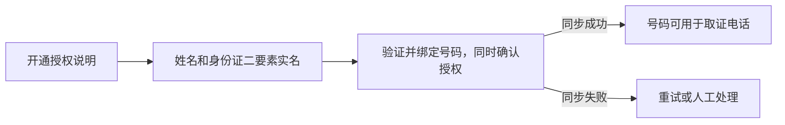
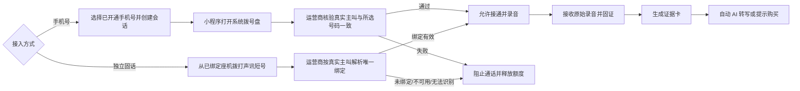

# 一通话 ONECALL 产品需求规格

> 2026-10-20 规则覆盖：开通/授权/试用和本期后台以 [09 当前业务基线](09-business-activation-and-lean-admin.md) 为准。小程序/Web 均能开通订购支付；自建 IVR 按键开通并允许未实名试用产证，购买引导小程序。下文旧“运营商开通接口”“ACC-003 未实名一律不能绑号取证”“SUB-011 实名后才发试用”不适用于 IVR 路径；工单、退款、发票线上流程留作规划，本期线下客服支持。

> 状态：产品评审  
> 版本：v0.5  
> 基线日期：2026-10-19  
> 目标端：原生微信小程序  
> 配套系统：Java 服务端、最小运营后台

## 1. 产品定义

### 1.1 定位

一通话帮助个人用户、企业和团队将重要通话和现场材料形成来源明确、完整可校验、能够按需出证的电子材料。核心差异是运营商通信网络侧生成的原始通话录音，而非手机本地录音。

对外价值表达必须克制：产品可以说明来源、完整性保护和出证服务，不得承诺“必然被法院采信”“一定胜诉”或其他司法结果。

### 1.2 首发目标

- 让符合条件的用户完成实名、号码验证和局端录音授权。
- 让用户通过五种来源提交证据，并清楚看到来源和处理状态。
- 让通话录音形成可定位的逐字稿和结构化摘要，降低回听成本。
- 让用户按时间或事情管理证据，自动完成公证处哈希存证，并按需获取存证验证报告、证据包或申请线下公证书。
- 建立可解释的订阅、用量和到期规则，避免证据因欠费被静默删除。

### 1.3 非目标

- 不读取、搜索或批量导出用户的完整微信聊天记录。
- 不在小程序本地录制运营商电话，也不把手机录音描述为局端录音。
- 不允许用户编辑或替换原始证据、系统元数据和 AI 原始版本。
- 不提供诉讼结果预测、法律代理或自动法律意见。
- 首发只接入能够由运营商返回唯一真实主叫的手机号和独立固话直线；不设计企业总机、PBX、分机归属、统一外呼号拆分或坐席 PIN。
- 首发不建设完整客服、财务、风控和供应商业务中台。

### 1.4 用户与角色

| 角色 | 主要诉求 | 权限边界 |
| --- | --- | --- |
| 未开通用户 | 了解服务并完成开通 | 不能发起局端取证电话 |
| 已实名用户 | 管理号码、证据、套餐和出证 | 仅访问本人账户数据 |
| 企业成员/坐席 | 使用组织分配的权益取证并管理本人有权访问的证据 | 每个成员单独登录、实名和授权；不共享个人凭证 |
| 企业管理员 | 邀请成员、分配坐席、管理组织号码与额度、查看组织审计 | 默认不能查看无业务授权的证据正文或播放录音 |
| 运营人员 | 处理异常、工单和权益补偿 | 默认不能查看证据正文或播放录音 |
| 审核/法务人员 | 审核公证材料或合规事件 | 按工单、按目的临时授权 |
| 外部供应商 | 提供实名、录音、时间、AI、公证等能力 | 只能处理完成约定目的所需的数据 |

## 2. 信息架构

底部导航固定为四个 Tab：

| Tab | 主要内容 |
| --- | --- |
| 取证 | 局端电话、相册、现场拍摄、微信文件、聊天截图入口及状态提示 |
| 证据箱 | 按时间/事情浏览、筛选、搜索、批量选择和查看证据 |
| 出证 | 公证处存证验证报告、时间戳证书、完整证据包、线下公证书申请、订单和进度 |
| 我的 | 实名、号码、套餐、用量、证书、订单、协议、客服和账户设置 |

首次使用取证电话时，主流程为：

该流程在小程序内固定为四个可见节点：`开通授权说明、实名认证、绑定号码并授权、开通结果`。独立的“授权确认”页面删除，授权范围和总确认复选框合并到微信号码确认页及短信验证提交页。用户实际需完成的操作仍为实名、绑号和授权三项。提交授权后由运营商接口同步返回成功或失败，不设置“等待运营商回执”页面；只有同步业务结果明确成功时号码才进入可用状态。

## 3. 账户与实名认证

### 3.1 微信登录

- `ACC-001` 用户通过微信登录建立账户；服务端生成内部账户 ID，不以 `openid` 作为跨系统业务主键。
- `ACC-002` 首次登录必须展示隐私保护指引；在取得必要同意前，只处理完成登录所必需的信息。
- `ACC-003` 用户未实名时可浏览服务说明和套餐，但不能绑定录音号码或提交出证申请。

### 3.2 大陆居民身份核验

- `ACC-010` 实名表单只采集姓名和大陆居民身份证号；不得要求用户上传证件照片，除非风险升级流程另有合法依据。
- `ACC-011` 客户端校验必填、18 位格式和校验位，但“实名认证成功”只能由权威二要素服务返回。
- `ACC-012` 非大陆居民身份证、证件无效、姓名不匹配、供应商明确失败时不得进入号码绑定。
- `ACC-013` 供应商超时或不可用显示“暂时无法完成核验”，不得显示身份不匹配；用户可以安全重试。
- `ACC-014` 高风险、身份异常、频繁换号或申请公证书时可以进入人脸活体等增强核验。
- `ACC-015` 身份证号在所有普通页面只显示掩码；用户不能通过客服口述完整身份证号来绕过核验。
- `ACC-016` 同一身份关联多个活动账户时进入风险审核，不在客户端暴露其他账户信息。

### 3.3 实名页面状态

| 状态 | 页面动作 |
| --- | --- |
| 未填写 | 输入姓名和身份证号，展示敏感信息用途说明 |
| 校验中 | 禁止重复提交，可取消返回但不进入后续步骤 |
| 成功 | 显示姓名与证件掩码，进入号码绑定 |
| 不匹配 | 提示核对输入，不披露供应商内部原因 |
| 服务不可用 | 提供稍后重试和客服入口 |
| 风险升级 | 解释额外核验用途，取得单独同意后进入增强核验 |

## 4. 开通授权与号码管理

### 4.1 开通授权说明页最终评审文案

以下为产品评审稿，协议名称、处理主体和保存期限须由法务替换为正式版本。

---

#### 开通运营商局端录音

**重要通话，由运营商在通信网络侧生成原始录音。**

开通后，使用已绑定号码拨打取证电话时，运营商会在通信网络侧生成录音，并按服务流程完成完整性校验和时间证明。它不是手机本地录音，也不会读取你的普通通话内容。

**完成 3 步即可开通**

1. **实名认证**  
   使用姓名和大陆居民身份证号完成身份核验。首次开通不要求上传身份证照片。
2. **绑定本人使用的号码**  
   手机号可以通过微信或短信验证；独立固话直线需要从待绑定座机拨打验证声讯短号，由运营商核对真实主叫。以上方式均不代表运营商登记人或号码产权已经与当前身份核对。
3. **授权运营商开通局端录音**  
   每个号码需要单独授权。提交后同步返回开通成功或失败结果；只有成功时，该号码才可发起取证电话。

**关于公证书**

手机号材料申请公证书前，需要核验姓名、身份证号和手机号的运营商实名登记信息是否一致。固话材料按公证机构要求核验企业或个人对该线路的合法使用权、登记归属及必要证明。资格不满足时仍可按现有规则保存和查看普通证据，但暂不能用该号码的材料申请公证书。

**录音和证据如何形成**

- 只有你主动发起的取证电话才进入本服务流程。
- 运营商的实际录音状态和通话结果以运营商回执为准。
- 收到原始录音后，平台会记录文件哈希、可信时间信息和处理日志。
- 内部固证完成后，平台会将文件哈希和必要的最小元数据提交至合作公证处存证平台；成功取得存证编号后，你可以申请电子数据存证验证报告。原始文件是否由公证处保存以正式服务说明为准。
- AI 逐字稿和摘要只是辅助阅读内容，不替代原始录音，也不代表司法机关对事实的认定。

**使用前请注意**

- 请依法使用录音功能，并根据适用场景履行必要的通话告知义务。
- 运营商覆盖地区、号码类型、漫游状态或特殊通话可能影响开通和录音。
- 录音分钟、AI 转写、存储和出证可能消耗套餐权益或产生费用，提交前会展示可用额度或价格。
- 停止授权只影响后续取证电话，不会修改已经形成的证据。既有证据的保存和删除按正式协议及法律要求处理。

**绑定号码页授权内容汇总**

微信号码确认页和短信验证提交页在提交按钮前展示协议与公证条件摘要，并使用下列已批准的总确认复选框。固话绑定页沿用单一复选框结构，但因企业线路不等同于个人实际使用号码，改为确认对线路具有合法使用/管理权限并同意相同的数据处理、局端录音和必要共享范围。

- [ ] 我已阅读并同意以上全部授权内容，确认绑定号码由本人实际使用，并同意按上述范围处理敏感个人信息、开通运营商局端录音及进行必要的数据共享。

主按钮：**同意授权并提交开通**

次级入口：查看完整协议｜暂不开通

---

### 4.2 号码绑定

- `PHN-001` 个人账户最多有三个有效主叫号码，手机号和独立固话合计计算；额度和存储按账户共享。
- `PHN-002` 号码支持微信手机号授权和短信验证码两种验证来源；微信能力优先评估实时验证组件，短信作为绑定其他号码、拒绝授权或微信能力异常时的完整回退路径。
- `PHN-003` 微信快速/实时验证表示用户明确授权提供一个经微信平台验证的号码；短信验证码表示当前可接收该号码短信。两种结果均不得解释为当前设备 SIM、本人长期使用或运营商实名一致。
- `PHN-004` 在微信授权结果或短信提交前展示“协议与公证条件”摘要和唯一的总确认复选框；复选框文案固定为“我已阅读并同意以上全部授权内容，确认绑定号码由本人实际使用，并同意按上述范围处理敏感个人信息、开通运营商局端录音及进行必要的数据共享。”绑定页同时明确说明：绑定成功后，拨打录音电话时必须使用该手机号作为呼出主叫号码；多 SIM 设备的实际拨出号码必须与本次所选号码一致。
- `PHN-005` 开通阶段不调用运营商三要素核验，公证资格初始化为 `NOT_CHECKED`。
- `PHN-006` 同一号码不得同时绑定多个活动账户；发生冲突时进入账户找回或人工审核流程。
- `PHN-007` 达到三个号码上限时只能停用或移除一个号码后再新增。
- `PHN-008` 停用号码立即禁止新取证电话，但其历史证据和用量记录仍归原账户。
- `PHN-009` 每个号码独立保存验证来源、验证时间、平台请求记录、协议同意、运营商开通和撤销记录；验证来源至少区分 `WECHAT_QUICK_VERIFICATION`、`WECHAT_REALTIME_VERIFICATION` 和 `SMS_OTP`。
- `PHN-010` 号码重新绑定或授权协议实质变更后，必须重新取得授权。
- `PHN-011` 微信手机号一次性凭证仅由服务端兑换，必须校验有效期、单次使用和请求归属；不得在客户端日志或分析事件中记录凭证或完整手机号。
- `PHN-012` 用户拒绝微信授权、接口异常、调用额度不可用或凭证失效时，不得阻断短信路径；同一号码已绑定其他活动账户时进入账户找回或人工审核，不得通过更换验证方式绕过冲突。
- `PHN-031` 主叫号码类型至少区分 `MOBILE` 和 `FIXED_LINE`。手机号接入方式为小程序打开系统拨号盘；固话接入方式为用户从已绑定座机拨打运营商声讯短号，小程序不得模拟能够替座机发起呼叫。
- `PHN-032` 固话只支持运营商能够返回唯一、规范化真实主叫的独立固话直线。企业总机、PBX、分机号、统一外呼号和坐席 PIN 不在首发范围。
- `PHN-033` 固话验证流程为：填写含区号完整号码、申请一次性验证短码、使用待绑定座机拨打验证声讯短号、输入短码、运营商核对真实主叫。短码限时且单次有效，必须防猜测、防重放并限制尝试频率。
- `PHN-034` 固话验证只证明该次操作能从对应线路发起呼叫，不证明运营商登记人、号码产权或长期使用权与账户身份一致；用户必须确认对该线路具有合法使用权。
- `PHN-035` 固话验证成功后仍需为该号码独立保存授权和运营商开通结果；不得复用其他手机号或固话的授权记录。
- `PHN-036` 企业成员个人账户下的手机号和固话仍按个人规则合计最多三个并分别授权；由企业管理的组织独立固话使用单独企业固话名额，不占成员个人号码上限，名额由企业商品版本或合同配置。
- `PHN-037` 企业独立固话必须归属一个组织并由有权限的管理员发起绑定；同一活动号码不得同时归属多个个人账户或组织。

### 4.3 运营商授权和开通

- `PHN-020` 微信号码确认页和短信验证提交页仅展示“协议与公证条件”摘要，再使用一个独立的总确认复选框取得同意；不展示“授权号码”“局端录音与存证”和“敏感信息处理与必要共享”摘要行。复选框默认不选中，未勾选时提交按钮不可用，也不得再跳转到独立授权确认页。
- `PHN-021` 授权记录至少关联账户、号码、协议版本、授权范围、同意项、设备、IP、时间和请求 ID。
- `PHN-022` 提交授权后，服务端同步调用运营商开通接口并在同一请求内返回业务结果；明确成功时进入 `ACTIVE`，明确失败时进入 `FAILED`，客户端不设置“处理中”或“等待回执”状态。
- `PHN-023` 同步失败页面展示可理解的失败类别、是否可重试和客服入口，不直接展示供应商错误码。
- `PHN-024` 同步调用发生网络异常、超时或无法解析响应时，不得显示已开通，也不进入等待回执页面；页面提示“暂时无法完成开通”并允许使用同一幂等请求安全重试。
- `PHN-025` 撤销授权后禁止新建局端录音会话，并向运营商发送撤销请求；既有证据不受影响。
- `PHN-026` 每次发起取证电话前，用户选择一个已开通号码作为预期主叫；多 SIM 设备需提示在系统拨号页选择对应电话卡。小程序不得宣称能够指定或读取实际 SIM。
- `PHN-027` 开通进度按四节点显示当前节点名称和位置；第 3 节点完成号码验证、授权确认和开通提交，第 4 节点根据同步结果展示“开通成功”或“开通失败”。
- `PHN-028` 开通提交期间按钮进入请求中状态并阻止重复点击；同步结果返回后立即进入结果页，不展示虚构百分比、倒计时或后台等待文案。
- `PHN-029` 运营商明确失败进入 `FAILED`；用户重试保留前次失败记录，并使用新的业务尝试记录关联原授权。
- `PHN-030` 同一请求 ID 的重复提交必须幂等，不得重复创建授权、开通权益或审计事件；网络异常重试不得绕过供应商幂等约束。
- `PHN-038` 固话验证和开通可按运营商能力合并为一次受控流程；只有真实主叫匹配、授权有效且运营商明确返回成功时才进入可取证状态。
- `PHN-039` 小程序手机号拨号选择器只展示已授权开通的手机号，不展示固话；固话从独立入口查看声讯短号和当前可用线路。
- `PHN-040` 号码停用或撤销后，手机号不得再创建小程序拨号会话，固话从声讯短号呼入时必须被运营商拒绝；两者的历史证据和用量流水均保留。

### 4.4 号码卡片展示

每张号码卡显示：号码掩码、号码类型、验证来源与状态、接入方式、局端录音状态、公证资格、本账期录音、套餐共享提示、最后更新时间和可用操作。手机号公证资格沿用下表；固话将“运营商实名信息”替换为“号码归属/合法使用权材料”，状态值保持一致。

| 状态 | 用户文案 |
| --- | --- |
| `NOT_CHECKED` | 申请公证书前需核验运营商实名信息 |
| `MATCHED` | 已满足当前公证实名要求 |
| `MISMATCHED` | 运营商实名信息不一致，暂不能申请公证书 |
| `EXPIRED` | 核验已过期，申请公证书前需重新核验 |

## 5. 取证入口和统一处理

### 5.1 来源类型

| 来源 | 用户动作 | 系统可证明的事实 | 不得声称的事实 |
| --- | --- | --- | --- |
| 运营商电话 | 使用已开通号码发起取证电话 | 运营商回执、录音文件、通话元数据 | 法院必然采信、对方身份必然真实 |
| 现场拍摄 | 小程序内调用相机拍照/录像 | 文件由本次小程序采集流程产生 | 画面内容一定真实、地点一定准确 |
| 相册导入 | 选择已有照片/视频 | 用户在某时提交了该文件 | 文件拍摄于导入时间或现场 |
| 微信会话文件 | 主动从微信原生选择器选文件 | 用户从选择器提交了该文件 | 文件发送人、会话名称或消息上下文 |
| 聊天截图 | 从相册选择并声明为聊天截图 | 用户提交并声明其类型 | 截图未编辑、对方账号已被平台核验 |

### 5.2 通用处理要求

- `EVI-001` 所有来源进入统一流程：来源说明、选择/采集、校验、上传、哈希复核、固证、证据卡。
- `EVI-002` 用户在提交前看到来源标签、文件名/类型/大小和预计消耗空间。
- `EVI-003` 原始文件不得因预览、压缩或转码而被覆盖；派生文件单独保存。
- `EVI-004` 证据卡必须展示来源、创建/导入时间、平台接收时间、固证状态和校验入口。
- `EVI-005` 用户填写的人物、地点、聊天对象和事情说明属于“用户注释”，不得混入系统元数据。
- `EVI-006` 上传失败支持断点续传；用户取消后清理未完成的临时对象和预占额度。
- `EVI-007` 同一提交请求重复到达时不得生成重复证据或重复扣减用量。
- `EVI-008` 哈希不一致、病毒、类型伪造、加密文件或超限文件进入明确的拒绝/隔离状态。
- `EVI-009` 固证成功后原始对象不可覆盖；删除请求按保存政策处理并保留审计记录。

### 5.3 取证电话

- `EVI-020` “正在由运营商录音”只在收到对应会话和主叫号码的权威回执后显示。
- `EVI-021` 小程序进入后台或系统拨号页不等于通话成功；最终结果以回调为准。
- `EVI-022` 运营商必须在接通前以网络侧识别的真实主叫号码执行强一致校验，客户端选择或上报的号码不得作为实际主叫依据。
- `EVI-022A` 实际主叫与本次所选号码一致，且号码有效、已授权并开通时，才允许接通、录音、计费和固证。
- `EVI-022B` 实际主叫是账户下另一个已绑定号码时也必须阻止，不得静默切换或归入另一个号码。
- `EVI-022C` 实际主叫未绑定、未授权、未开通或已停用时必须阻止；无法识别、校验超时或运营商异常时按失败关闭。
- `EVI-022D` 强一致校验未通过时不扣录音或试用分钟、不生成证据卡，只保留脱敏安全审计记录；电话中和用户返回小程序后均提供可理解的失败提示。
- `EVI-022E` 小程序直接拨号路径只接受手机号，并继续执行“实际主叫与本次所选手机号完全一致”的强一致规则；账户下另一个已绑定号码也不得静默切换。
- `EVI-022F` 固话短号路径不依赖小程序预先选择号码。运营商提供真实主叫后，服务端必须解析到当前账户或组织下唯一、有效、已授权且已开通的 `FIXED_LINE` 绑定，才允许继续。
- `EVI-022G` 固话实际主叫未绑定、归属冲突、未授权、未开通、已停用、无法识别或线路不在覆盖范围时，运营商必须在建立有效录音前拒绝；不扣权益、不生成证据。
- `EVI-022H` 手机号和固话形成的录音统一进入证据箱、共享适用套餐权益；每笔证据与用量流水均保存运营商确认的实际主叫、号码类型、接入方式和运营商会话。
- `EVI-023` 未接通、无有效录音或固证失败不扣减用户最终录音分钟。
- `EVI-024` 录音提示音默认开启；关闭时展示可能影响证据评价的提示并记录选择。
- `EVI-025` 通话结束后展示处理中、固证成功、固证失败三类结果，不以固定倒计时伪造进度。
- `EVI-026` 免费试用拨号前必须展示账户累计已用时长、剩余时长和“累计用完后主动挂断当前通话”，本次最大可录时长取服务端返回的剩余额度快照。
- `EVI-027` 免费试用的时长上限由服务端和运营商通话控制能力执行，不依赖小程序前台计时；小程序退到后台或被系统终止时仍须按上限结束通话。
- `EVI-028` 因免费试用累计达到 5 分钟而结束时，结果页明确显示主动挂断原因、本次有效录音时长、累计时长和后续固证状态，不得显示为异常掉线。
- `EVI-029` 已录制部分继续进入正常固证和证据流程；未接通、无有效录音或运营商确认未形成录音的会话不消耗试用时长。

### 5.4 相册、现场拍摄和微信文件

- `EVI-030` 相册入口允许照片和视频；现场拍摄入口只能使用相机。
- `EVI-031` 位置为可选敏感权限，拒绝位置权限不阻止拍摄，但证据卡明确显示“未记录位置”。
- `EVI-032` 微信文件使用 `wx.chooseMessageFile`；页面明确不能读取完整聊天记录。
- `EVI-033` 聊天截图从专用入口选择，提交前要求确认“这是用户声明的聊天截图”。
- `EVI-034` 文件白名单由服务端版本化配置，客户端只做前置提示；服务端使用扩展名、MIME 和魔数综合判断。
- `EVI-035` 可执行文件、脚本和已知危险内容不得进入证据箱；具体白名单和大小上限为上线阻断配置。
- `EVI-036` 现场拍照、现场录像、现场录音和导入已有证据不以订阅状态作为功能开关；符合免费体验条件的用户可任选一种工具完成首份材料固证。
- `EVI-037` 首份材料免费固证包含文件校验、加密上传、内部固证和公证处平台存证；四种工具共享一份账户级免费额度，不按工具分别赠送。
- `EVI-038` 免费额度只在固证成功后确认消耗；用户取消、系统选择器取消、上传失败、校验拒绝、隔离或固证失败时释放预占，不扣减最终额度。
- `EVI-039` 免费额度不足时必须在调用相机、麦克风、系统相册或 `wx.chooseMessageFile` 前拦截，展示套餐和单次固证包入口；不得在用户完成拍摄、录制或文件选择后才提示付费。

## 6. 证据箱与事情

- `EVI-040` 证据箱支持按时间和按事情两种视图，以及全部、通话、照片、录像、录音、文件筛选。
- `EVI-041` 证据卡展示来源、标题、时间、固证状态、摘要状态和所属事情，不在列表暴露完整敏感内容。
- `EVI-042` 用户可新建事情并添加多份证据；一份证据首发只归属一个主要事情，可随时移出或调整。
- `EVI-043` 用户调整事情只改变组织关系，不改变原始证据、哈希和固证时间。
- `EVI-044` 空状态、处理中、失败、隔离、只读和正常证据必须使用不同状态文案和操作。
- `EVI-045` 分享给律师使用受控链接或导出包，默认设置有效期和访问审计，不直接公开对象存储地址。
- `EVI-046` 账户没有任何证据时，证据箱不得展示“按时间/按事情”分段控件和“全部/通话/照片/录像/录音/文件”分类标签；形成首份证据后才展示两组控件。
- `EVI-047` 空状态使用约 160 x 160 pt 的静态“带锁扣档案箱”线性插画，采用浅蓝灰描边；不得使用声波动画、渐变或高于主按钮的视觉强调。
- `EVI-048` 空状态文案固定为三级居中结构：主标题“证据箱是空的”；说明“通话、录音、照片存进来会自动加时间戳并加密，需要时可直接出证”；情绪句“希望你永远用不上”。
- `EVI-049` 空状态底部提供同宽双入口：主按钮“打一通取证电话”进入取证电话流程，并在按钮下展示“通话全程自动录音并生成存证记录”；次级按钮“导入已有证据”进入相册、拍摄、微信文件和聊天截图来源选择。
- `EVI-050` 页面内容区底部展示极浅灰信息条，横向等距展示“本地加密”“时间戳防篡改”“支持出证”，每项由小图标和 12 pt 文字组成；信息条不得暗示司法机关必然采信。
- `EVI-051` 空状态保持现有蓝色主色，扩大主要区块留白；按钮圆角为 12 pt、左右页边距为 20 pt，操作区与底部安全区域保持 24 pt 间距，页面只允许一层极淡阴影且不得使用渐变。
- `EVI-052` 有内容时恢复“按时间/按事情”分段控件和来源分类标签；两组控件分别只能有一个选中项，选中态沿用品牌蓝且不得依赖颜色作为唯一状态标识。
- `EVI-053` 列表顶部展示当前结果数量和“新建事情”入口；按时间视图以日期分组，按事情视图以事情名称分组，切换视图不得改变证据本体或当前来源筛选。
- `EVI-054` 证据卡按“来源与时长/采集方式、固证状态、标题、形成时间、AI 摘要或完整性说明”的顺序展示；仅通话录音等适用证据展示 AI 摘要，不以虚构摘要填充其他类型。
- `EVI-055` 固证完成、处理中和异常状态均同时使用图标与文字表达；卡片点击进入证据详情，列表不得暴露完整逐字稿、身份证号、完整手机号或永久存储地址。
- `EVI-056` 来源筛选结果为空时展示轻量筛选空结果和“查看全部”操作，不得误用账户级“证据箱是空的”页面；底部导航及当前筛选状态保持不变。

### 6.1 通话录音受控分享

- `EVI-057` 只有已形成录音证据且当前账户同时具有播放与分享权限的通话可创建分享；主叫不一致、未接通、未取得录音或无权播放的记录不展示分享入口。
- `EVI-058` 企业内部分享优先按实名成员直接授权，不使用提取码；个人用户和企业普通成员只能分享本人录音，证据管理员只能分享被授权部门录音，企业管理员角色本身不自动取得录音分享权，审计员不得分享录音。
- `EVI-059` 外部分享默认采用不可猜测链接加独立提取码，有效期 24 小时、最多成功访问 5 次、禁止下载；用户可选择 1 小时、7 天或不超过 30 天的自定义有效期，以及 1 次、5 次或不限次数访问。
- `EVI-060` 高敏场景可改用“指定手机号 + 短信验证码”；提取码只证明访问者持有码，不得表述为实名认证或身份核验。
- `EVI-061` 分享内容可选“仅录音”“录音 + 逐字稿”或“录音 + 逐字稿 + AI 摘要”；分享固定到创建时的派生内容版本，不因后续重新转写而静默变化。
- `EVI-062` 创建成功后分开展示链接与提取码，并提示通过不同渠道发送；任何页面不得暴露对象存储地址、原始录音直链或永久播放凭证。
- `EVI-063` 分享方可查看有效、过期和已撤销记录，并执行撤销、延长有效期和重新生成提取码；重新生成提取码后旧提取码及既有播放会话立即失效。
- `EVI-064` 接收方在提取码模式下无需注册或登录平台；连续错误达到策略阈值后临时锁定，成功验证后只获得短期播放会话与分片访问凭证。
- `EVI-065` 接收页标记“录音播放副本”，展示分享编号、访问时间、有效期和剩余次数；默认不提供下载，不修改原始录音及其哈希。
- `EVI-066` 创建、验证成功/失败、锁定、播放、时间定位、下载（如授权）、延期、换码、撤销和过期均写不可变审计；过期或撤销阻止后续访问，但必须明确无法收回接收方已下载、录屏或另行保存的内容。

## 7. AI 转写与智能摘要

### 7.1 自动生成规则

- `AI-001` 仅在原始录音固证成功、用户已同意 AI 处理且 AI 权益充足时自动创建任务。
- `AI-002` 自动处理前按录音时长预占 AI 分钟；成功后确认，失败、超时或平台重试后释放。
- `AI-003` 权益不足时证据仍正常生成，结果页展示所需分钟、现有额度和购买入口，不自动扣费。
- `AI-004` 用户可在设置中关闭后续自动生成；关闭不删除已有结果。

### 7.2 逐字稿

- `AI-010` 逐字稿包含说话人、句级开始/结束时间、文字和置信度。
- `AI-011` 点击任一句可从对应录音时间播放；播放位置允许少量前置上下文。
- `AI-012` 低置信度片段、听不清和说话人不确定必须可见，不用猜测文本填补。
- `AI-013` 原始转写版本不可由用户直接编辑；用户纠错另存为注释。

### 7.3 结构化摘要

摘要固定包含：

1. 通话事实概述。
2. 涉及人物及其在通话中的自称身份。
3. 金额、日期、期限和其他关键数字。
4. 明确承诺或行动项。
5. 争议、否认、保留意见和不确定信息。
6. 风险提示，包括低置信度或缺少身份确认。

- `AI-020` 每个要点必须关联一个或多个逐字稿片段和录音时间范围。
- `AI-021` 无引用、引用不支持结论或包含模型新增事实的要点不得发布。
- `AI-022` 姓名、金额、日期、否定词和承诺用语进入重点校验，低置信度时必须提示人工回听。
- `AI-023` 页面和导出物标明模型生成、版本、生成时间及“仅供辅助阅读”。
- `AI-024` 重新转写生成新版本，旧版本和引用继续保留；当前展示版本可切换。
- `AI-025` AI 文本、用户注释和原始录音分区展示，任何派生内容都不得进入原始证据哈希。

## 8. 订阅套餐、权益和支付

### 8.1 商品结构

首发采用“免费体验 + 按需购买 + 两档订阅 + 场景加量”。原型中的价格是建议灰度初始配置，生产价格、额度和有效期均由运营后台发布的商品版本决定，小程序不得硬编码。

| 商品 | 核心权益 | 建议灰度初始配置 |
| --- | --- | --- |
| 免费体验 | 累计 5 分钟局端录音；首份工具材料免费固证；5 分钟 AI | 免费；三类权益独立计量 |
| 单次固证包 | 1 份工具材料校验、上传、内部固证、公证处平台存证及本份材料存储 | ¥12.9/份；购买后 30 天内使用 |
| 30 分钟通话包 | 30 分钟局端录音、对应通话固证和录音存储 | ¥18.9/包；购买后 30 天内使用 |
| 个人基础 | 每期 60 分钟局端录音、20 份工具材料固证、60 分钟 AI、5 GB 存储 | 月付 ¥39；季付 ¥105（约 9 折，省 ¥12）；包年 ¥390（约 8.3 折，省 ¥78） |
| 个人进阶 | 每期 300 分钟局端录音、100 份工具材料固证、300 分钟 AI、20 GB 存储 | 月付 ¥89；季付 ¥240（约 9 折，省 ¥27）；包年 ¥890（约 8.3 折，省 ¥178） |
| AI 加量包 | 30 分钟转写与要点摘要 | ¥9.9/包；购买后 30 天内使用 |
| 存储扩容包 | 5 GB 原始材料存储空间 | ¥9.9/包；有效期 12 个月 |

线下公证书、公证处另行收取的费用及未明确列入商品的出证服务不包含在上述商品内。存证验证报告、完整证据包和线下公证书分别定价，不使用含义不清的“基础出证权益”。

所有套餐的原始证据完整性、加密、防篡改和审计标准相同，不得按套餐降低。

### 8.2 额度规则

- `SUB-001` 订阅录音、工具材料固证和 AI 权益按月度权益周期发放，未使用额度在本期结束后不结转；季度和包年只改变付款周期与总有效期，不改变单期额度。
- `SUB-002` 活动赠送额度单独记录来源和到期时间，优先使用即将到期的可用额度。
- `SUB-003` 付费加量包的有效期、退款和消耗顺序在购买前明确展示。
- `SUB-004` 录音按运营商确认的有效接通时长计量；AI 按成功处理的源录音时长计量。
- `SUB-005` 存储统计原始录音、照片、视频、现场录音和上传文件；预览、哈希、证书、审计及 AI 文本不占用户可见额度。
- `SUB-006` 计量采用预占、确认、释放；用户可查看每笔用量对应的号码、证据、时间和权益来源。
- `SUB-007` 首发使用微信支付手动购买和续费；不默认开通自动续费。
- `SUB-008` 套餐到期或空间超额后，用户仍可查看、校验和导出既有证据，但暂停新增取证、AI 任务和出证申请。
- `SUB-009` 续费、扩容或清理可释放内容后恢复能力；系统不得因欠费静默删除原证据。
- `SUB-010` 套餐版本发布后不可修改历史权益；调价或改额度创建新版本。
- `SUB-011` 符合资格的账户首次完成实名、号码绑定、授权和运营商开通后，发放一笔 `300` 秒免费录音权益；免费试用不绕过任何开通与授权要求。
- `SUB-012` 免费录音权益按账户共享，可由已开通号码分多次使用；每笔流水记录实际号码、通话会话、证据和权益来源。
- `SUB-013` 免费试用按运营商确认的有效录音秒数累计。每次拨号先原子预占当前全部剩余秒数，结束后按权威时长确认并释放未用部分。
- `SUB-014` 免费试用剩余为零时不得再创建试用通话；用户购买或获得其他适用录音权益后，只能重新发起通话，不得静默把已挂断通话切换为付费续录。
- `SUB-015` 同一账户同一时刻只允许一笔免费试用录音预占，重复请求和并发拨号不得突破累计 `300` 秒上限。
- `SUB-016` 试用用完、套餐到期或后续未购买均不影响已经形成的原始录音、固证记录和证据访问。
- `SUB-017` 符合资格的账户获得一笔数量为 `1` 的 `FREE_EVIDENCE_SOLIDIFICATION_COUNT` 权益；它独立于 `FREE_TRIAL_CALL_SECONDS`，可用于现场拍照、录像、录音或导入材料中的任意一种。
- `SUB-018` 进入原生采集或文件选择能力前，服务端按账户原子预占一份适用固证权益；同一免费权益只允许一笔活动预占，并发请求不得形成两份免费固证结果。
- `SUB-019` 只有证据进入 `SOLIDIFIED` 后才确认一份用量；取消、过期、上传失败、校验拒绝、隔离和固证失败均释放预占。重复完成请求只返回同一结果，不重复确认用量。
- `SUB-020` 免费额度用完后，用户可以购买订阅套餐或单次固证包恢复新增材料能力；单次固证包的价格、有效期、适用来源、退款和消耗顺序必须在支付前展示。
- `SUB-021` 免费额度耗尽、套餐到期或空间超额不得锁定、降级或删除既有证据；用户仍可按保存政策查看、校验和导出，限制只作用于新增或派生处理。

### 8.3 商品配置与订购流程

- `SUB-022` 运营后台可配置商品名称、类型、购买周期、价格（人民币分）、月付对比基准、权益项与数量、权益发放周期、发放期数、总有效期、生效时间、适用渠道、排序、推荐场景、上下架状态和购买限制；前端不得内置生产价格或自行计算应付金额、折扣或节省金额。
- `SUB-023` 商品版本遵循 `DRAFT → REVIEWED → PUBLISHED → RETIRED`。已发布版本不可覆盖修改；改价、改额度或改有效期必须创建新版本并保留审计记录。
- `SUB-024` 套餐页只消费服务端返回的当前已发布目录。商品未发布、已下架、价格缺失或权益配置不完整时不得创建支付订单。
- `SUB-025` 首发固定展示四个核心可购买商品：单次固证包、30 分钟通话包、个人基础和个人进阶；AI 与存储加量包放在次级区域，并在对应额度不足场景直接推荐。
- `SUB-026` 商品列表、详情和订单确认页必须显示同一商品版本的名称、价格、权益和有效期。提交订单时服务端重新校验版本；若已调价或下架，阻止支付并要求用户确认新版本。
- `SUB-027` 购买流程为 `选择商品 → 商品详情 → 确认订单 → 微信支付 → 服务端确认支付 → 发放权益 → 返回原任务`。客户端支付成功回调不能直接发放权益。
- `SUB-028` 订单快照不可变，至少保存商品版本、价格、币种、权益、有效期规则、协议版本和用户确认时间。后续调价不得修改历史订单和已发放权益。
- `SUB-029` 订阅套餐支持按月、按季度和包年购买，首发均为一次性微信支付和手动续费，不默认开通自动续费。有效期内续费按商品版本规则顺延，过期后购买从支付成功时间重新计算。
- `SUB-030` 按需包、订阅套餐和加量包分别生成权益 grant；消耗按适用范围、最早到期和明确优先级执行，不得把余额合并成不可解释的总数。
- `SUB-031` 商品推荐只依据用户当前入口、真实余额和历史订单：材料额度用完优先单次固证包，试用录音用完优先 30 分钟通话包，多次按需购买后可比较基础套餐；不得使用虚假销量、倒计时或库存稀缺性。
- `SUB-032` 支付取消、失败或未取得微信服务端成功通知时不发放权益；重复通知只确认一次。支付成功但发放失败进入补偿队列，不要求用户重复付款。
- `SUB-033` 运营后台发布、下架和改价属于高风险操作，必须进行权限控制、二次确认和完整审计；生产环境价格变更至少需要审核人与发布人分离。
- `SUB-034` 个人基础和个人进阶的月付、季付、包年分别使用独立且不可覆盖的商品版本。原型灰度建议为：季付约 9 折；包年按付 10 个月享 12 个月设计。后台可独立调整或关闭任一周期，前端只展示已发布选项。
- `SUB-035` 季付一次支付 3 个月费用，首期在支付成功后发放，后续按购买日每月发放，共 3 期；包年一次支付 12 个月费用，共发放 12 期。不存在对应日期的月份以当月最后一日作为发放日。
- `SUB-036` 季付和包年不得一次性发放全部录音、固证与 AI 额度。每一期创建独立权益 grant、有效期和流水，未来期权益不可提前使用；存储权益按商品版本明确是周期刷新还是持续保有，首发采用套餐有效期内持续保有。
- `SUB-037` 页面展示的“约 9 折”“约 8.3 折”和“省 ¥X”必须由服务端使用同一目录版本、相同单期权益的月付商品作为基准校验。月付基准缺失、权益不等价或计算不一致时，不得发布折扣文案。
- `SUB-038` 商品列表展示三个周期的实际总价；商品详情使用月付、季付、包年三段选择器；订单确认、支付结果、订单记录必须保存并展示所选周期、实付总价、发放期数、有效期和商品版本，不得只展示折算月价。
- `SUB-039` 季度或包年在有效期内续费时，新周期从现有有效期结束后开始；后台调价只影响新订单，已支付订单的后续各期仍按原订单快照发放。
- `SUB-040` 季度和包年退款必须依据购买时展示并锁定的退款规则执行。已发放期、已消费权益、未发放期和优惠回收的计算均生成可审计流水；规则未经法务和支付渠道确认前，不开放自助中途退款。

### 8.4 企业和团队套餐

企业版首发提供“企业基础版”和“企业旗舰版”两个可配置商品族。原型中的 5/20 个坐席与 5/30 个独立固话仅用于评审信息结构，不是不可变生产配置；价格、坐席、固话名额、共享额度、周期和增购规则均由后台商品版本或合同报价决定。

| 方案 | 建议评审结构 | 主要能力 |
| --- | --- | --- |
| 企业基础版 | 默认示例 5 坐席、5 个独立固话 | 组织共享录音/AI/固证/存储额度、成员与号码管理、基础用量和审计 |
| 企业旗舰版 | 默认示例 20 坐席、30 个独立固话 | 基础版能力，并可配置部门额度、分级管理员、证据审批、审计导出、企业词库和接口集成 |

- `ENT-001` 企业客户创建独立组织，组织套餐、成员、坐席、组织主叫号码、证据权限和用量与个人账户隔离；一个自然人继续使用自己的实名账户加入组织。
- `ENT-002` 坐席代表可使用组织权益的成员资格，不代表电话号码、SIM、分机或并发线路；每个活动坐席必须关联一个已实名成员。
- `ENT-003` 企业版数量型权益默认在组织内共享，实际可共享范围和部门配额由商品版本/合同配置；任何前端页面不得写死生产额度。
- `ENT-004` 企业管理员可以邀请/停用成员、分配/回收坐席、管理组织独立固话和查看脱敏用量；默认不能绕过证据访问授权播放录音或查看正文。
- `ENT-005` 成员使用手机号取证时，证据和用量同时记录组织、成员/坐席、实际主叫和会话；使用组织独立固话时至少记录组织、实际主叫和会话，不能确定操作者时不得虚构归属到某个坐席。
- `ENT-006` 所有组织录音统计必须覆盖其手机号和独立固话，并支持按号码类型、实际主叫、接入方式、成员/坐席（可确定时）、部门、证据和时间汇总。
- `ENT-007` 企业基础版和旗舰版使用与个人套餐相同的商品发布、订单快照、支付/合同、权益账本和不可覆盖原则；合同报价同样必须形成可审计版本。
- `ENT-008` 企业价格、包含坐席数、独立固话名额、权益额度、购买周期、有效期、增购包和功能开关全部后台可配置；客户端只展示当前有效版本。
- `ENT-009` 坐席超额、固话名额超额或共享权益不足时分别给出增购/升级入口，不得把三种限制合并为不明确的“套餐不可用”。
- `ENT-010` 企业总机、PBX、分机归属、统一外呼号拆分、坐席 PIN 和分机级证据归属明确不在首发范围；本期不建立相应页面、接口和领域模型。

## 9. 公证处存证与出证

### 9.1 自动提交公证处存证

- `NPS-001` 运营商通话、现场拍摄、相册导入、微信会话文件和聊天截图五类原始证据，在一通话内部固证达到 `SOLIDIFIED` 后，自动将 SHA-256 和经批准的最小元数据提交至公证处存证平台。
- `NPS-002` 只有供应商明确返回成功码和有效 `recordNo` 后，页面、接口和导出物才能显示“公证处存证已完成”；HTTP 成功、任务已发起或内部固证完成均不能替代该条件。
- `NPS-003` 内部固证状态与公证处存证状态分开展示。外部平台异常时原始证据仍安全保存，页面显示“公证处存证处理中/暂未完成”，不得误报丢失或成功。
- `NPS-004` 同一证据版本使用稳定 `dealId` 幂等重试；重复消息、超时和人工重试不得形成重复记录或改用新业务流水号绕过重复校验。
- `NPS-005` 原始证据为根记录；定稿 AI 内容、授权材料或导出清单仅在被选入出证材料时作为子记录存证，并通过 `parentDealId` 关联。可变“事情”关系不进入父子存证链。
- `NPS-006` 未取得附件上传/补传接口和托管规则前，产品只声明提交哈希及元数据，不得显示或宣传“原始文件已由公证处托管”。
- `NPS-007` 提交字段执行白名单和最小必要原则；默认不提交完整身份证号、完整手机号、证据正文、AI 文本或可变用户备注。
- `NPS-008` 公证处存证失败不触发 AI 结果删除、原始证据覆盖或重复计费；系统持续对账，并向用户展示可理解的状态和最近更新时间。
- `NPS-009` 公证处存证属于所有新原始证据的一致处理步骤，不因用户是否购买 AI 或选择哪种取证来源而跳过；如该能力单独收费，必须在取证前明示并使用独立用量流水。

### 9.2 公证处电子数据存证验证报告

- `NPS-010` 已取得 `recordNo` 的证据支持生成公证处电子数据存证验证报告；报告生成状态与存证状态独立。
- `NPS-011` 报告状态至少包括未申请、生成中、可查看和生成失败；异步回调丢失时可通过任务查询收敛，重复或乱序通知不得回退终态。
- `NPS-012` 报告交付前由服务端下载、校验类型/大小、计算 SHA-256 并保存至自有加密对象存储；小程序不得直接暴露供应商下载 URL。
- `NPS-013` 报告详情展示关联证据、`recordNo`、供应商返回的报告/保全编号、报告哈希、获取时间和验证入口；编号或哈希与申请快照不一致时阻止交付。
- `NPS-014` 页面明确说明报告用于验证存证记录和数据完整性，不直接证明材料描述的基础法律事实，不等同于公证书，也不承诺司法机关必然采信。
- `NPS-015` 供应商接口响应中的请求 `timestamp` 不得直接标记为可信存证时间；存证时间以正式报告或经供应商确认的签名字段为准。

### 9.3 可用交付与线下公证书

| 类型 | 说明 | 前置条件 |
| --- | --- | --- |
| 公证处电子数据存证验证报告 | 验证公证处平台存证记录和材料完整性 | 已取得 `recordNo`，报告任务完成且校验通过 |
| 可信时间戳证书 | 证明指定文件和时间证明之间的关联 | 证据内部固证完成，时间服务可用 |
| 完整证据包 | 原始文件、完整性清单、可用报告/证书、选定文字稿等打包 | 证据可导出，用户确认范围 |
| 线下公证书 | 一通话受理申请并由运营人员协调公证处线下办理 | 实名/三要素/必要增强核验及公证处材料要求 |

- `CRT-001` 用户可以选择一份或多份证据申请可用交付；公证处存证验证报告按对应 `recordNo` 生成，线下公证书创建独立申请工单。
- `CRT-002` 提交付费交付或线下公证申请前展示包含内容、办理方式、预计时效、费用、退款规则和缺失材料。
- `CRT-003` 线下公证书申请前按号码类型执行资格核验：手机号执行姓名、身份证号、手机号三要素核验；固话按公证机构规则核验登记主体、合法使用权或授权材料。任一相关号码不满足时阻止提交并提供换绑或补充材料说明。
- `CRT-004` 三要素不一致只影响线下公证书资格，不修改既有证据、公证处存证状态、存证验证报告和其他出证资格。
- `CRT-005` 线下公证申请至少覆盖资格检查、待补材料、待支付、待线下提交、已受理、办理中、已完成、已拒绝、已取消和退款中/已退款；支付状态独立保存。
- `CRT-006` 支付成功不等于公证处受理或公证书出具；页面分别展示支付、线下提交、受理、办理和交付状态。
- `CRT-007` 下载链接短期有效、可撤销并记录访问；交付物保存期限须在下单前展示。
- `CRT-008` 在没有正式公证书申请接口前，运营人员按批准 SOP 线下提交材料；产品不得显示“在线自动受理”或“自动出具公证书”。
- `CRT-009` “已受理”必须有关联公证处受理凭据，“已完成”必须关联公证书编号、完成凭据和交付记录；人工更新全量审计。
- `CRT-010` 补件生成新材料快照，不覆盖原申请；拒绝、取消和退款分别记录原因、责任方、通知和支付冲正流水。

## 10. 页面和状态清单

| 页面组 | 必需页面/状态 |
| --- | --- |
| 引导与账户 | 首次引导、微信登录、隐私指引、实名填写/处理中/结果、增强核验 |
| 开通 | 授权说明、号码输入、微信或短信验证、绑定页授权确认、同步成功/失败结果；不设置独立授权确认页 |
| 号码管理 | 手机号/独立固话卡、新增、固话主叫验证、停用、撤销、重新授权、公证资格和按号码用量；个人账户合计最多三个 |
| 取证首页 | 正常、未开通、套餐到期、空间不足、服务异常 |
| 电话 | 手机号拨号准备与选择、系统拨号交接、固话声讯短号说明、提示音、通话中、挂断处理、成功/失败 |
| 文件取证 | 相册、拍摄、微信文件、聊天截图、校验、上传、固证结果 |
| 证据箱 | 空状态、列表、筛选、按事情、证据详情、隔离/失败/只读、公证处存证处理中/完成/异常 |
| 录音分享 | 分享管理、创建与成功、提取码/手机/企业成员验证、接收方播放、错误锁定、过期、撤销、延期和换码 |
| AI | 排队、处理中、成功、低置信度、失败、重试、额度不足、版本与注释 |
| 套餐 | 个人/企业商品列表、企业基础/旗舰方案、详情、支付/合同、成功/失败、全主叫用量、坐席与固话名额、加量、到期/超额 |
| 出证 | 存证验证报告生成/查看/失败、选择证据、线下公证资格检查、费用确认、支付、补件、受理、办理、结果、退款 |
| 我的 | 身份、号码、套餐、证书、订单、发票、协议、隐私、客服、注销 |

## 11. 文案与体验规则

- `NFR-UX-001` 使用“保存下来”“形成证据”等用户语言，专业术语提供解释。
- `NFR-UX-002` 所有权威状态必须说明来源或最近更新时间；不能用动画代替真实状态。
- `NFR-UX-003` 信息类文字对比度至少达到 WCAG AA；可点击热区不小于 44×44pt。
- `NFR-UX-004` 金额、日期、时长、哈希和时间戳使用等宽数字。
- `NFR-UX-005` 页面按 375pt 基准和 4pt 间距阶梯设计；不使用未经定义的孤立间距。
- `NFR-UX-006` 错误文案说明发生了什么、证据是否安全、用户可以做什么，不展示内部错误堆栈。
- `NFR-UX-007` 品牌统一使用方案 B Logo；深色通话页使用反白版本。

## 12. 产品事件与核心指标

在取得分析所需合法授权并完成去标识化后，记录以下事件：

- 开通说明曝光、实名开始/成功/失败、短信发送/验证、授权提交和开通结果。
- 各取证入口点击、选择取消、上传开始/成功/失败、固证结果。
- 取证电话创建、运营商接通/录音回执、异常匹配和证据生成。
- AI 自动触发、额度不足、成功、失败、低置信度、引用跳转和用户纠错。
- 套餐查看、购买、支付、到期、超额、加量和用量明细查看。
- 企业方案查看、获取报价、成员/坐席变更、组织固话变更、组织权益和全部实际主叫用量查看。
- 公证处存证提交/成功/失败、报告生成/校验/下载、线下公证选择、资格失败、补件、受理、支付、履约完成和交付。

核心指标包括：按号码类型的开通完成率、运营商开通时长、手机号/固话有效通话证据生成率、上传成功率、AI 成功率、摘要引用合格率、个人/企业套餐转化、坐席启用率、出证转化和异常人工介入率。不得将证据正文、完整身份证号、完整号码或录音内容写入分析事件。

## 13. 产品评审退出条件

- 所有上线阻断项已有负责人和明确关闭证据。
- 页面清单覆盖正常、空、加载、失败、只读和权限拒绝状态。
- 对外文案经法务确认，不包含无法由真实供应商能力支持的承诺。
- 套餐价格、额度、文件限制和保存期限形成可配置的正式规则。
- 所有 `ACC/PHN/EVI/AI/SUB/ENT/NPS/CRT` 需求均在验收文档中有对应场景。

