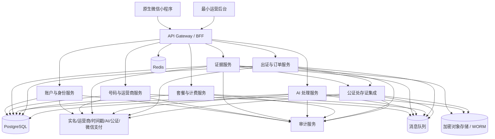
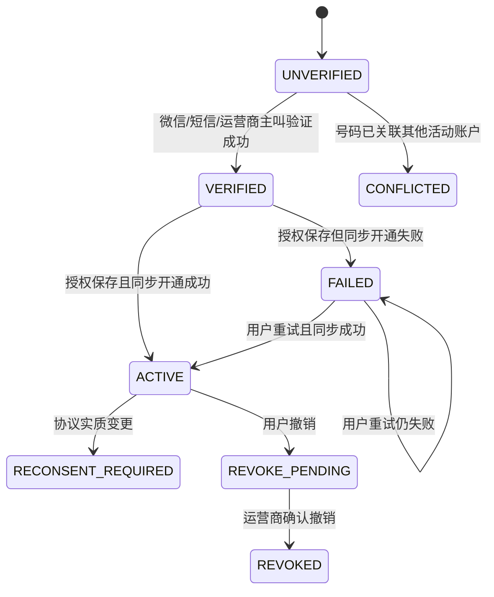
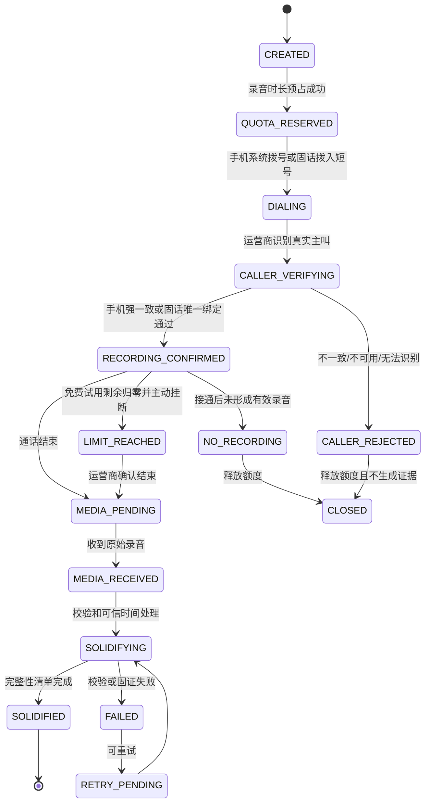
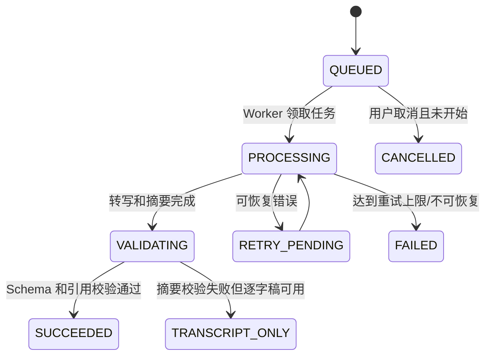
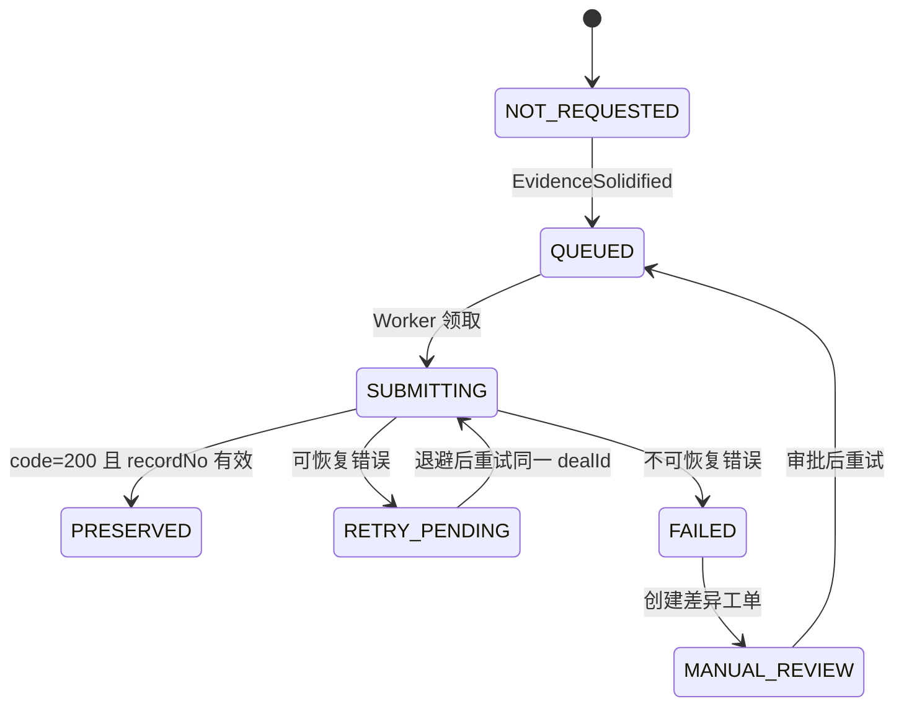
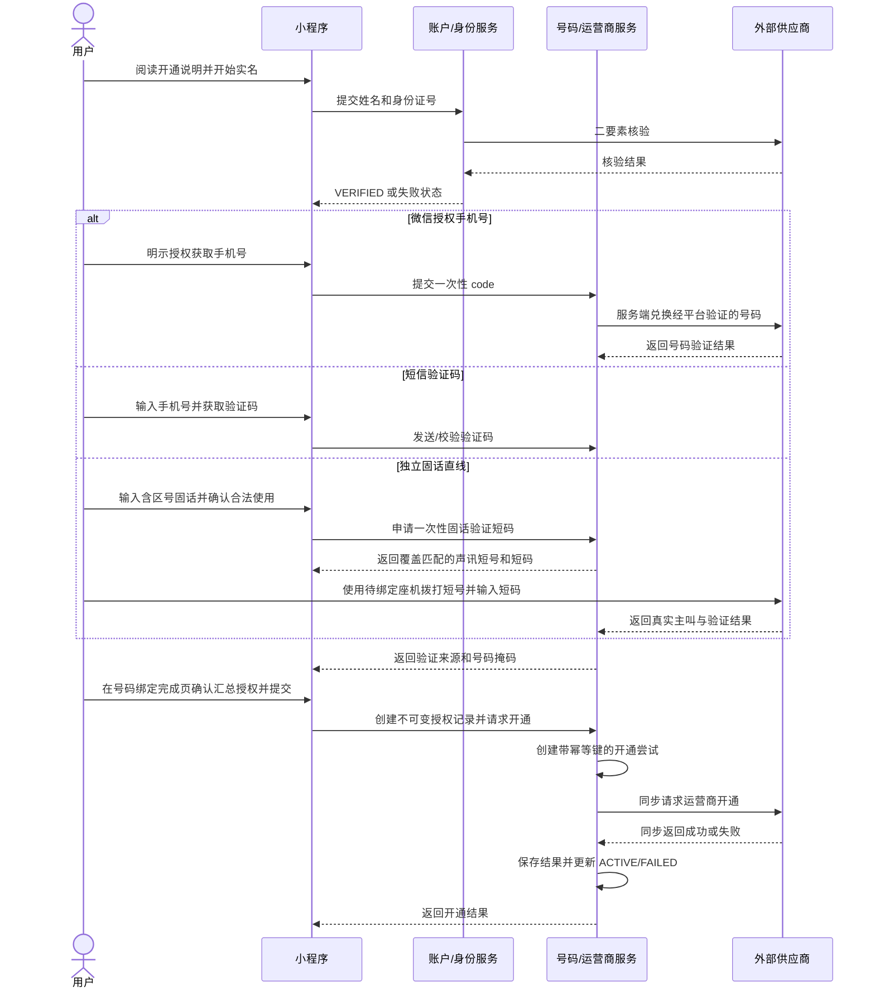
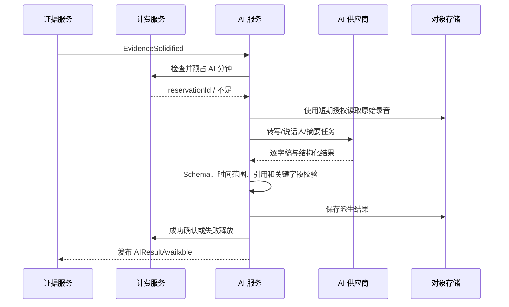
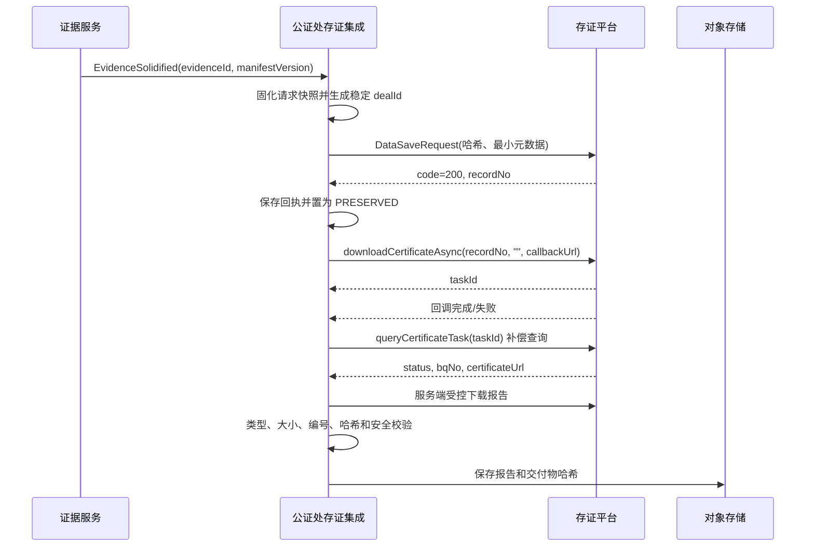
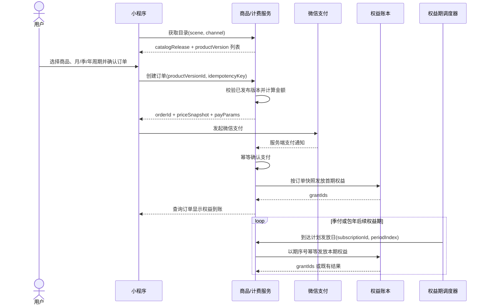

# 一通话 ONECALL 技术方案

> 状态：技术评审稿  
> 版本：v0.4  
> 基线日期：2026-10-19  
> 深度：产品评审级概要设计，不替代 OpenAPI、数据库设计和供应商接口协议

## 1. 设计目标

技术方案必须保证：

1. 用户看到的录音、内部固证、公证处存证、存证报告、公证资格和支付状态都有权威来源。
2. 原始证据、系统元数据、AI 派生内容和用户注释相互隔离且可追溯。
3. 外部供应商可以替换，供应商字段和错误码不直接泄漏到领域模型。
4. 所有收费能力使用不可覆盖的权益和用量流水，重复回调不重复扣费。
5. 手机号与独立固话使用同一主叫号码模型，但保持验证方式、接入方式和公证资格规则可区分。
6. 敏感身份、录音和证据只在完成明确目的所需的最小范围内处理。
7. 任何异步步骤失败时都能确定当前状态、重试责任和用户可采取的动作。

## 2. 系统边界

### 2.1 部署建议

- 首发可以使用模块化单体 Spring Boot 应用加独立异步 Worker，按账户、号码、证据、AI、计费和出证划清模块边界。
- PostgreSQL 保存事务状态和不可变流水，Redis 用于短期会话、限流、验证码和幂等缓存，不能作为权威业务数据源。
- 原始证据和派生文件保存到境内加密对象存储；固证后的原始对象启用版本保护或 WORM 能力。
- 消息队列承载供应商回调后的内部事件、证据处理、AI 任务和计费确认；关键写入使用事务 Outbox。
- 公证处存证使用独立适配层和 Worker；供应商凭据、`productKey`、`stepKey` 只存在服务端受控配置中。
- 当业务量或组织边界需要时，各模块可按相同领域边界拆分服务，不在首发提前引入分布式复杂度。

## 3. 模块职责

| 模块 | 责任 | 不承担的责任 |
| --- | --- | --- |
| 小程序 | 页面、权限提示、临时文件、上传编排、状态轮询/订阅 | 判断运营商或固证是否成功 |
| API/BFF | 微信会话校验、接口聚合、鉴权、幂等和响应脱敏 | 保存原始证据 |
| 账户与身份 | 微信账户、实名状态、风险升级和身份索引 | 号码局端开通 |
| 号码与运营商 | 短信验证、号码、授权、开通、通话会话和回调映射 | 修改证据内容 |
| 证据服务 | 上传、校验、哈希、时间证明、不可变清单、证据箱 | 生成法律结论 |
| AI 服务 | 转写、说话人、摘要、引用、版本和注释 | 覆盖原始录音或固证状态 |
| 套餐计费 | 商品版本、订阅、权益、预占、确认、释放和支付订单 | 直接删除证据 |
| 出证服务 | 资格检查、材料快照、订单、供应商工单和交付 | 改写原始证据 |
| 公证处存证集成 | 自动哈希存证、报告任务、回调/轮询、下载校验和对账 | 将存证报告解释为公证书、在接口未确认时上传原文件 |
| 运营后台 | 异常处理、补偿、审核和审计查询 | 无工单浏览用户证据 |

## 4. 核心领域模型

### 4.1 账户、身份与号码

| 对象 | 关键内容 | 约束 |
| --- | --- | --- |
| `Account` | 内部账户 ID、微信主体标识、状态 | 不以 openid 作为其他表主键 |
| `IdentityProfile` | 姓名密文、证件密文、证件 HMAC 索引、实名状态 | 一个活动身份关联冲突需风控处理 |
| `IdentityVerification` | 供应商、请求、结果、风险级别、完成时间 | 追加记录，不覆盖历史核验 |
| `CallerNumberBinding` | 所有者类型/ID、号码类型、标准化号码密文、号码 HMAC 索引、验证来源、接入方式、验证状态 | 个人手机号与固话合计最多三个；组织固话受商品名额约束；验证来源与公证资格分离 |
| `CallerVerificationAttempt` | 微信/短信/运营商主叫请求 ID、一次性凭证或短码摘要、验证来源、结果、时间、风险信息 | 追加记录；一次性凭证和短码不落普通日志，完整号码只加密保存 |
| `CarrierAuthorizationRecord` | 号码、协议版本、同意项、设备、IP、时间、撤销链 | 只追加，不允许 UPDATE 改写授权事实 |
| `CarrierProvisioning` | 号码、供应商请求 ID、同步结果、状态、错误分类、重试关联 | 每次开通尝试追加记录；网络重试使用幂等键，不覆盖历史结果 |
| `NotarizationEligibility` | 号码、资格规则类型、状态、供应商、材料快照、核验时间、到期时间 | 默认 `NOT_CHECKED`；手机号执行三要素，固话执行归属/合法使用权规则 |

身份证号和主叫号码的检索索引使用带服务端密钥的 HMAC，而非普通 SHA 哈希，降低枚举碰撞风险。原值使用 KMS 管理的信封加密；密钥、密文和 HMAC 密钥分离管理。手机号按 E.164 标准化；固话至少按国家码、区号和本地号码标准化，分机号不进入首发主叫模型。

`CallerNumberType`：`MOBILE`、`FIXED_LINE`。

`CallerVerificationSource`：`WECHAT_QUICK_VERIFICATION`、`WECHAT_REALTIME_VERIFICATION`、`SMS_OTP`、`CARRIER_ORIGINATING_CALL`。来源只说明验证渠道，不代表运营商实名或号码产权一致。

`CallAccessMode`：`MINI_PROGRAM_DIAL`、`SERVICE_SHORT_CODE`。前者只适用于手机号，后者只适用于独立固话直线。

### 4.2 证据与派生内容

| 对象 | 关键内容 | 约束 |
| --- | --- | --- |
| `EvidenceIngestSession` | 来源、账户、临时对象、上传状态、幂等键、权益预占 ID | 一次用户提交对应一个会话；采集或选择前必须取得适用权益预占 |
| `CallSession` | 账户/组织、成员/坐席、接入方式、预期主叫绑定（固话可空）、实际主叫绑定、被叫、运营商会话、主叫校验、权益来源、最大录音秒数、权威时长、结束原因 | 实际主叫只接受运营商网络侧结果；手机号要求预期/实际强一致，固话按实际主叫解析唯一绑定；免费试用保存额度快照和 `TRIAL_LIMIT_REACHED` |
| `Evidence` | 证据 ID、来源、所有者、状态、固证时间 | 固证后原始引用不可覆盖 |
| `EvidenceObject` | 对象版本、大小、MIME、哈希、存储键、类型 | 区分 ORIGINAL/PREVIEW/DERIVED |
| `AcquisitionMetadata` | 平台实际采集的时间、设备、位置授权、运营商回执 | 与用户声明分离 |
| `UserSourceNote` | 用户填写的人物、事项、聊天对象、说明 | 明确标记为用户声明 |
| `IntegrityManifest` | 原始对象哈希、算法、接收时间、时间证明、处理链 | 版本化、签名或防篡改保存 |
| `Matter` | 事情 ID、标题、描述、所有者 | 组织关系不改变证据本体 |
| `MatterEvidenceLink` | 事情和证据关系、添加时间 | 变更保留审计 |

`EvidenceSource` 固定枚举：

- `OPERATOR_CALL`
- `CAMERA_CAPTURE`
- `ALBUM_IMPORT`
- `WECHAT_FILE_IMPORT`
- `WECHAT_SCREENSHOT_IMPORT`

### 4.2A 受控录音分享

| 对象 | 关键内容 | 约束 |
| --- | --- | --- |
| `EvidenceShareGrant` | 不可猜测分享 ID、证据/通话、账户/组织、创建人、内容范围及派生版本、验证模式、接收成员或手机号绑定、提取码哈希、有效期、成功访问上限/计数、下载权限、状态、撤销时间和原因 | 只引用已形成的录音证据；不保存提取码明文；原始录音和派生版本不可因分享而修改 |
| `SharePlaybackSession` | 分享授权、验证方式、验证结果、短期会话 ID、过期时间、最近活动、撤销世代号、设备/IP 风险摘要 | 短期、单用途；换码、撤销、授权过期或访问次数用尽后不能续签分片凭证 |
| `ShareAccessEvent` | 分享、会话、事件类型、发生时间、脱敏设备/IP、结果、失败原因 | 创建、验证、失败、锁定、播放、定位、下载、延期、换码、撤销和过期只追加不可改 |

`ShareVerificationMode` 至少包含 `EXTRACTION_CODE`、`DESIGNATED_MOBILE_OTP` 和 `ORGANIZATION_MEMBER`；`ShareStatus` 至少包含 `ACTIVE`、`EXPIRED`、`REVOKED` 和 `LOCKED`。提取码使用带服务端密钥的慢哈希或 KDF 保存，并与分享 ID、版本和轮换世代绑定；不得使用可离线枚举的普通哈希。

### 4.3 AI

| 对象 | 关键内容 | 约束 |
| --- | --- | --- |
| `AIJob` | 证据、任务类型、模型、状态、重试、权益预占 | 幂等创建，同版本只执行一次 |
| `TranscriptVersion` | 模型、语言、版本、生成时间、整体置信度 | 不覆盖旧版本 |
| `Utterance` | 说话人、开始/结束时间、文本、置信度 | 时间范围必须位于录音内 |
| `SummaryVersion` | 固定结构化输出、模型、校验状态 | 只引用同一逐字稿版本 |
| `SummaryFact` | 类型、结论、置信度、引用集合 | 没有有效引用不得发布 |
| `AICitation` | Utterance ID、原文快照、音频时间范围 | 支持页面跳转和导出复核 |
| `UserAnnotation` | 用户、对象、注释、创建时间 | 不修改 AI 或证据原文 |

### 4.4 套餐、用量与出证

| 对象 | 关键内容 | 约束 |
| --- | --- | --- |
| `ProductVersion` | SKU、商品类型、名称、购买周期、人民币分价格、月付基准、权益规则、权益周期与期数、总有效期、渠道、排序、推荐场景、状态、生效时间 | 已发布版本不可覆盖；调价、改周期或改权益创建新版本 |
| `CatalogRelease` | 目录版本、包含的商品版本、发布时间、渠道和发布审计 | 小程序只读取当前有效的已发布目录 |
| `Subscription` | 权益所有者（账户/组织）、套餐版本、购买周期、覆盖起止时间、总期数、下一期序号、下一发放时间、状态 | 首发手动续费；季度和包年按月分期发放权益 |
| `EntitlementGrant` | 权益类型、计量单位、总量、剩余、来源、有效期 | 免费录音使用 `FREE_TRIAL_CALL_SECONDS=300`，首份材料使用 `FREE_EVIDENCE_SOLIDIFICATION_COUNT=1`；订阅/赠送/加量/补偿分开 |
| `UsageReservation` | 权益所有者（账户/组织）、权益、业务对象、预占数量或秒数、到期 | 免费录音和免费固证分别限制单账户一个活动预占；可确认或释放，不直接删除 |
| `UsageLedger` | 账户/组织、成员/坐席、部门、实际主叫、号码类型、接入方式、证据、运营商会话及确认/释放/退款/补偿 | 不可变；成员不可确定时留空，不得把固话用量虚构归属到坐席 |
| `PaymentOrder` | 微信支付订单、商品版本快照、服务端计算金额、币种、支付状态 | 支付回调幂等；不接受客户端提交金额 |
| `CertificationOrder` | 证据快照、方式、资格、供应商状态 | 支付与履约状态分离 |
| `DeliveryArtifact` | 证书/证据包、哈希、下载策略、到期 | 短期授权下载并审计 |

固证次数权益、存储权益、AI 权益和录音权益使用不同的 `EntitlementType`，不得用“是否订阅”布尔值代替。四项工具在服务端统一解析适用权益，优先级和有效期由版本化规则决定；免费固证、订阅套餐、单次固证包和人工补偿必须形成不同的 `EntitlementGrant` 与可解释流水。

商品后台采用发布制而不是直接编辑线上行。状态为 `DRAFT → REVIEWED → PUBLISHED → RETIRED`；价格以人民币分保存，禁止浮点金额。发布操作校验权益单位、有效期、价格、微信支付商品映射和生效时间，生产环境由不同人员完成审核与发布。缓存只保存完整 `CatalogRelease`，切换版本时原子替换，不允许用户在同一次结算中读取到混合版本。

个人基础和个人进阶分别发布月付、季付和包年 `ProductVersion`。季度与包年版本引用同一目录发布中的月付基准版本，服务端计算并校验 `referenceTotalCents = monthlyPriceCents × periodCount`、`savingCents` 和展示折扣；权益内容或周期不等价时禁止发布“省 ¥X”或折扣标签。客户端只渲染服务端返回的实际总价和经校验营销文案，不计算折扣，也不得只提交“月/季/年”让服务端临时套价。

季度和包年订单支付成功后创建一条 `Subscription` 及多条不可变的权益期计划。第一期在支付确认事务的 Outbox 流程中发放，后续期由调度任务按购买日发放；目标月份不存在对应日期时使用月末。每期以 `(subscription_id, period_index, entitlement_type)` 作为幂等键创建独立 `EntitlementGrant`。调度延迟可补发但不得改变计划起止时间；未来期不可提前消费，历史期到期后不结转。存储空间在首发版本中随整个订阅有效期持续有效，其余数量型权益按期刷新。

企业与团队增加以下最小领域对象：

| 对象 | 关键内容 | 约束 |
| --- | --- | --- |
| `Organization` | 企业主体、状态、合同/商品版本、数据策略 | 与个人账户数据域隔离 |
| `OrganizationMembership` | 组织、账户、角色、部门、状态 | 成员必须使用独立实名账户，不共享登录凭证 |
| `OrganizationSeatAssignment` | 组织、坐席、成员、分配起止和状态 | 活动坐席唯一关联一个活动成员；回收不删除历史用量 |
| `OrganizationNumberAssignment` | 组织、主叫号码绑定、管理范围、状态 | 首发只允许 `FIXED_LINE` 独立直线；受组织固话名额约束 |
| `OrganizationQuotaPolicy` | 共享/部门/成员额度规则和版本 | 不改变原始账本，只决定权益解析和预占上限 |

企业商品仍复用 `ProductVersion`、`Subscription`、`EntitlementGrant` 和 `UsageLedger`，通过权益所有者类型区分个人与组织。首发明确不创建 PBX、总机、分机、统一外呼号拆分或坐席 PIN 模型；未来引入时必须作为独立设计和数据迁移评审。

### 4.5 公证处存证与线下公证

| 对象 | 关键内容 | 约束 |
| --- | --- | --- |
| `NotaryPreservationRecord` | 证据、供应商、`dealId`、`parentDealId`、材料哈希快照、请求版本、状态、`recordNo`、回执哈希 | `(provider, dealId)` 唯一；请求/回执只追加，成功记录不可覆盖 |
| `NotaryCertificateTask` | `recordNo`、调用模式、`taskId`、供应商状态、`bqNo`、报告对象、错误和重试 | 当前代表存证验证报告任务，不代表公证书；报告版本不可覆盖 |
| `OfflineNotaryApplication` | 账户、材料快照、实名/三要素资格、运营工单、受理号、状态、费用、交付和退款关联 | 人工状态必须有关联凭据、操作者和审计 |

`NotaryPreservationRecord` 保存平台提交前的不可变请求快照。原始证据根记录的 `parentDealId` 为空；选入出证的定稿逐字稿、摘要、授权材料或证据包清单使用独立 `dealId` 并指向原始证据根记录。“事情”是可变组织关系，不能作为父子存证链。

## 5. 状态机

### 5.1 身份与号码

`IdentityVerificationStatus`：`UNVERIFIED`、`PENDING`、`VERIFIED`、`FAILED`、`REVIEW_REQUIRED`、`EXPIRED`。

`CallerNumberBindingStatus`：`UNVERIFIED`、`VERIFICATION_PENDING`、`VERIFIED`、`CONFLICTED`、`SUSPENDED`、`REMOVED`。

`CarrierAuthorizationStatus`：`NOT_GRANTED`、`GRANTED`、`RECONSENT_REQUIRED`、`REVOKE_PENDING`、`REVOKED`。

`CarrierProvisioningStatus`：`NOT_REQUESTED`、`ACTIVE`、`FAILED`、`SUSPENDED`、`REVOKED`。运营商开通接口同步返回业务结果，因此领域状态不设置 `PENDING` 或 `TIMEOUT`；网络异常或无法解析响应记录在开通尝试中，号码状态保持为调用前状态。

`NotarizationEligibilityStatus`：`NOT_CHECKED`、`MATCHED`、`MISMATCHED`、`EXPIRED`。

组合状态不能压缩成单一“已开通”字段。可用条件为：所有者有效、号码 `VERIFIED`、授权 `GRANTED`、开通 `ACTIVE`、权益所有者有可用录音权益且未被风控暂停。手机号进入小程序选择器；固话只能由声讯短号入口按真实主叫解析。

### 5.2 通话与证据

只有 `RECORDING_CONFIRMED` 可以驱动“正在由运营商录音”；只有 `SOLIDIFIED` 可以驱动“证据已固化”。客户端计时器和页面生命周期不能设置这两个状态。

通用 `EvidenceIngestStatus`：`CREATED`、`UPLOADING`、`RECEIVED`、`VALIDATING`、`QUARANTINED`、`HASHING`、`TIMESTAMP_PENDING`、`SOLIDIFIED`、`FAILED`、`DELETION_REQUESTED`。只读是账户访问策略，不是证据状态。

### 5.3 AI

用户权益只在 `SUCCEEDED` 或按产品确认可计费的 `TRANSCRIPT_ONLY` 状态确认；其他终态释放预占。`TRANSCRIPT_ONLY` 是否计费是上线阻断规则，默认不计费。

### 5.4 订阅与线下公证

`SubscriptionStatus`：`PENDING_PAYMENT`、`ACTIVE`、`EXPIRING`、`EXPIRED`、`CANCELLED`、`REFUND_PENDING`、`REFUNDED`。

`SubscriptionPeriodStatus`：`SCHEDULED`、`GRANTING`、`GRANTED`、`EXPIRED`、`REFUND_BLOCKED`、`CANCELLED`。状态只追加转换；重复调度或补偿不能产生第二组 grant。

`OfflineNotaryApplicationStatus`：`DRAFT`、`ELIGIBILITY_CHECK`、`MATERIAL_REQUIRED`、`READY_FOR_SUBMISSION`、`SUBMITTED_OFFLINE`、`ACCEPTED`、`PROCESSING`、`COMPLETED`、`REJECTED`、`CANCELLED`、`REFUND_PENDING`、`REFUNDED`。

支付状态和履约状态独立持久化，不能因供应商出证失败把微信支付记录改为“未支付”。

### 5.5 公证处存证与报告

`NotaryPreservationStatus`：`NOT_REQUESTED`、`QUEUED`、`SUBMITTING`、`PRESERVED`、`RETRY_PENDING`、`FAILED`、`MANUAL_REVIEW`。

`NotaryReportTaskStatus`：`NOT_REQUESTED`、`REQUESTED`、`PROCESSING`、`COMPLETED`、`RETRY_PENDING`、`FAILED`、`MANUAL_REVIEW`。

内部证据 `SOLIDIFIED` 不能直接驱动“公证处存证已完成”。该文案只由 `PRESERVED` 且已持久化有效 `recordNo` 驱动。

报告异步状态映射为：供应商 `0 -> PROCESSING`、`1 -> COMPLETED`、`2 -> FAILED`。回调和 `queryCertificateTask(taskId)` 轮询共用同一幂等状态转换，旧回调不得将终态回退。

## 6. 关键流程

### 6.1 首次开通

微信手机号验证、短信验证码、固话主叫验证、实名和运营商开通使用不同的供应商请求 ID 与幂等键。微信一次性 `code` 仅在服务端兑换；固话短码只保存摘要并按有效期、单次使用和尝试次数处理。小程序在手机号确认/短信提交/固话绑定页展示协议与公证条件摘要和唯一总确认复选框，勾选后将验证结果、协议版本和逐项授权作为同一提交意图发送；删除页面中的摘要行不得导致授权记录字段或审计粒度减少。同步开通的技术重试复用原幂等键；用户在明确失败后主动重试时创建新的尝试记录并关联原授权。HTTP 成功但业务码失败必须映射为 `FAILED`，网络异常或响应不可解析不得写入 `ACTIVE`。

### 6.2 取证电话

手机号小程序拨号路径：

1. 服务端验证所选 `MOBILE` 绑定和权益，创建 `CallSession`，固化 `accessMode=MINI_PROGRAM_DIAL`、`expectedCallerNumberBindingId` 并预占录音时长。免费试用以秒计量，原子预占账户全部剩余秒数，并把 `maxRecordingSeconds` 固化到会话。
2. 小程序调用 `wx.makePhoneCall` 只传入被叫或运营商接入号；该接口不能指定双卡设备的 SIM，也不能返回实际主叫。拨号前提示用户在系统拨号页选择与预期号码对应的电话卡。
3. 运营商在接通前返回签名的真实主叫、运营商会话 ID、校验结果和原因码。服务端以号码 HMAC 索引校验真实主叫与预期绑定完全一致，客户端上报号码不参与最终判断。
4. 一致且号码仍为已授权、已开通状态时允许接通和录音；即使真实主叫是同一权益所有者下另一个可用号码也拒绝静默切换。

独立固话短号路径：

1. 用户从已绑定座机拨打后台按运营商覆盖下发的声讯短号。小程序只展示操作说明，不创建“已拨号”事实，也不尝试调用座机。
2. 运营商返回签名的规范化真实主叫和会话 ID。服务端以号码 HMAC 索引在个人账户或组织下解析唯一活动 `FIXED_LINE` 绑定，随后创建 `accessMode=SERVICE_SHORT_CODE` 的 `CallSession`；`expectedCallerNumberBindingId` 为空，`actualCallerNumberBindingId` 使用解析结果。
3. 只有绑定、授权、开通、组织/账户状态和共享权益全部有效时才预占并继续；未绑定、冲突、未授权、已停用、无法识别、超时或线路不支持时由运营商拒绝，不创建有效录音。
4. 通过语音菜单或正式供应商协议约定的方式取得被叫号码；具体输入、确认、防误拨和隐私规则必须在供应商契约中锁定。

两条路径共用后续处理：

1. 拒绝会话释放全部预占，不创建证据或用量确认流水，仅保存脱敏审计记录；运营商语音提示原因，小程序可查询失败结果。
2. 免费试用累计达到 `300` 秒时，由服务端或运营商控制面主动结束当前通话，记录 `TRIAL_LIMIT_REACHED`、指令时间、运营商确认时间和误差；重复结束指令必须幂等。
3. 收到录音文件时写入隔离区，完成大小、类型、病毒、哈希和回执一致性校验。
4. 原始对象进入受保护存储，生成 `IntegrityManifest` 并申请可信时间证明。
5. 按运营商确认的有效录音秒数结算权益，确认实际用量并释放未用预占；未接通或无录音时全部释放。每笔 `UsageLedger` 同时保存账户/组织、可确定的成员/坐席、实际主叫、号码类型、接入方式、证据和运营商会话。
6. 固证成功后创建证据卡，发布 `EvidenceSolidified` 事件；达到试用上限不影响已录制部分的固证。
7. AI 服务消费事件并在权益充足时创建自动处理任务。

如果运营商不能提供稳定的端到端会话 ID，必须在供应商评审阶段定义可证明的匹配算法和冲突人工处理流程；不得仅按接近时间自动归属。

### 6.3 文件证据接入

1. 用户选择现场拍照、录像、录音或导入来源后，小程序先向服务端申请 `EvidenceIngestSession`，不得先请求相机、麦克风、相册或微信文件选择权限。
2. 服务端校验账户状态、存储空间和适用固证权益，按账户与权益类型原子创建 `UsageReservation`。免费用户使用 `FREE_EVIDENCE_SOLIDIFICATION_COUNT`；订阅或单次固证包使用各自的 grant。
3. 权益不足或并发预占冲突时，服务端返回明确阻断结果，小程序展示套餐和单次固证包入口，不调用任何原生采集或文件选择 API。
4. 预占成功后，小程序才根据入口调用相机、麦克风、系统相册或 `wx.chooseMessageFile`，并把实际来源类型写入同一会话。
5. 用户选定材料后，服务端返回版本化文件限制、分片和临时上传凭证；客户端可计算初步摘要用于续传校验，服务端必须重新计算最终哈希。
6. 对象先进入隔离区，完成白名单、魔数、病毒、加密和资源消耗检查。
7. 校验通过后复制/提交为受保护原始对象，生成完整性清单和时间证明；证据进入 `SOLIDIFIED` 后以会话幂等键确认一次固证次数用量，并继续按批准规则提交公证处平台存证。
8. 用户取消、会话过期、上传失败、校验拒绝、隔离或固证失败时释放预占；临时对象按清理策略处理，危险文件不提供在线预览。
9. 同一账户的并发免费会话最多一笔成功确认，重复请求返回原会话或原证据；任何重试不得把数量为 `1` 的免费权益确认两次。

### 6.3A 录音受控分享

1. 创建分享时重新校验租户、成员状态、录音证据状态、播放权限和独立的分享权限；企业管理员角色不作为录音访问依据。
2. 服务端把内容范围绑定到确定的原始录音、逐字稿和摘要版本，生成不可猜测分享 ID；外部提取码只返回创建成功一次，数据库仅保存验证材料。
3. 外部默认策略为 24 小时、最多成功访问 5 次、禁止下载；自定义有效期由服务端限制在 30 天内。企业内部按成员 ID 授权，离职或权限范围失效时即时拒绝。
4. 接收方提交提取码或手机号验证码后，服务端原子校验状态、有效期、访问次数、失败锁定和撤销世代，成功后签发短期播放会话，不要求平台账户登录。
5. 播放清单和每个媒体分片均使用短期令牌；网关在续签或分片请求时重新检查授权世代，使撤销、换码、过期和次数耗尽能够在后续请求生效。
6. 接收方只取得转码后的播放副本和获授权派生内容，不取得对象存储键、原始文件 URL 或永久下载地址。允许下载时也只签发短期、限次的播放副本下载凭证。
7. 验证成功计数必须幂等，页面刷新或同一播放会话内请求分片不得重复扣次数；失败次数按分享、设备和网络风险维度限流并在阈值后锁定。
8. 创建、验证、播放、延期、换码、撤销和授权判断均写 `ShareAccessEvent`；审计事件不得记录提取码、短信验证码、原文或完整手机号。

### 6.4 AI 转写与摘要

供应商输出必须转换为内部固定 Schema。摘要事实若不存在有效引用、引用超出录音时长、原文与结论存在明显否定冲突或关键字段置信度低，则不得作为正常摘要发布。

### 6.5 公证处自动存证与报告

1. 五类原始证据达到 `SOLIDIFIED` 后均发布事件；事务 Outbox 保证事件不因进程故障丢失。
2. `dealId` 由服务端生成且不含个人信息；相同证据/清单版本的重试始终复用该值，请求快照变化时拒绝重用。
3. `DataSaveRequest` 使用服务端配置的 `productKey`、`stepKey`，`dataMap` 经字段白名单过滤，`dataMap->attachs` 写入 SHA-256。
4. 只有 `code == "200"` 且 `recordNo` 通过唯一性检查后才提交本地成功状态。响应 `timestamp` 只作为供应商请求/响应时间记录。
5. 生产优先使用异步报告任务；回调丢失时按退避策略查询，完成后只由服务端下载供应商 URL。
6. 下载器实施 HTTPS 主机白名单、DNS/IP 重绑定防护、时限/大小限制、MIME/魔数校验、病毒扫描和 SHA-256；报告进入自有加密对象存储后才向用户签发短期链接。
7. 报告中的存证编号、材料标识或哈希与请求快照不一致时进入人工审核，不得交付。

详细字段、错误映射和阻断项见 [05-yuzhang-notary-integration.md](05-yuzhang-notary-integration.md)。

### 6.6 线下公证书申请

1. 用户选择证据并选择“申请线下公证书”，出证服务检查账户实名、证据状态和相关通话号码。
2. 按号码类型执行或刷新资格核验：手机号执行三要素，固话执行公证机构批准的登记主体/合法使用权材料规则；结果保存到 `NotarizationEligibility`。
3. `MISMATCHED` 阻止线下公证书提交，但不改变证据、公证处自动存证、存证验证报告和其他出证方式。
4. 满足条件后冻结证据、`recordNo`、报告、授权及用户声明的材料快照，展示按已批准 SOP 得出的费用、时效和退款规则。
5. 支付或申请确认后创建 `OfflineNotaryApplication` 和运营工单；运营人员准备材料并线下提交公证处。
6. 运营人员依据受理凭据更新为 `ACCEPTED`；补件创建新材料快照，拒绝/取消/退款分别留痕。
7. `COMPLETED` 必须关联公证书编号、完成凭据和交付记录。当前没有正式申请接口，不能以模拟回调或内部工单状态宣称公证处已受理/出具。

### 6.7 商品目录、订单与支付

1. `GET /commerce/catalog?scene=&channel=MINI_PROGRAM` 返回当前目录版本和商品版本；Redis 缓存键包含渠道与目录版本，数据库仍是权威来源。
2. 小程序只提交代表已选月付、季付或包年的 `productVersionId` 和幂等键。`POST /payment-orders` 在事务中重新校验上架、生效时间、账号资格和限购规则，并从服务端商品快照计算人民币分金额。
3. 商品在浏览到提交之间发生调价、下架或权益变化时返回 `CATALOG_CHANGED` 和新版本摘要，不创建旧价支付单；用户必须重新确认。
4. `PaymentOrder` 保存不可变价格、购买周期、月付对比基准、节省金额、权益周期、发放期数、总有效期、协议和目录版本快照。微信预支付参数只由服务端使用该订单金额生成。
5. 权益仅在微信服务端通知验签、金额和商户订单匹配后发放；小程序 `requestPayment` 成功回调只触发订单查询。
6. 支付通知、订单查询和权益发放均幂等。支付已成功但权益未发放时由 Outbox/补偿任务重试并告警，不创建第二笔订单。
7. 支付取消或失败保持 `UNPAID/CLOSED`，不生成 grant。退款通过反向流水撤销未使用权益；已使用部分按已批准退款规则处理，不修改原流水。
8. 场景推荐由服务端返回推荐原因码，例如 `EVIDENCE_QUOTA_EXHAUSTED`、`TRIAL_CALL_EXHAUSTED`、`AI_QUOTA_LOW`、`STORAGE_QUOTA_LOW`；客户端仅映射批准文案，不自行推测销量或制造稀缺性。
9. 季度和包年续费创建新订单与新订阅覆盖段；尚未结束时从当前 `coverageEndAt` 顺延，已过期时从支付成功时间开始。旧版本的待发放权益期继续依据原订单快照履约，不被目录调价覆盖。
10. 中途退款先冻结未发放期并进入 `REFUND_PENDING`。计费服务依据订单快照和已批准规则生成退款试算，明确已发放、已消费、未发放和优惠回收金额；确认后使用反向流水处理，不删除原支付、grant 或用量记录。

## 7. API 领域边界

以下仅定义领域能力，字段级契约在技术评审通过后另行生成 OpenAPI。

| 领域 | 代表性接口 | 关键要求 |
| --- | --- | --- |
| 会话 | `POST /sessions/wechat` | 校验微信登录凭证，签发内部会话 |
| 实名 | `POST /identity/verifications`、`GET /identity/status` | 敏感字段不进日志，提交幂等 |
| 微信手机号 | `POST /phones/wechat-verifications` | 服务端兑换一次性 code、来源区分、幂等、防重放和短信回退 |
| 短信 | `POST /phones/otp`、`POST /phones/otp/verify` | 限流、防重放、错误次数锁定 |
| 主叫号码 | `GET/POST /caller-numbers`、`POST /caller-numbers/{id}/disable` | 类型/所有者/接入方式校验；个人合计最多三个，组织固话校验商品名额 |
| 固话验证 | `POST /caller-numbers/fixed-line-verifications`、`GET .../{id}` | 返回覆盖匹配的声讯短号和一次性短码；按运营商真实主叫确认，限时、防重放 |
| 授权 | `GET /agreements/current`、`POST /caller-numbers/{id}/authorizations` | 保存逐项同意和协议版本 |
| 开通 | `POST /caller-numbers/{id}/provisioning`、`GET .../status` | `POST` 同步返回开通结果；`GET` 查询当前号码状态；请求幂等且不伪造成功 |
| 固话接入配置 | `GET /call-access/fixed-line` | 按组织/账户、号码和运营商覆盖返回当前声讯短号、可用状态与说明，不在客户端硬编码 |
| 通话 | `POST /call-sessions`、`GET /call-sessions/{id}` | 手机路径接收预期主叫并强一致；固话路径由运营商实际主叫创建/解析会话；免费试用返回余额和权威结束原因 |
| 上传 | `POST /evidence-ingests`、分片提交、完成 | 幂等、限制快照、哈希复核 |
| 证据 | `GET /evidence`、`GET /evidence/{id}` | 账户隔离、来源和派生内容分离 |
| 录音分享管理 | `POST/GET /evidence/{id}/shares`、`GET /shares`、`POST /shares/{id}/revoke`、`POST /shares/{id}/extend`、`POST /shares/{id}/rotate-code` | 创建时校验播放/分享权限；有效期上限、成功访问次数、下载策略和内容版本由服务端确定；换码使旧会话失效 |
| 分享访问 | `POST /public/shares/{opaqueId}/verify`、`POST /public/shares/{opaqueId}/playback-sessions`、分片令牌接口 | 不依赖平台登录；提取码/短信限流和锁定；只签发短期会话与分片令牌，不返回原始对象 URL |
| 事情 | `POST /matters`、`PUT /matters/{id}/evidence` | 只改组织关系 |
| AI | `POST /evidence/{id}/ai-jobs`、版本/注释查询 | 权益、版本、引用和审计 |
| 套餐 | `GET /commerce/catalog`、`GET /commerce/products/{versionId}` | 只返回当前渠道可见且有效的已发布版本；目录带版本号和推荐原因 |
| 企业 | 组织、成员、坐席、组织号码、配额和用量聚合接口 | RBAC、组织隔离、后台商品/合同配置；不提供 PBX、分机或坐席 PIN 接口 |
| 支付 | `POST /payment-orders`、`GET /payment-orders/{id}` | 服务端计算金额、保存快照、微信支付通知幂等、权益到账可查询 |
| 出证 | 资格预检、订单、支付、进度、下载 | 支付/履约分离、材料快照 |
| 公证处存证 | 存证状态、`recordNo`、报告任务、报告下载 | 只展示服务端权威状态，外部 URL 不透传 |
| 线下公证 | 申请、材料快照、补件、受理、办理、交付、退款 | 人工状态需凭据和审计，不模拟供应商 API |
| 回调 | 供应商专用 callback 端点 | 签名、时间窗、幂等、原文归档 |
| 运营 | 异常队列、补偿、重试、审计 | RBAC、理由、审批和双人控制 |

所有创建/支付/回调接口必须使用业务幂等键。客户端重试、微信支付重复通知和供应商回放不得产生重复业务对象或流水。

## 8. 外部适配器

| 适配器 | 最小能力 | 必须评审的事实 |
| --- | --- | --- |
| `IdentityProvider` | 二要素、增强核验、结果查询 | 数据驻留、留存、错误语义 |
| `SmsProvider` | 发送、状态、频控 | 送达率、模板、签名、风控 |
| `CarrierRecordingProvider` | 手机/固话开通与撤销、固话主叫验证、声讯短号配置、真实主叫、通话状态、限时结束、录音、记录调取 | 号码类型覆盖、标准化规则、匹配键、主动挂断能力与误差、延迟、完整性 |
| `TrustedTimeProvider` | 时间证明、验证、证书 | 机构资质、证书格式、长期验证 |
| `AIProvider` | 转写、说话人、摘要或基础模型 | 境内部署、不训练、质量、SLA |
| `NotaryPreservationAdapter` | 哈希存证、同步/异步报告、任务查询 | 正式 SDK、签名/验签、字段、附件、URL、SLA、费用 |
| `OfflineNotaryCoordinator` | 申请工单、材料清单、受理凭据、补件和交付登记 | 地域、材料、资格、人工 SOP、退款、时效 |
| `WeChatPayAdapter` | 下单、支付通知、退款 | 商户权限、签名、对账、退款 |

适配器返回统一领域结果和标准化错误类别，同时保存经过脱敏和加密的供应商原始回执供审计。供应商切换不得改变证据 ID 或历史状态含义。

## 9. 权限与运营后台

### 9.1 角色

| 角色 | 可用能力 |
| --- | --- |
| 客服只读 | 账户和状态掩码、工单，不可查看证据内容 |
| 运营处理 | 开通/上传/AI/出证异常重试，不能直接改终态 |
| 企业管理员 | 在所属组织内管理成员、坐席、独立固话、部门配额和脱敏用量；证据正文另行授权 |
| 权益管理员 | 通过补偿单发放权益，不可编辑既有流水 |
| 合规审核 | 经工单和目的授权查看必要材料，操作全审计 |
| 安全管理员 | 密钥/策略/告警管理，不处理普通业务工单 |
| 审计员 | 只读查看审计事件和审批记录 |

录音分享权限单独计算：个人用户和企业普通成员限本人录音；证据管理员限被授权部门；企业管理员仅限另行取得证据播放与分享授权的录音；审计员无录音分享权限。前端隐藏入口不能替代服务端对象级鉴权。

### 9.2 高风险操作

以下操作需要理由、工单、二次确认，必要时双人审批：身份解冲突、号码解绑、授权状态人工修复、公证处存证/报告终态修复、线下受理号和公证书完成状态登记、权益补偿、退款、证据隔离解除、临时查看证据正文、重新生成交付物。

运营人员不能直接编辑数据库。所有人工动作调用受控领域命令，产生操作者、审批人、前后状态、原因、时间和关联工单的审计事件。

## 10. 安全与隐私

- 身份证、手机号、固话、企业成员关系、录音、照片、视频、文件、逐字稿和公证材料按敏感级别分类。
- 外部和内部传输使用 TLS；数据库敏感字段和对象存储使用 KMS 管理的加密。
- 原始证据使用不可预测对象键，禁止公共读；访问使用短期、单用途凭证。
- 固证后启用对象版本保护/WORM；任何迁移均校验前后哈希并记录链路。
- 日志、追踪、指标和分析事件禁止包含完整身份证、手机号、固话、验证码/验证短码、证据正文和签名密钥。
- 公证处存证的 `accessKey`、`secretKey` 由 KMS/密钥库管理，按环境隔离和轮换；`productKey`、`stepKey` 只能来自版本化服务端配置。
- 存证平台报告 URL 只允许隔离下载器访问，必须防止 SSRF、DNS 重绑定、超大响应和内容类型伪造；客户端只接收自有短期链接。
- 供应商访问采用最小数据集、目的限制、期限限制和可审计授权；AI 供应商不得将数据用于模型训练。
- 用户查看、下载、分享和出证均写访问审计；分享链接使用不可猜测 ID，默认短期、可撤销、限制成功访问次数且关闭下载。
- 提取码只保存加盐且带服务端密钥的验证材料，不进入日志、分析事件或客服页面；错误校验按分享、设备和网络维度限流并支持临时锁定。
- 录音分享只签发短期播放会话和媒体分片令牌；撤销、换码、过期或次数耗尽后停止续签。任何客户端接口不得返回原始对象存储地址。
- 账户注销、用户删除、法定留存和 WORM 之间的冲突由正式数据生命周期政策解决，发布前不得写死不可逆删除行为。
- 定期进行依赖、镜像、文件解析器和上传链路的安全扫描；危险文件在隔离环境处理。

## 11. 可靠性与可观测性

### 11.1 原则

- 每个异步业务对象必须有状态、最后更新时间、下一步重试时间和关联请求 ID。
- 回调先原样归档、验签和幂等登记，再转换领域事件。
- 关键消费者使用至少一次投递加业务幂等；不依赖“消息只投递一次”。
- 定时对账运营商会话、对象存储、公证处 `dealId/recordNo`、报告任务、计费流水、微信支付和线下公证工单。
- 用户页面展示真实状态和最近更新时间，供应商故障时不使用模拟成功状态。

### 11.2 关键指标

- 实名、短信、固话主叫验证、运营商开通和公证资格供应商成功率与延迟。
- 按号码类型与接入方式统计通话回执匹配率、录音到达延迟、固证成功率、拒绝原因和孤儿录音数量。
- 上传成功率、分片重试、隔离率、哈希不一致和病毒命中。
- AI 排队时长、成功率、重试率、引用校验失败率和单位分钟成本。
- 权益预占未释放、重复流水、支付对账差异和退款积压。
- 出证受理、补件、完成时长、失败与供应商 SLA 偏差。
- 公证处存证提交延迟、成功率、重复 `dealId`、无 `recordNo` 积压、报告状态 `0` 超时、回调/轮询收敛率和报告校验失败。

具体 SLO、告警阈值、容量和灾备 RPO/RTO 在获得供应商 SLA 与业务预测后确定，列为上线门禁。

## 12. 降级策略

| 故障 | 用户行为 | 系统行为 |
| --- | --- | --- |
| 实名服务不可用 | 暂停新实名，允许已实名用户使用其他能力 | 不把超时当不匹配，排队告警 |
| 运营商开通不可用 | 显示“暂时无法完成开通”，允许重试 | 保留授权与失败尝试，不进入等待状态，不伪造 `ACTIVE` |
| 通话回执延迟 | 展示等待运营商确认 | 延迟匹配和对账，不提前扣费 |
| 时间服务不可用 | 证据显示固证处理中 | 原始对象安全保存，恢复后继续 |
| AI 不可用 | 原始证据正常可用 | 任务排队或失败释放额度 |
| 支付不可用 | 不创建已支付权益 | 查询订单并等待权威通知 |
| 公证处存证平台不可用 | 显示内部固证完成、公证处存证处理中/暂未完成 | 原始证据安全保存，幂等排队并对账；不提前显示成功 |
| 存证报告生成不可用 | 显示报告生成中或失败 | 不影响既有 `recordNo` 和原始证据，回调/轮询补偿 |
| 线下公证协同暂停 | 暂停新申请或显示人工处理延迟 | 存证验证报告、时间戳和证据包按能力继续 |
| 对象存储异常 | 暂停接收新证据 | 不影响已有证据元数据和状态查询 |

## 13. 技术评审退出条件

- 供应商开通接口能够在同一请求内同步返回可验证的成功/失败业务结果；通话录音回执仍支持本文会话匹配，不依赖客户端猜测。
- 数据模型明确区分原始证据、系统元数据、用户声明、AI 内容和审计记录。
- 计量、支付、公证处存证、报告任务、线下公证和回调均有幂等及对账方案。
- 正式存证 SDK/接口、签名与回调规则、产品/节点配置、附件边界、报告验证和线下公证 SOP 均已通过供应商、法务与安全评审。
- 运营商已书面确认手机号与独立固话的覆盖、真实主叫字段、声讯短号、固话验证、防重放和失败拒绝能力；企业总机/PBX/分机仍明确排除。
- 安全团队批准身份、密钥、对象存储、后台访问和文件处理方案。
- 法务批准敏感信息同意、供应商共享、录音提示和数据生命周期规则。
- 字段级 OpenAPI、数据库迁移、威胁模型、运行手册和灾备方案作为实现前置交付物另行完成。

