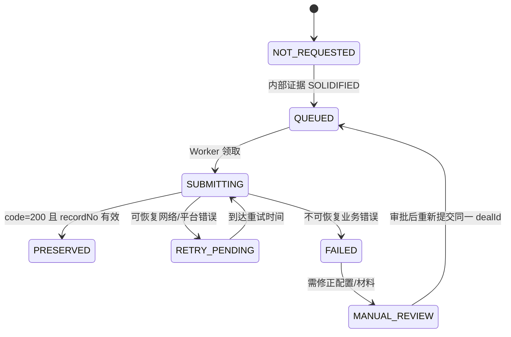
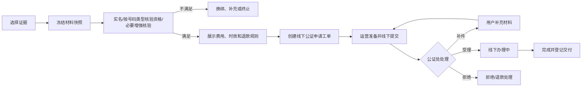

# 豫章公证处电子数据存证接入设计

> 状态：技术评审稿  
> 版本：v0.3  
> 资料基线日期：2026-10-19  
> 适用范围：全来源原始证据自动存证、存证验证报告、线下公证书协同申请

## 1. 目标与能力边界

一通话在完成平台内部固证后，将五类原始证据的 SHA-256 哈希和经批准的最小元数据提交至可信电子存证平台。平台成功返回 `recordNo` 后，系统才能显示“公证处存证已完成”，并可基于该编号生成和下载公证处电子数据存证验证报告。

本方案严格区分三类事实：

| 能力 | 当前资料结论 | 产品表述 |
| --- | --- | --- |
| 哈希数据存证 | 已有接口示例，成功返回 `recordNo` | 公证处存证已完成，仅在收到成功响应后显示 |
| 存证验证报告 | 已有同步、异步下载和任务查询示例 | 公证处电子数据存证验证报告 |
| 原始附件托管 | 错误码提到附件补传，但缺少上传方法和保管规则 | 未确认，不得声称原文件已由公证处托管 |
| 公证书申请和出具 | 当前接口文档未提供受理、补件、支付或出具接口 | 线下公证书协同申请，由运营人员对接公证处 |

接口方法名中的 `downloadCertificate` 和文档中的“凭证”不能直接翻译为“公证书”。结合演示样例，当前可确认的交付物是电子数据存证验证报告；公证书属于另行申请、审查和出具的法律文书。

## 2. 资料依据与限制

### 2.1 资料清单

| 资料 | 可确认内容 | 不可据此确认的内容 |
| --- | --- | --- |
| `可信电子存证平台接口文档-可出豫章公证处报告.pdf` | SDK 初始化、哈希存证、`recordNo`、同步/异步报告下载、任务查询、错误码 | 正式生产地址、签名算法、SDK 版本、附件上传方法、法律效力、SLA 和公证书申请 |
| `南昌市豫章公证处电子数据验证报告_演示样例.html` | 报告名称、结构、存证编号、完整性值、存证时间、验证结论、文件列表和申请公证书提示 | 正式签章样式、生产验证地址、不可编辑性、真实业务数据和最终法律模板 |

HTML 文件标题明确标注“演示版”，且包含“进入编辑/锁定只读”和导出已编辑文件的脚本。它只能用于评审报告信息结构，不能作为生产签名文书、真实证书样例或法律模板。

### 2.2 资料中的接口缺口

- 文档未给出请求签名的规范化串、算法、编码、时间窗、随机数和密钥轮换办法。
- 异步下载支持 `callbackUrl`，但未说明回调签名、来源校验、重放防护和回调报文契约。
- 错误码 `0009` 至 `0014` 涉及附件补传，但没有附件上传/补传接口、文件限制和托管责任说明。
- 同步和异步接口返回供应商 URL，但未说明有效期、访问鉴权、允许的 MIME、最大尺寸和下载完整性字段。
- 响应 `timestamp` 的字段说明是“请求时间戳”，不能把它直接展示成可信存证时间。
- 错误码枚举中代码 `0014` 复用了 `_0013` 的枚举标签，接入代码只能以字符串错误码判断，不能复制该枚举名。
- 未提供正式 SDK/JAR、校验值、Maven 坐标、沙箱、生产网络白名单、限流、费用和 SLA。

上述缺口关闭前，只能进行受控技术验证，不得将静态演示结果作为生产能力验收。

## 3. 配置与凭据

### 3.1 已知配置

| 配置 | 来源 | 管理规则 |
| --- | --- | --- |
| `apiAddress` | 存证平台提供 | 按环境配置，只允许 HTTPS 和已批准主机 |
| `platAppId` | 存证平台提供 | 按租户和环境隔离，不写入客户端 |
| `accessKey` | 存证平台提供 | 作为密钥管理，不写配置文件和日志 |
| `secretKey` | 存证平台提供 | 存入 KMS/密钥库，支持版本和轮换 |
| `productKey` | 存证平台按保全产品配置 | 由业务配置中心版本化，禁止客户端传入 |
| `stepKey` | 存证平台按保全点配置 | 与证据类型/处理阶段映射后版本化 |

凭据仅由服务端 `NotaryPreservationAdapter` 使用。生产、预发布和沙箱必须使用不同凭据；任何调试输出、异常堆栈、链路追踪和运营页面都不得出现 `accessKey`、`secretKey` 或签名原文。

### 3.2 上线前配置验收

供应商必须书面确认每个 `productKey`、`stepKey` 和动态存证字段的含义、必填性、长度、字符集及变更兼容规则。配置发布需双人审批，并在沙箱使用固定测试向量验证；配置错误不能通过重试自动恢复为成功。

## 4. 存证策略与请求映射

### 4.1 自动存证范围

以下五类原始证据在内部状态达到 `SOLIDIFIED` 后自动进入公证处存证队列：

- 运营商局端通话录音。
- 小程序内现场拍摄的照片或视频。
- 从相册导入的照片或视频。
- 通过 `wx.chooseMessageFile` 选择的微信会话文件。
- 用户提交并声明为聊天截图的文件。

每次提交至少包含原始对象 SHA-256、完整性清单版本和经批准的来源元数据。AI 逐字稿、摘要、用户注释和“事情”关系不改变原始记录；仅当某一确定版本被用户选入证据包或线下公证材料时，才以子记录另行存证。

### 4.2 `DataSaveRequest` 映射

| 供应商字段 | 内部来源 | 规则 |
| --- | --- | --- |
| `productKey` | 版本化供应商配置 | 不接受客户端值 |
| `stepKey` | 证据类型/材料类型映射 | 必须来自已批准配置 |
| `dealId` | 内部稳定业务流水号 | 全局唯一、无个人信息、重试不变 |
| `parentDealId` | 父记录 `dealId` | 原始证据为空；派生材料指向原始证据根记录 |
| `dataMap` | 最小存证元数据 | 字段需与供应商事先约定并做白名单过滤 |
| `dataMap->attachs` | 原始对象/材料哈希集合 | 首发使用 SHA-256；附件托管另行确认 |

建议的 `dataMap` 仅包含内部证据 ID 的不可猜测外部标识、来源类型、文件显示名、MIME、字节数、哈希算法、平台接收时间、完整性清单版本及必要的运营商会话外部标识。完整身份证号、完整手机号、证据正文、AI 文本和可变用户备注默认不得提交；确有公证材料目的时按单独同意和字段清单处理。

### 4.3 `dealId` 与父子链

- 原始证据根记录使用稳定格式，如 `oc:evidence:{evidenceUuid}:manifest:{version}`；格式一经发布不得复用给其他业务对象。
- 相同证据和清单版本的所有重试使用同一个 `dealId`，本地唯一约束为 `(provider, dealId)`。
- 原始证据的 `parentDealId` 为空。
- 定稿逐字稿、摘要、授权材料或导出清单在用于出证时使用自己的 `dealId`，并将原始证据根记录 `dealId` 作为 `parentDealId`。
- 多份证据组成的证据包使用独立材料清单记录，清单逐项引用各证据的 `recordNo`；不得任选一份证据作为其他无关证据的父节点。
- “事情”成员关系可变，不进入不可变父子链；调整事情不触发重复存证。

### 4.4 成功判定

HTTP 成功或供应商 SDK 未抛异常都不代表存证成功。只有响应 `code == "200"`、`data` 为有效且此前未绑定其他业务对象的 `recordNo`，并完成本地事务落库后，状态才能进入 `PRESERVED`。

平台返回的响应原文需加密归档并计算哈希。响应中的 `timestamp` 仅记为供应商响应时间字段；可信存证时间以正式报告或供应商明确签名字段为准。

## 5. 领域模型与状态机

### 5.1 核心对象

| 对象 | 关键字段 | 不变量 |
| --- | --- | --- |
| `NotaryPreservationRecord` | 证据、供应商、`dealId`、`parentDealId`、哈希快照、请求版本、状态、`recordNo`、回执哈希 | 一个供应商/`dealId` 只有一条活动记录；历史请求和响应不可覆盖 |
| `NotaryCertificateTask` | `recordNo`、调用模式、`taskId`、供应商状态、`bqNo`、报告对象、错误、重试次数 | 报告版本不可覆盖；供应商 URL 不作为用户永久地址 |
| `OfflineNotaryApplication` | 账户、材料快照、资格结果、工单、受理号、状态、费用、交付、退款关联 | 线下人工状态更新必须有凭据、操作者和审计 |

`NotaryPreservationStatus`：`NOT_REQUESTED`、`QUEUED`、`SUBMITTING`、`PRESERVED`、`RETRY_PENDING`、`FAILED`、`MANUAL_REVIEW`。

`NotaryReportTaskStatus`：`NOT_REQUESTED`、`REQUESTED`、`PROCESSING`、`COMPLETED`、`RETRY_PENDING`、`FAILED`、`MANUAL_REVIEW`。

`OfflineNotaryApplicationStatus`：`DRAFT`、`ELIGIBILITY_CHECK`、`MATERIAL_REQUIRED`、`READY_FOR_SUBMISSION`、`SUBMITTED_OFFLINE`、`ACCEPTED`、`PROCESSING`、`COMPLETED`、`REJECTED`、`CANCELLED`、`REFUND_PENDING`、`REFUNDED`。

支付状态仍由 `PaymentOrder` 独立保存，不能因线下申请被拒绝而把已支付记录改成未支付。

### 5.2 自动存证状态机

内部 `EvidenceIngestStatus=SOLIDIFIED` 与外部 `NotaryPreservationStatus=PRESERVED` 必须分开。外部平台不可用时，原始证据仍安全保存在一通话，但页面只能显示“内部固证已完成，公证处存证处理中/异常”。

### 5.3 用户状态文案

| 状态 | 用户可见文案 | 禁止文案 |
| --- | --- | --- |
| `QUEUED/SUBMITTING/RETRY_PENDING` | 公证处存证处理中 | 已存证、已由公证处保管 |
| `PRESERVED` 且有 `recordNo` | 公证处存证已完成 | 公证书已出具、法院必然采信 |
| `FAILED/MANUAL_REVIEW` | 公证处存证暂未完成，原始材料已在一通话安全保存 | 存证成功、数据丢失 |
| 报告 `PROCESSING` | 存证验证报告生成中 | 报告已生成 |
| 报告 `COMPLETED` 且已内部校验 | 存证验证报告可查看 | 公证书可查看 |

## 6. 存证验证报告流程

### 6.1 调用方式

接口资料提供：

- 同步 `downloadCertificate(recordNo)`，成功返回报告地址。
- 异步 `downloadCertificateAsync(recordNo, "", callbackUrl)`，成功返回 `taskId`。
- 查询 `queryCertificateTask(taskId)`，供应商状态 `0` 为处理中、`1` 为完成、`2` 为失败。
- 完成结果可能包含 `bqNo`、`certificateUrl`、`errorMsg` 和 `retryCount`。

生产默认使用异步方式。回调与轮询互为补偿：合格回调可以推进状态，超过回调等待阈值后按退避策略查询；两者必须通过相同的 `taskId` 幂等更新，终态不得被旧消息回退。

### 6.2 报告安全入库

`certificateUrl` 只允许服务端访问。下载器必须执行 HTTPS、主机白名单、DNS/IP 重绑定防护、连接和总时长限制、响应大小限制、MIME/魔数校验、病毒扫描及 SHA-256 计算。校验通过后写入自有加密对象存储并生成 `DeliveryArtifact`；客户端只获得一通话签发的短期下载链接，不直接获得供应商 URL。

报告记录至少保存：`recordNo`、`bqNo`、供应商任务 ID、供应商状态、报告 SHA-256、内部对象版本、获取时间、报告可识别的存证时间、验证入口和供应商原始回执哈希。若报告中的哈希、存证编号或材料标识与申请快照不一致，进入 `MANUAL_REVIEW`，不得交付。

### 6.3 报告说明

页面和导出记录必须说明：该报告用于验证公证机构存证系统上的记录及数据完整性，不直接证明材料所描述的基础法律事实，也不承诺司法机关必然采信。申请公证书属于独立程序。

## 7. 错误处理、幂等与对账

### 7.1 错误码归类

| 供应商错误码 | 内部类别 | 默认动作 |
| --- | --- | --- |
| `0001` | 产品/节点配置错误 | 不自动重试，告警并人工修正配置 |
| `0002`、`0015` | 数据不存在或重复存证 | 先按 `dealId` 对账，禁止换 ID 盲目重提 |
| `0003`、`0004` | 接入方/产品停用 | 熔断新提交，升级供应商处理 |
| `0005` 至 `0008` | 存证、模板、报告生成或下载异常 | 按契约判断重试；超过阈值人工处理 |
| `0009` 至 `0014` | 附件状态/补传异常 | 在附件接口补齐前阻断附件托管能力 |
| `0016` 至 `0019` | 接入密钥或签名错误 | 不自动无限重试，触发安全/配置告警 |

客户端仅展示标准化类别和下一步，不展示原始错误码、堆栈或凭据相关信息。

### 7.2 幂等规则

- 创建记录时以 `(provider, dealId)` 建唯一约束，并保存请求规范化哈希。
- 相同 `dealId` 且请求哈希相同的重试复用原记录；请求哈希不同则拒绝并进入人工审核。
- 收到 `0015` 时先查询本地成功记录和供应商对账能力，不创建新的 `dealId` 绕过重复保护。
- 报告任务以 `(provider, recordNo, reportType, materialSnapshotVersion)` 唯一，重复回调不创建重复交付物。
- 人工重试通过领域命令执行，保留前次尝试、原因、审批和操作者。

### 7.3 定时对账

对账任务至少检查：已提交但长期无 `recordNo`、本地 `PRESERVED` 但缺回执原文、同一 `recordNo` 关联多个对象、报告任务长期为供应商状态 `0`、状态 `1` 但报告未入库、供应商重试次数异常、报告哈希与材料快照不一致。

对账只能创建差异项或触发幂等查询/重试，不能直接把失败状态改为成功。所有差异需有负责人、截止时间和关闭证据。

## 8. 线下公证书协同申请

### 8.1 产品流程

当前资料没有公证书在线申请接口。小程序提供“申请线下公证书”入口，提交后创建一通话内部工单，由运营人员准备材料并与公证处线下协调：

### 8.2 业务规则

- 申请前必须校验账户实名有效；涉及局端通话的号码按类型核验资格：手机号完成姓名、身份证号、手机号三要素核验；独立固话按公证机构批准规则核验登记主体、合法使用权或授权材料。相关号码的资格均须为 `MATCHED`。
- `MISMATCHED` 只阻止线下公证书申请，不影响原始证据查看、自动存证、存证验证报告或其他导出。
- 提交前冻结材料清单、各证据哈希、`recordNo`、报告版本、用户声明和授权版本；后续补件生成新版本，不覆盖旧快照。
- 预计费用、办理地域、材料、时效、退款条件和交付方式必须来自已批准 SOP，不能由研发写死。
- `SUBMITTED_OFFLINE` 只能表示运营人员已向公证处提交；收到可核验的受理凭据后才能进入 `ACCEPTED`。
- `COMPLETED` 必须关联公证书编号、完成凭据和交付记录；如公证处只提供纸质文书，系统记录领取/寄送状态，不伪造电子公证书。
- 补件、拒绝、取消和退款分别记录原因、责任方、截止时间及通知；退款使用独立支付流水冲正。
- 人工修改受理号、终态或交付记录属于高风险操作，需要工单、二次确认和完整审计，必要时双人审批。

## 9. 安全与合规

- 与存证平台共享数据前，完成处理主体、目的、字段、保存期限、跨主体共享和用户权利的隐私/法务评审。
- 原始文件是否传至公证处必须以正式附件接口和数据处理协议为准；当前默认只提交哈希和最小元数据。
- 存证请求、回执、报告和线下材料均按敏感数据分类加密，运营后台默认只展示掩码和状态。
- 回调接口在签名规范确定后实施签名、时间窗、随机数/请求 ID、防重放和来源限制；在此之前异步回调不能通过生产安全门禁。
- SDK/JAR 必须进入制品仓库并校验来源、版本和哈希，执行依赖漏洞及许可证扫描。
- 报告验证二维码或地址必须由正式报告提供，不由客户端拼接；外链跳转显示目标域名并做白名单控制。
- 宣传和页面不得使用“公证处保管了原文件”“公证书自动出具”“法院必然认可”等未经证实的表述。

## 10. 上线阻断项

以下项目未关闭前，公证处存证能力不得全量生产上线：

1. 获取正式合同、生产接口文档、SDK/JAR、版本/校验值、沙箱和生产环境参数。
2. 确认请求签名与回调验签算法、时间窗、防重放、密钥轮换和网络白名单。
3. 确认 `productKey`、`stepKey`、动态字段 Schema、各证据类型映射和变更机制。
4. 补齐附件上传/补传接口、大小/类型限制、哈希校验、存储地点、保存/删除和费用规则；否则维持“仅哈希存证”。
5. 确认报告 URL 有效期、下载鉴权、报告格式、电子签章/长期验证、二维码验证地址及正式样例。
6. 确认 `recordNo`、`bqNo`、响应 `timestamp` 和报告存证时间的权威含义。
7. 完成错误码 `0014` 枚举缺陷确认、限流、重试边界、SLA、费用和技术支持升级路径。
8. 完成南昌市豫章公证处主体、资质、数据处理关系和对外文案的法务核验。
9. 定稿线下公证书的受理范围、地域、材料、三要素有效期、增强核验、费用、时效、补件、拒绝、退款和交付 SOP。

## 11. 验收标准

对应 [04-acceptance-roadmap.md](04-acceptance-roadmap.md) 中的 `NPS-T*` 场景，至少满足：

- 五类原始证据在内部固证成功后自动、幂等提交，且供应商故障不损坏原始证据。
- 没有有效 `recordNo` 时任何页面、接口和导出物都不会显示“公证处存证已完成”。
- 重复消息、超时重试和人工重试不会创建重复存证记录或改用新 `dealId` 绕过冲突。
- 异步报告回调丢失时轮询可以收敛；重复/乱序回调不能回退终态。
- 报告经服务端下载、校验、哈希和自有存储后才交付，供应商 URL 不直接暴露。
- 报告中的编号和哈希与材料快照一致；不一致时阻止交付并进入人工审核。
- 缺失附件接口时系统只声明哈希存证，不上传或宣称公证处托管原始文件。
- 线下公证书申请覆盖资格、补件、受理、办理、完成、拒绝、取消和退款，所有人工状态有审计凭据。

