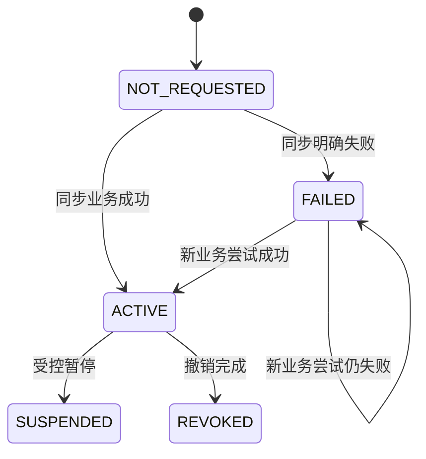

# 一通话 ONECALL 平台运营后台原型实施计划

> 已被精简方案覆盖（2026-10-20）：本期范围及验收以 [09 当前业务基线](09-business-activation-and-lean-admin.md) 为准。本文旧 55 路由、十角色、运营商开通接口、在线工单/退款/发票/复杂审批设计仅保留历史追溯，不是当前原型实施计划。

> 状态：待产品、安全、法务与运营确认  
> 版本：v0.1  
> 基线日期：2026-10-19  
> 交付类型：桌面 Web 高保真交互原型及自动化验收，不含生产后台实现

## 1. 计划目标与约束

### 1.1 目标

在独立目录中建设“一通话平台运营后台”原型，用于确认平台员工处理用户、企业、号码、通话、证据、公证、AI、商品、订单、发票、权益、分享、工单、供应商和系统配置时的信息架构、权限边界、状态语义和人工操作流程。

原型完成后应能验证：

- 平台员工身份、角色、数据范围与终端客户的个人/企业 IAM 完全分离。
- 客服和普通运营只看到完成工单所需的脱敏元数据，不因角色较高而默认获得原始录音、证据正文、完整身份证或完整号码。
- 所有人工处理通过受控领域命令推进，不提供直接改数据库、余额、终态、历史流水或不可变快照的入口。
- 同步开通、真实主叫匹配、内部固证、公证处存证、AI 版本、支付与权益发放、补件和权限变更的状态在界面中不会被混淆。
- 高敏访问、人工修复和财务/发布类操作能清楚展示工单、理由、二次验证、审批、有效期和审计要求。
- 1024、1280、1440 三档桌面视口均可完成关键任务，无页面级横向溢出或控件遮挡。

### 1.2 非目标

- 本阶段不开发生产 API、数据库、登录、审批引擎、供应商适配器或真实导出能力。
- 不把终端客户 Web 的企业空间、企业角色切换或租户授权逻辑搬进平台后台。
- 不建设供应商自助门户、公证处工作台、CRM、呼叫中心或通用低代码中台。
- 不允许在原型中编辑原始证据、录音、逐字稿原文、存证回执、订单快照、权益流水或审计事件。
- 不新增企业总机、PBX、分机、统一外呼号拆分或坐席 PIN 模型。
- 不把当前资料未证明的原文件托管、在线公证书受理、电子公证书下载或正式签章报告做成可用能力。
- 不用演示价格、SLA、退款、审批时限或访问时限替代尚未批准的正式规则。

### 1.3 依据与资料审计结论

本计划以 `01-source-audit.md` 至 `07-web-capability-hub-spec.md`、原始小程序 PRD、小程序原型、终端客户 Web 原型、公证处接口 PDF 和演示报告 HTML 为依据。资料约束如下：

1. 运营后台是独立产品面和独立 IAM/RBAC；现有 Web 原型只复用蓝灰、无渐变、紧凑业务工具的视觉语言。
2. 运营商开通接口同步返回业务成功或明确失败。网络异常只形成技术尝试记录，不能伪造 `PENDING`、`TIMEOUT` 或 `ACTIVE` 业务状态。
3. 公证处资料只证明哈希存证、`recordNo`、同步/异步存证验证报告、`taskId` 查询和 `0/1/2` 状态；未证明原文件托管和公证书在线受理。
4. 演示报告可编辑且标注“演示版”，只能参考信息结构，不能作为正式文书模板或签章能力证明。
5. 正式接入仍缺回调验签、附件补传、SDK、URL 安全规则、SLA 和正式签章报告；错误码 `0014` 还存在枚举标签错误。

## 2. 产品和安全原则

### 2.1 独立身份与最小权限

- 平台员工从独立身份源登录，使用平台组织、岗位、地域和业务范围授权；不得用终端用户账户或企业成员身份登录。
- 一个员工可拥有多个平台角色，但最终权限取角色权限、对象范围、临时授权和风险策略的交集，不使用“最高角色覆盖全部限制”。
- “平台超级管理员”只代表 IAM、角色和平台策略管理能力，不自动拥有业务数据原值、录音播放、证据正文、退款、商品发布或终态修复权限。
- 列表检索先校验数据范围再查询；禁止先查全量再由前端隐藏。越权请求不泄漏对象是否存在，并产生安全事件。
- 原型中的“角色预览”仅用于评审，固定放在评审工具栏并明确标注；生产导航不得提供任意切换角色或地域的控件。

### 2.2 不可变对象

以下对象只能追加新记录、版本、关联或纠正事件，不能覆盖历史值：

- 实名核验和风险升级记录。
- 号码验证、授权快照、运营商开通尝试和真实主叫匹配依据。
- 原始证据、原始录音、完整性清单、可信时间和证据对象版本。
- 公证处存证请求/回执、`dealId`、`recordNo`、报告任务和报告对象。
- AI 任务、逐字稿版本、摘要版本、引用和用户纠错建议。
- 商品版本、目录发布、报价、合同和订单商品快照。
- 支付、退款、权益 grant、预占和用量 ledger。
- 线下公证申请材料快照、补件快照、受理/交付凭据。
- 角色/权限版本、临时授权、审批记录和审计事件。

界面中对这些对象只提供“查看历史”“追加版本”“发起受控命令”或“创建差异工单”，不出现通用编辑、覆盖保存和删除入口。

### 2.3 高敏访问闭环

完整身份证、完整号码、原始录音、证据正文、逐字稿正文、原始公证材料和未脱敏导出均采用同一临时访问闭环：


原型必须展示而不能自行锁定的参数包括：最长有效期、可审批角色、是否允许下载、录音水印/语音水印规则、截图阻断能力、同时查看对象数和 break-glass 条件。未确认前默认不提供未脱敏下载；演示临时访问使用“策略待定”标签而非虚构时长。

访问授权至少绑定：`ticketId`、目的代码和说明、对象 ID 集合、允许字段/媒体范围、申请人、审批人、二次验证事件、签发/到期/撤销时间、会话/设备/IP 风险摘要。授权不得因为工单状态变化而扩大范围，工单关闭时立即失效。

### 2.4 受控命令与审批

- 所有写操作由服务端领域命令表达；原型确认页必须展示对象、当前状态、目标动作、影响范围、幂等语义、理由、关联工单和审批要求。
- 批量动作逐项鉴权并返回成功、失败、跳过及原因，禁止“部分成功但显示全部成功”。
- 技术重试复用原业务幂等键；明确业务失败后的再次申请追加新尝试。任何重试都不能覆盖前一次请求/响应。
- 审批人不能审批自己发起的操作；商品审核和发布、重大权益补偿、退款、通话匹配修复、证据隔离解除及高敏访问按最终策略执行职责分离。
- 审批通过只授权执行一次，不直接把业务对象改成目标终态；执行失败仍保留批准记录和失败结果。

## 3. 平台角色与权限矩阵

### 3.1 角色定义

| 角色 | 主要职责 | 默认数据范围 | 明确禁止 |
| --- | --- | --- | --- |
| 平台超级管理员 | 平台员工、角色、范围、策略和紧急访问机制管理 | IAM 与策略元数据 | 默认查看业务敏感原值、证据内容；独自审批自己的提权 |
| 运营协调 | 跨域工单分派、异常队列和 SLA 跟踪 | 被分派业务线/地域的脱敏元数据 | 播放录音、改终态、改余额、退款或发布商品 |
| 客服 | 用户/企业基础查询、工单沟通和状态解释 | 工单关联对象的掩码与状态 | 完整身份证/号码、证据正文、录音、供应商凭据 |
| 实名与风控 | 实名异常、身份冲突、号码风险和资格复核 | 被分派案件；默认掩码 | 无授权批量揭示身份原值、修改历史核验结果 |
| 运营商渠道 | 号码验证、开通、通话回执、真实主叫和渠道对账 | 指定供应商/地域的脱敏号码与会话 | 证据正文、AI 正文、财务和平台 IAM |
| 证据与公证运营 | 固证、存证、报告及线下公证工单 | 被分派申请的元数据和材料清单 | 默认打开原始证据；伪造受理号、报告或完成状态 |
| 财务 | 订单、支付、退款、发票和对账 | 财务对象及必要脱敏主体信息 | 查看证据内容、直接改支付状态或权益余额 |
| 商品配置 | 商品草稿、权益规则、目录和企业报价模板 | 商品/目录/报价域 | 单人完成草拟、审核和生产发布；改历史版本 |
| 审计员 | 审计事件、审批链、访问授权和导出审计 | 被授权范围的只读审计数据 | 发起业务命令、查看证据正文或密钥 |
| 安全管理员 | 安全策略、告警、隔离复核、会话和凭据元数据 | 安全域；业务内容默认不可见 | 普通业务处理、财务命令、读取供应商 secret 明文 |

### 3.2 能力矩阵

符号：`R` 常规只读，`M` 仅掩码，`C` 可发起受控命令，`A` 可审批，`J` 仅经工单临时授权，`-` 无权限。所有能力仍受对象范围约束。

| 业务域 | 超管 | 运营 | 客服 | 实名/风控 | 运营商 | 证据/公证 | 财务 | 商品 | 审计 | 安全 |
| --- | --- | --- | --- | --- | --- | --- | --- | --- | --- | --- |
| 用户/企业基础资料 | M | M | M | M/J | M | M | M | - | M | M |
| 实名核验元数据 | M | M | M | R/C | M | M | - | - | M | M |
| 完整证件原值 | -/J | -/J | - | J | - | J | - | - | - | J |
| 号码/授权/开通 | M | M/C | M | M/C | M/C | M | - | - | R | M |
| 通话会话/匹配依据 | M | M/C | M | M | M/C | M | - | - | R | M/A |
| 证据元数据 | M | M/C | M | M | M | R/C | - | - | R | M/A |
| 原始录音/证据正文 | -/J | J | - | J | - | J | - | - | - | J |
| 公证存证/报告/申请 | M | M/C | M | M | - | R/C/A | M | - | R | M |
| AI 任务/版本元数据 | M | M/C | M | - | - | R/C | - | - | R | M |
| 商品/目录/报价 | R | R | R | - | - | - | R | R/C/A | R | - |
| 订单/支付/退款/发票 | M | M | M | - | - | M | R/C/A | R | R | M |
| 权益/用量/补偿 | M | M/C | M | - | M | M | R/A | R | R | M |
| 分享/导出 | M | M/C | M | - | - | M/C | - | - | R | M/A |
| 工单/审批 | R | R/C | R/C | R/C/A | R/C | R/C/A | R/C/A | R/C/A | R | R/A |
| IAM/临时授权/策略 | R/C/A | - | - | - | - | - | - | - | R | R/C/A |
| 审计事件 | R | R | M | R | R | R | R | R | R | R |

“超级管理员”行中的 `J` 也必须走临时授权；它不是常规业务访问的后门。最终双人审批清单由安全、财务、法务和业务负责人确认后，作为服务端策略配置，不由前端硬编码。

### 3.3 数据范围模型

每个角色绑定一个或多个范围：平台组织、业务线、地域、供应商、工单队列和对象集合。跨范围检索返回统一拒绝页并记录 `AccessDenied` 事件。运营商渠道人员至少限定供应商和地域；财务限定结算主体；公证运营限定公证机构/工单队列。全平台聚合报表仅展示去标识化指标，点击指标不会自动授予明细权限。

## 4. 信息架构与路由

### 4.1 全局框架

- 顶栏：产品标识、全局脱敏检索、当前数据范围、待办、告警、帮助、员工账户。
- 左侧导航：工作台、客户与组织、号码与通话、证据与智能、公证与交付、交易与权益、服务运营、平台治理。
- 主内容区：面包屑、对象标题/风险标签、页签、筛选工具栏、稳定表格/时间线、详情抽屉或独立详情页。
- 高风险确认使用模态框；多步骤处理使用全页向导；不能把复杂业务向导塞进多层卡片。
- 1024px 下左栏可收起，表格优先保留标识、状态、时间和操作列，次要列进入详情抽屉；不通过缩小字体容纳所有列。

### 4.2 完整路由清单

| 导航组 | 路由 | 页面 | 首要角色/说明 |
| --- | --- | --- | --- |
| 会话 | `/login` | 员工登录 | 独立 SSO 占位、二次验证和异常态 |
| 会话 | `/access-denied` | 无权限 | 不泄漏对象存在性 |
| 工作台 | `/dashboard` | 运营总览 | 按权限显示待办、异常和脱敏指标 |
| 工作台 | `/work-queues` | 我的工作队列 | 分派、SLA、批量领取 |
| 工作台 | `/approvals` | 待我审批 | 职责分离、过期和已撤回状态 |
| 客户与组织 | `/users` | 用户列表 | 脱敏查询 |
| 客户与组织 | `/users/:id` | 用户详情 | 实名、号码、交易、工单、审计页签 |
| 客户与组织 | `/identity-cases` | 实名/风控案件 | 核验异常和冲突处理 |
| 客户与组织 | `/identity-cases/:id` | 案件详情 | 临时揭示、依据和处理命令 |
| 客户与组织 | `/organizations` | 企业列表 | 企业主体、套餐与状态 |
| 客户与组织 | `/organizations/:id` | 企业详情 | 成员摘要、坐席、号码、合同、用量、审计 |
| 号码与通话 | `/numbers` | 主叫号码列表 | 手机号/独立固话、验证/授权/开通分列 |
| 号码与通话 | `/numbers/:id` | 号码详情 | 全生命周期和每次尝试 |
| 号码与通话 | `/provisioning-attempts` | 开通尝试队列 | 同步结果与技术异常分开 |
| 号码与通话 | `/calls` | 通话会话列表 | 实际主叫、接入方式、录音/固证状态 |
| 号码与通话 | `/calls/:id` | 通话详情 | 回执时间线、匹配依据、权益流水引用 |
| 号码与通话 | `/call-reconciliation` | 孤儿录音/匹配差异 | 双人复核，不自动认领 |
| 证据与智能 | `/evidence` | 证据列表 | 来源、内部固证、公证存证分列 |
| 证据与智能 | `/evidence/:id` | 证据详情 | 元数据、对象版本、完整性、处理链、审计 |
| 证据与智能 | `/evidence-quarantine` | 隔离队列 | 安全审核与解除申请 |
| 证据与智能 | `/ai-jobs` | AI 任务列表 | 排队、处理、校验、重试 |
| 证据与智能 | `/ai-jobs/:id` | AI 任务详情 | 模型、权益预占、失败和版本引用 |
| 证据与智能 | `/ai-versions/:id` | AI 版本详情 | 只读逐字稿/摘要版本及引用完整性 |
| 公证与交付 | `/preservations` | 公证处存证队列 | `dealId`、`recordNo`、差异与重试 |
| 公证与交付 | `/preservations/:id` | 存证详情 | 请求/回执哈希、尝试、对账 |
| 公证与交付 | `/notary-reports` | 存证验证报告任务 | `taskId`、供应商 `0/1/2` 映射 |
| 公证与交付 | `/notary-reports/:id` | 报告详情 | 下载校验、内部对象和交付状态 |
| 公证与交付 | `/offline-notary` | 线下公证申请列表 | 材料、补件、受理、交付 |
| 公证与交付 | `/offline-notary/:id` | 线下公证申请详情 | 快照版本、资格、凭据、退款关联 |
| 交易与权益 | `/products` | 商品版本列表 | 草稿、审核、发布、退役 |
| 交易与权益 | `/products/:id` | 商品版本详情 | 不可变版本和权益规则 |
| 交易与权益 | `/catalog-releases` | 目录发布 | 原子目录快照及审批 |
| 交易与权益 | `/catalog-releases/:id` | 目录发布详情 | 商品集合、渠道、生效时间 |
| 交易与权益 | `/enterprise-quotes` | 企业报价/合同 | 需求、报价、合同、权益生效 |
| 交易与权益 | `/orders` | 订单列表 | 商品快照、支付与履约分列 |
| 交易与权益 | `/orders/:id` | 订单详情 | 支付、退款、权益发放、发票时间线 |
| 交易与权益 | `/refunds` | 退款队列 | 申请、审批、渠道结果、权益冲正 |
| 交易与权益 | `/invoices` | 发票列表 | 开票、失败、作废/红冲占位 |
| 交易与权益 | `/invoices/:id` | 发票详情 | 抬头快照、订单关联和处理记录 |
| 交易与权益 | `/entitlements` | 权益与用量 | grant、预占、ledger 和差异 |
| 交易与权益 | `/compensations` | 权益补偿单 | 追加 grant/ledger，不改余额历史 |
| 服务运营 | `/shares` | 受控分享 | 状态、访问次数、撤销世代、异常 |
| 服务运营 | `/exports` | 下载与导出任务 | 用途、范围、脱敏、二次验证、失效 |
| 服务运营 | `/tickets` | 工单列表 | 队列、优先级、SLA、关联对象 |
| 服务运营 | `/tickets/:id` | 工单详情 | 沟通、对象、命令、审批、审计统一时间线 |
| 服务运营 | `/vendors` | 供应商列表 | 能力、环境、健康度、联系人 |
| 服务运营 | `/vendors/:id` | 供应商详情 | 配置版本、SLA 占位、告警和升级路径 |
| 服务运营 | `/reconciliation` | 综合对账中心 | 运营商、公证、支付、权益差异 |
| 平台治理 | `/staff` | 平台员工 | 状态、角色和范围，不展示凭据 |
| 平台治理 | `/roles` | 角色与权限 | 版本化策略和权限对比 |
| 平台治理 | `/access-grants` | 临时访问授权 | 申请、审批、使用、到期和撤销 |
| 平台治理 | `/audit` | 审计中心 | 按对象、工单、操作者、命令追踪 |
| 平台治理 | `/security-alerts` | 安全告警 | 越权、异常揭示、隔离和会话撤销 |
| 平台治理 | `/system-config` | 系统配置 | 非密钥配置版本与发布记录 |
| 平台治理 | `/jobs` | 任务与调度 | 状态、重试、死信、幂等键摘要 |

未列入路由的对象通过详情页页签或侧边抽屉表达，不为每个内部表创建页面。全局检索只接受业务 ID、工单号、订单号、`dealId`、`recordNo`、`taskId` 及经策略允许的 HMAC 精确匹配；不支持用完整证件或号码做模糊搜索。

## 5. 关键页面规格

### 5.1 工作台和工作队列

- 工作台按角色组合展示“我的待办、待审批、异常积压、即将超 SLA、供应商健康度、昨日关键指标”，没有权限的模块不渲染。
- 指标卡只提供聚合趋势和口径说明；进入明细时再次鉴权。
- 工作队列支持按业务域、风险、状态、地域、供应商、负责人和 SLA 筛选，支持领取/转派；批量领取不改变业务对象状态。
- 空状态、依赖不可用、统计延迟和权限不足必须使用不同文案。

### 5.2 用户与企业详情

- 用户详情页签：概览、实名记录、主叫号码、订单与权益、关联工单、访问/操作审计。默认只显示姓名/证件/号码掩码，不列出证据正文或录音播放器。
- 企业详情页签：主体概览、成员与坐席摘要、组织号码、合同商品、共享权益、工单、审计。企业管理员与平台员工权限模型并列说明，不能互相替代。
- 身份冲突处理只允许创建“补充核验、解除错误关联申请、暂停能力”等受控命令；历史核验结果保持可追溯。
- 完整身份揭示从工单内发起，显示审批范围、剩余有效期和水印；退出页面或授权到期立即清除原值。

### 5.3 号码、开通和通话详情

- 号码详情将“持有验证、授权、运营商开通、公证资格、停用/撤销”作为独立轨道，禁止聚合成一个“已认证”标签。
- 开通尝试展示业务请求 ID、幂等键摘要、调用前状态、同步业务结果、网络/解析结果、错误分类和重试关联。
- 网络结果未知时只允许“按原幂等键技术重试/查询”，明确失败后才允许创建新的业务尝试；成功结果只能进入 `ACTIVE`，明确失败进入 `FAILED`。
- 通话详情展示预期主叫、运营商实际主叫、强一致判断、接入方式、运营商会话、权威时长、结束原因、录音到达、固证、权益预占/确认和公证存证的并行时间线。
- 录音播放器默认不出现；经临时授权后只在受控查看会话中出现，显示对象、目的、倒计时、水印和禁止扩大范围提示。
- 孤儿录音或主叫不一致不能由单人“选择用户”解决。修复向导要求候选绑定、运营商原始依据摘要、冲突检查、影响预览、双人复核和追加式关联事件。

### 5.4 证据、隔离与 AI

- 证据列表分别展示 `EvidenceIngestStatus`、公证处存证状态和 AI 状态；“内部固证已完成”不得渲染成“公证处存证已完成”。
- 证据详情页签：元数据、对象版本、完整性清单、处理记录、公证处存证、AI 版本、访问审计。原始对象和派生对象有明确标签。
- 常规详情只展示 MIME、大小、哈希摘要、存储区和状态；正文/媒体需临时授权。对象存储键和永久地址永不显示。
- 隔离解除必须由安全角色审核；普通运营可补充上下文但不能执行解除。恶意或无法解析文件不进入主处理链。
- AI 失败重试创建/推进幂等任务；重新处理生成新 `TranscriptVersion`/`SummaryVersion`，不覆盖旧版本。摘要引用校验失败显示 `TRANSCRIPT_ONLY` 或失败原因，不能伪造完整成功。

### 5.5 公证处存证、报告和线下公证

- 存证详情展示规范化请求哈希、`dealId`、可选 `parentDealId`、尝试、原始回执哈希、`recordNo` 和成功判定；响应 `timestamp` 标为供应商响应时间，不标为可信存证时间。
- 人工重试沿用同一 `dealId`；`0015` 先进入对账，禁止换 ID 盲目重提。请求哈希变化时阻断并建立差异工单。
- 报告任务明确 `0 -> PROCESSING`、`1 -> COMPLETED`、`2 -> FAILED`；回调与轮询事件共用时间线，旧事件不能使终态回退。
- 供应商报告 URL 不向页面暴露。报告详情展示白名单下载、大小/MIME/病毒/哈希校验及内部加密对象状态；校验不一致进入 `MANUAL_REVIEW`。
- 线下公证页按材料快照版本展示资格、补件、线下提交、受理凭据、处理、完成凭据、交付及退款关联。`SUBMITTED_OFFLINE`、`ACCEPTED`、`COMPLETED` 各有独立凭据要求。
- 未获得正式 SOP 前，费用、时限、补件期限、拒绝/退款和交付方式显示“待正式规则确认”，相应命令在原型中置为阻断态。

### 5.6 商品、订单、发票和权益

- 商品版本状态为 `DRAFT -> REVIEWED -> PUBLISHED -> RETIRED`。已发布版本无编辑入口；变更创建新版本。审核人与发布人不能是草拟人，最终职责分离规则待确认。
- 发布确认展示人民币分价格、权益单位/周期、微信支付映射、生效时间、渠道和完整 `CatalogRelease` 差异，采用原子发布语义。
- 订单详情分别展示订单、支付、履约、权益发放、退款和发票状态；供应商履约失败不把已支付改成未支付。
- 退款页面在正式规则确认前只展示申请、审批、渠道调用、结果和权益冲正的状态骨架，不承诺自动退款或任意人工金额。
- 发票页保留开票失败、作废/红冲状态位置，但必须等财税规则确认后开放动作。
- 权益补偿创建独立 `EntitlementGrant` 和 `UsageLedger`，展示类型、单位、数量、有效期、原因、对象和审批；不提供“直接改剩余余额”。
- 支付回调、首次发放、后续期发放和补发分别展示幂等键/事件；重复回调不能产生第二组权益。

### 5.7 分享、导出、工单和供应商

- 分享详情展示验证模式、范围、次数、有效期、撤销世代和访问事件；不显示提取码明文或原始存储地址。
- 导出任务展示申请目的、范围、脱敏、二次验证、准备/部分失败/可下载/失效状态。重新申请创建新任务，不复活旧链接。
- 工单详情是人工处理的中心上下文：对象引用、客户沟通、内部备注、领域命令、审批和审计事件按时间合并，但权限不同的内容分别鉴权。
- 供应商详情展示能力与环境，不显示 `secretKey`/token 明文。凭据轮换只展示版本、状态、责任人和审计引用。
- 对账中心只能创建差异项、执行幂等查询/重试或分派工单，不能用“以本地为准/以供应商为准”直接覆盖事实。

### 5.8 IAM、审计和系统配置

- 员工状态、角色、范围变更使用版本化申请；离职/停用立即撤销活动会话和临时授权，但不删除历史审计。
- 角色详情提供权限矩阵和版本差异，不允许用客户端隐藏代替服务端鉴权。
- 临时访问授权页完整展示申请、审批、签发、每次使用、到期、撤销和异常访问；访问正文与访问日志使用不同权限。
- 审计事件按账户/组织、业务对象、工单、操作者、审批人、命令、时间和结果查询；事件不可编辑或删除，导出默认脱敏。
- 系统配置只覆盖可公开给运营界面的非密钥业务配置和版本；生产发布需审批。供应商 secret、KMS 密钥和数据库连接信息不进入原型表单。

## 6. 状态机与命令契约

### 6.1 运营商开通



网络超时或响应无法解析不创建新的业务状态，只追加技术尝试，号码保持调用前状态。技术重试复用请求和幂等键；明确 `FAILED` 后的用户/运营业务重试创建新尝试并关联前次记录。

### 6.2 主叫匹配与录音

正常匹配由运营商真实主叫驱动：手机号要求预期与实际强一致，独立固话按实际主叫解析唯一有效绑定。异常进入差异队列；人工修复只追加 `CallMatchCorrection` 事件，包含候选、依据、前后关联、审批和冲突检查。不能编辑原始运营商回执，也不能把无法确定的固话操作者归给任意坐席。

### 6.3 存证与报告

存证沿用 `NOT_REQUESTED -> QUEUED -> SUBMITTING -> PRESERVED/RETRY_PENDING/FAILED -> MANUAL_REVIEW`；只有 `code="200"`、有效唯一 `recordNo` 且本地持久化完成才是 `PRESERVED`。报告状态与存证状态分开，报告完成也不代表公证书已出具。

### 6.4 AI 版本

AI 沿用 `QUEUED -> PROCESSING -> VALIDATING -> SUCCEEDED/TRANSCRIPT_ONLY`，可恢复错误进入 `RETRY_PENDING`，不可恢复或超限进入 `FAILED`。重新处理引用旧版本并追加新版本；任何人工纠错作为建议/注释存在，不能覆盖 AI 原文或证据。

### 6.5 支付、退款与权益

订单、支付、退款、订阅期、权益 grant 和用量 ledger 是相互关联但独立的状态对象。支付成功通过幂等 Outbox 发放权益；发放失败进入补偿任务而非回退支付。退款成功后追加冲正流水，不能删除原 grant/ledger。具体可退金额、已消费权益处理和发票红冲由正式规则决定。

### 6.6 补件与权限变更

- 补件：用户/运营提出要求 -> 创建补件任务 -> 上传/选择材料 -> 冻结新快照 -> 审核 -> 接受或再次补件。旧材料快照永久保留。
- 权限：提交变更申请 -> 风险/冲突校验 -> 审批 -> 原子生效新策略版本 -> 撤销旧会话 -> 审计。审批或发布失败时保持旧版本有效。
- 临时提权：申请 -> 审批 -> 二次验证 -> 签发 -> 使用 -> 到期/撤销；任何阶段拒绝或过期都不能访问目标内容。

### 6.7 首批受控命令目录

| 命令 | 前置条件 | 结果 | 幂等/审计要求 |
| --- | --- | --- | --- |
| 技术重试开通 | 结果未知、同一业务请求 | 追加技术尝试 | 复用幂等键，不改历史 |
| 重新申请开通 | 前次明确失败且授权仍有效 | 新开通尝试 | 新请求 ID，关联前次 |
| 修复通话匹配 | 差异工单、依据齐全、无冲突 | 追加匹配纠正 | 双人复核，保留原依据 |
| 重试固证/AI | 可恢复状态 | 推进同一幂等任务 | 不重复证据、不重复扣费 |
| 重试公证存证 | 已批准人工复核 | 同一 `dealId` 重提/查询 | 请求哈希必须一致 |
| 重新生成报告/交付物 | 原任务失败或对象失效 | 新任务/新交付物版本 | 旧版本保留 |
| 追加 AI 新版本 | 原证据可用、权益规则允许 | 新 AI 版本 | 不覆盖旧版本 |
| 发放权益补偿 | 补偿单批准 | 新 grant 和 ledger | 业务幂等键唯一 |
| 发起退款 | 符合正式退款规则 | 独立退款单 | 支付和冲正可对账 |
| 解除证据隔离 | 安全审核通过 | 追加解除事件并恢复流程 | 普通运营不可执行 |
| 更新线下公证状态 | 凭据满足对应状态要求 | 追加状态事件 | 终态需高风险确认 |
| 发布商品/目录 | 校验通过、职责分离审批 | 新发布版本原子生效 | 历史版本不变 |
| 变更员工角色/范围 | IAM 申请批准 | 新策略版本生效 | 撤销旧会话，全审计 |
| 签发临时内容访问 | 工单、目的、审批、二次验证 | 短期受限会话 | 每次使用留审计 |

## 7. 批量操作和审批边界

### 7.1 允许批量操作

- 领取、转派或加标签工单。
- 对同类、同供应商、同错误分类的可恢复任务发起幂等重试申请。
- 对通知/待办标记已读、确认或导出脱敏汇总。
- 对低风险配置草稿做批量校验，但不能批量发布。

### 7.2 禁止批量操作

- 揭示完整身份证、号码、证据正文或录音。
- 修复真实主叫/录音归属、解除隔离、修改线下公证终态。
- 退款、权益补偿、商品发布、权限提升或 break-glass。
- 下载原始证据、未脱敏导出、撤销授权或删除业务对象。

批量命令执行前展示对象总数、实际可执行数、被跳过数、影响摘要和审批要求；执行后提供逐项结果和可重试清单。选择“全部筛选结果”时必须保存筛选快照或服务端对象集合版本，避免执行期间范围漂移。

## 8. 原型技术和文件边界

### 8.1 目录

```text
operations-prototype/
  README.md
  onecall-operations-admin.html
  preview.html
  qa/
    qa.js
    run.ps1
    screenshots/
```

- `onecall-operations-admin.html` 是唯一源文件；`preview.html` 由 QA 脚本复制生成，不手工编辑。
- `qa/qa.js` 使用 Playwright 验证路由、权限、关键工作流、文案和响应式；截图只保存评审所需关键视图。
- 目录与 `web-prototype/` 完全分离，不修改终端客户 Web 的状态、路由、fixture 或 QA。
- 使用内置 SVG Logo 和现有图标库/内嵌图标方案；不依赖网络资源。原型 fixture 不使用真实个人信息、号码、密钥或供应商凭据。

### 8.2 原型状态和假数据

- 用集中式 fixture 和状态枚举生成页面，不在各页面复制互相矛盾的状态文本。
- 提供评审角色、范围和异常场景选择器，但固定标注“原型评审”，且生产设计说明中删除。
- 每个高风险动作至少具备：无权限、缺工单、待审批、二次验证失败、执行成功、部分失败/依赖失败状态。
- 演示二次验证码只能存在于 QA fixture，不在可见页面长期明示为生产规则。
- 所有“成功”演示页必须显示由哪个受控命令/外部回执推动，不能由前端按钮直接篡改终态而不留事件。

### 8.3 视觉基线

- 继承终端客户 Web 的蓝灰、无渐变、浅背景、轻描边、克制阴影和紧凑信息密度，但使用独立的平台运营导航和品牌副标题。
- 页面段落不做营销 Hero；工作台优先呈现队列、表格、状态、时间线和可操作信息。
- 卡片圆角不超过 8px，不嵌套装饰性卡片。表格数字、金额、时长、哈希和 ID 使用等宽数字。
- 命令按钮使用明确图标和动词；危险动作使用独立危险色并二次确认。状态颜色不能作为唯一信息载体。
- 最小交互热区 40px；正文和状态达到 WCAG AA。长 ID、中文姓名、企业名、错误信息和 200% 文本缩放不得覆盖操作区。

## 9. 实施切片和里程碑

每个里程碑均先完成页面/状态清单，再实现交互，最后补齐 QA 和截图；不得为后续阶段提前加入未经确认的生产规则。

### P0：权限骨架与高风险主链路

交付：

- 独立登录/会话、平台壳层、角色/范围预览、无权限页。
- 工作台、工作队列、审批、工单详情、审计中心、临时访问授权。
- 用户/企业、实名案件、号码、开通尝试、通话/匹配差异、证据/隔离详情。
- 同步开通重试、通话匹配修复、隔离解除和临时查看的完整受控流程。
- 角色路由拒绝、字段掩码、不可变历史和 1024/1280/1440 基础 QA。

P0 验收信号：`OPS-T01` 至 `OPS-T04`、`OPS-T07` 至 `OPS-T10`、`OPS-T12` 及 `SEC-T09` 至 `SEC-T11` 在原型中都有可复现状态。

### P1：公证、AI、交易和权益闭环

交付：

- AI 任务/版本、公证处存证/报告、线下公证申请/补件。
- 商品版本/目录发布、企业报价/合同、订单、退款、发票、权益/补偿。
- 存证对账与报告校验、AI 新版本、支付/发放分离、权益补偿和商品职责分离流程。
- 分享、导出及相应临时访问/审计。

P1 验收信号：`OPS-T05`、`OPS-T06`、`OPS-T11`，公证处 `dealId/recordNo/taskId` 语义和支付/权益不变量可通过自动化场景验证。

### P2：供应商治理、系统配置和完整异常面

交付：

- 供应商、综合对账、安全告警、员工、角色、系统配置、任务与调度。
- 所有页面的空、加载、延迟、部分失败、权限不足、依赖不可用和长文本状态。
- 完整键盘可达性、200% 文本缩放、截图基线和 README 交付说明。

P2 验收信号：全部计划路由可导航、角色矩阵无越权、关键对象可从工单追踪到命令/审批/业务结果/审计，三档视口自动化通过。

## 10. Playwright QA 与验收矩阵

### 10.1 视口

固定检查：

- 1024 x 768：收起/窄侧栏、表格列降级、模态框和多步骤向导。
- 1280 x 800：标准运营工作区和所有关键流程截图。
- 1440 x 900：展开侧栏、宽表格、详情时间线和双栏页面。

每档断言 `documentElement.scrollWidth <= clientWidth`，并检查固定顶栏、侧栏、浮层、表格操作区和底部按钮不重叠。对 200% 浏览器缩放/等效 CSS 像素视口另做人工或自动检查。

### 10.2 自动化场景

1. 登录、会话过期、二次验证失败、员工停用和无权限。
2. 十类角色的导航可见性、直接路由拒绝和对象范围隔离。
3. 客服查询用户只能见掩码，尝试访问录音/证件原值被拒绝并产生事件。
4. 临时访问从工单申请、审批、二次验证、带水印查看到到期/撤销；范围外对象仍拒绝。
5. 同步开通成功/明确失败/网络未知；技术重试和新业务尝试语义不同。
6. 手机号强一致、固话唯一绑定、主叫不一致和孤儿录音双人修复。
7. 固证重试不重复证据或扣费，隔离解除只允许安全审批链。
8. AI 重试/重新处理生成新版本，旧逐字稿和摘要保持不变。
9. 公证存证只有有效 `recordNo` 才成功；`0015` 进入对账；请求哈希不同阻断。
10. 报告回调/轮询乱序不回退终态，校验失败进入人工审核且不交付。
11. 线下公证补件生成新快照；缺受理/完成凭据时不能推进相应状态。
12. 商品草拟、审核、发布职责分离；发布后修改创建新版本。
13. 支付成功但权益发放失败保持支付成功，补偿后只新增幂等 grant/ledger。
14. 权益补偿不能编辑余额；退款、渠道结果、冲正和发票状态分别展示。
15. 分享撤销/换码后旧会话失效；导出部分失败和链接失效不扩大范围。
16. 批量领取与批量重试逐项返回；筛选范围变化不扩大已确认对象集。
17. 审计可从工单追踪申请人、审批人、命令、前后状态、外部结果和失败原因。
18. 每个关键页面覆盖空、加载、无权限、依赖失败、超长 ID/企业名/错误信息。

### 10.3 文案与数据断言

- 页面不存在把“存证验证报告”写成“公证书”、把内部固证写成公证处完成、把供应商响应时间写成可信存证时间的文案。
- 页面不存在企业总机、PBX、分机、统一外呼号拆分、坐席 PIN、原文件由公证处托管等首发外承诺。
- 真实或生产来源的完整身份证、完整号码、提取码、验证码、access key、secret key 不进入任何 fixture、DOM、URL、日志或截图。专门的临时访问自动化可在运行时注入明显标注为虚构的完整证件/号码，仅在已授权内容容器中短暂出现，并断言离开、到期或撤销后从 DOM 清除；对象存储键和凭据密钥即使在临时访问中也不展示。
- 所有状态标签同时包含文字；金额以人民币分对应的格式化结果展示，不使用浮点计算演示折扣。
- 所有命令结果含工单/命令 ID、时间、操作者和审计入口；不可变对象无通用编辑/删除控件。

## 11. 依赖、门禁与待确认事项

### 11.1 开始原型实现前必须确认

- 本计划的目标、非目标、角色列表、信息架构和 P0/P1/P2 顺序。
- 是否接受独立 `operations-prototype/` 目录及单文件 HTML + Playwright 的现有原型技术形态。
- P0 评审用的角色/范围 fixture 和业务样例是否可以使用完全虚构数据。

### 11.2 只阻断对应动作，不阻断只读页面和状态骨架

| 待确认 | 负责人建议 | 未确认时的原型处理 |
| --- | --- | --- |
| 平台员工身份源、SSO、二次验证、会话策略 | 安全/IT | 使用占位登录与异常态，标注策略待定 |
| 超管 break-glass、审批链、最长时限 | 安全/法务 | 不提供可执行 break-glass，只展示申请骨架 |
| 双人审批命令清单和额度阈值 | 安全/财务/业务 | 高风险动作统一演示待审批，不写死阈值 |
| 原始录音/证据访问时限和水印 | 安全/法务 | 临时会话显示“策略待定”，禁用下载 |
| 运营商人员的供应商/地域范围 | 渠道负责人 | 使用虚构单供应商范围，不支持跨范围 |
| 退款、已消费权益、发票红冲/对账 | 财务/法务 | 动作阻断，只展示独立状态与依赖 |
| 商品审核/发布职责分离 | 商业化/财务 | 使用三人模型演示，不声称为最终制度 |
| 线下公证 SOP、补件期限、退款和交付凭据 | 法务/公证运营 | 费用/时限/动作阻断，保留快照和凭据结构 |
| 供应商正式接口、SLA、告警和升级路径 | 技术/供应商 | 健康度与配置页使用“未签约/待验证”状态 |
| 平台组织、地域及跨范围查询规则 | 运营/安全 | 默认最小范围和跨范围拒绝 |

### 11.3 生产实现前的额外门禁

原型通过不代表生产设计获批。生产开发还需补齐：服务端授权策略模型、领域命令 API、审批引擎、审计防篡改、数据脱敏/临时解密、对象级媒体授权、供应商正式契约、SLO、灾备、数据生命周期、渗透测试和法务批准。上述工作另立技术设计和实施计划，不在本原型中假实现。

## 12. 完成定义与交付评审

原型进入“可评审”必须同时满足：

- 里程碑评审时，未进入当前里程碑的路由可显示明确的后续阶段占位；最终交付时路由清单全部具备可导航、与权限相符且含规定状态的页面，不以占位页计为完成。P0/P1/P2 的实际完成范围在 README 中列明。
- 角色矩阵、字段掩码、对象范围和直接 URL 鉴权在自动化中有正反用例。
- 关键领域状态、失败恢复和幂等语义与现有需求/技术文档一致。
- 所有写操作通过受控命令确认页，所有高敏访问经过工单化临时授权。
- 计划列出的不可变对象没有覆盖编辑或删除交互。
- Playwright 在 1024、1280、1440 通过，并产出足够支持评审的关键截图。
- 源文件、预览、QA、截图分离，未修改或混入 `web-prototype/`。
- 安全、运营、客服、财务、商品、公证和技术负责人分别确认其角色视角；法务确认敏感访问和公证相关文案。

本计划获得确认后才开始创建 `operations-prototype/`。任何会改变角色边界、敏感数据访问、双人审批、退款/发票、商品发布或公证 SOP 的决定，先回写本计划或后续批准规格，再进入原型实现。
