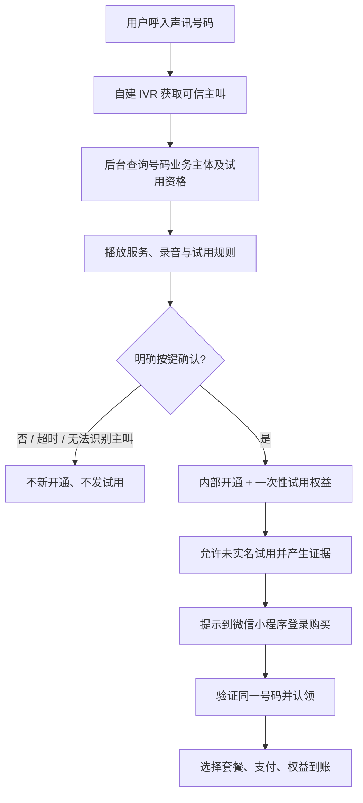

# 业务开通、IVR 试用与精简运营后台

> 当前业务基线：2026-10-20，依据本轮用户明确说明。涉及开通、IVR、实名前置条件和后台范围时，本文优先于 01—08 中旧稿。本文同时作为 `lean-ivr-admin` work unit 的设计和实施计划。

> 当前跨端实施说明：统一演示套餐、状态转换、快照与线下客服口径已在 [10-cross-channel-rules.md](10-cross-channel-rules.md) 建立 S1 可执行基线。S2 运营后台独立员工账号、六主入口和完整套餐/试用界面已实现并接入；小程序、Web 与完整 IVR 分支的 S3 接入仍待实施。本文下方上一 work unit 的实施与验证记录保持历史事实，不表示客户页面已完成同步。

## 1. 已确认目标与边界（Goal confirmation）

- 自建 IVR 部署在运营商机房，业务开通、订购、试用与权益由 ONECALL 后台负责；运营商提供号码、线路和通信承载，不接入运营商订购系统。
- 小程序和 Web 均支持业务开通、套餐订购与支付。IVR 支持呼入、语音告知、按键确认开通和试用，购买引导到微信小程序，不在 IVR 完成支付。
- 用户已明确确认：未完成平台注册实名认证的 IVR 用户可以直接试用并产生录音证据。不能沿用旧稿“未实名一律禁止取证”的全局条件。
- 5 人团队，本期后台聚焦用户管理、开通/试用查询、套餐与试用设置、订单查询。工单、退款、发票保留规划，由线下人工客服支持。
- 成功信号：运营能区分未认领/已认领、未实名/已实名、已开通/已停用、试用/付费；能查 IVR 语音与按键记录、试用证据元数据；能修改套餐新版本及后续试用规则，且历史订单、已发试用、证据归属不被改写。
- 非目标：本轮不开发后端、真实支付、真实 IVR、短信发送、客户小程序/Web UI；不建设工单、退款审批、发票、供应商管理、多级审批、十角色 IAM、原始录音播放或证件查看平台。
- Preflight：基线 `2756a20`，工作分支 `feat/operations-admin-prototype`，工作区干净。本轮用户补充确认为前述业务梳理与精简后台的范围确认，不重复要求批准。

## 2. 系统职责与统一名词

| 系统 | 责任 |
| --- | --- |
| 运营商基础网络 | 机房、号码、线路、呼叫承载和可信主叫等通信事实，具体线路能力由接入验证 |
| 自建 IVR | 接听、播放版本化提示、采集按键、获取线路主叫、调用后台、录音与通话控制、购买提示 |
| ONECALL 后台 | 业务主体、开通、授权记录、试用资格、权益、订单、证据归集和跨端一致性 |
| 小程序 / Web | 登录、验证认领、实名、开通、订购、支付、证据查询；IVR 购买默认引导小程序 |

“业务开通”表示内部服务启用，不表示运营商产品订购。“套餐订购”创建付费订单；“支付成功”和“权益到账”独立。“通信事件”来自自建 IVR/接入线路，不称为运营商业务开通回执。机房部署位置不改变系统所有权。

## 3. 三入口业务路径

### 3.1 小程序 / Web

登录 → 验证号码 / 认领既有业务主体 → 协议确认 → 内部业务开通 → 符合资格则试用，或选择套餐 → 创建订单快照 → 支付 → 服务端确认支付 → 幂等发放权益。

既有小程序实名流程可保留；Web 也能完成开通订购，不能继续标注“仅到小程序开通”。IVR 未实名试用是明确允许的例外，不自动将所有 Web 付费资格规则改成免实名。已开通不等于已购买，已购买不等于可以申请公证书；公证资格继续单独核验。

### 3.2 IVR 首次试用

- 以稳定 `BusinessSubject` 承载号码级业务，不凭主叫伪造微信账户或实名身份。手机号、独立固话保留号码类型；固话不假设可收短信，验证认领沿用主叫挑战等可信方式，购买可从微信搜索小程序进入。
- 语音告知记录提示词版本、试用额度/有效期、服务/录音同意及按键；没有确认不新开通。业务告知与用户试用录音证据是不同对象。
- 试用默认沿用 300 秒累计额度，可分次使用。剩余秒数由后台原子预占，IVR 限时并在耗尽时结束取证通话；按可验证有效录音秒数确认，释放未用预占，不按振铃或菜单时长扣减。
- 未实名状态如实保存；试用录音可固证、形成证据，但不据此证明人员身份或公证资格。正常固证/存证规则继续适用。
- 重复呼入、重复按键、重复事件投递、跨小程序/Web 再开通或认领不重复发试用；试用唯一键绑定号码对应的稳定业务主体与活动，不因登录、删绑、停用、规则版本变化而重置。
- IVR 播报购买指引；可收短信的手机号在符合通知条件时可发送小程序指引，发送失败不撤销开通和录音。不能把“已引导”显示为“已购买”。本原型不真实发送消息。

### 3.3 认领与证据归属

- 小程序登录态不等于持有验证。后端验证同一号码、校验绑定冲突和号码回收等风险后，追加 `SubjectClaim`。
- 认领前：`accountId=null`、`identity=UNVERIFIED`；认领后：有账户关联，实名仍可为未完成，不自动改成已实名。
- 证据始终引用产生时的 `subjectId`、会话、主叫、授权快照及实际采集事实。认领追加访问关联，不迁移或重写证据所有者，不重新发试用。
- 存在其他账户/组织绑定冲突时禁止自动认领，走线下人工核验。禁止仅凭当前可收短信就无条件开放历史证据，尤其对号码回收等风险。
- 原型只展示脱敏证据元数据，不提供录音播放或历史证据的自动授权能力。

## 4. 最小领域契约（后端规划）

| 对象 / 状态 | 权威事实与约束 |
| --- | --- |
| `BusinessSubject` | 稳定主体 ID、号码 HMAC 索引/密文、来源、小程序账户关联、实名状态；手机号不作为公开 ID |
| `ServiceActivation` | `INACTIVE / ACTIVE / SUSPENDED`；后台负责，无运营商订购接口；客服暂停只阻止新使用，保留历史 |
| `ConsentRecord` | 渠道、协议/提示词版本、明确同意事件、IVR 会话/按键和时间；小程序/Web 同意保留快照 |
| `TrialGrant` | `subjectId + campaignId` 唯一；额度、有效期、规则版本在发放时锁定；到期/耗尽不删除证据 |
| `IVRSession` | `RECEIVED / CONFIRMED / ABANDONED / REJECTED`；与业务开通、试用、取证会话分别关联 |
| `SubscriptionOrder` | 来源仅 `MINIAPP / WEB`，商品版本快照；`UNPAID / PAID / CLOSED / UNKNOWN` 支付状态与权益发放状态分开 |
| `SubjectClaim` | 已验证主体、账户、验证依据、冲突检查、追加关联；非实名结果、非证据所有权改写 |

接口职责：IVR 用服务身份接入 `POST /ivr/sessions`、`POST /ivr/sessions/{id}/confirm`；确认事件带会话 ID、事件 ID、提示词版本和明确按键。后台在事务中校验可信主叫/确认/状态，幂等开通与发放试用，断线重试通过事件 ID 查询原结果。小程序/Web 共用业务开通、商品、订单接口；认领必须消费后端验证凭证。支付状态仅由支付侧可信验证推进，不接受 IVR/客户端声明已支付。

这些接口为业务设计，当前仓库仅有本地浏览器原型；没有真实鉴权、存储或支付实现。

## 5. 本期后台与后续规划

| 本期入口 | 主要操作 |
| --- | --- |
| 概览 | 用户、IVR 待认领、试用、付费订单的样例指标，解释口径 |
| 用户管理 | 搜索/来源和状态筛选，主体/账户/实名分列；详情查看号码、授权、试用、证据元数据、订单；暂停/恢复需确认及理由 |
| 业务开通 | 三渠道来源、内部业务结果、同意依据、试用关联，仅查询 |
| IVR 呼入 | 会话列表/详情，语音版本、按键、开通、试用、认领和购买引导链路；不做线路管理 |
| 套餐设置 | 编辑新版本草稿、确认发布、上下架；旧版本及历史订单不变 |
| 试用规则 | 额度、有效天数、启用；发布仅影响后续首次领取，不重发、不补量 |
| 订单查询 | 商品快照、渠道、支付与权益分列；无人工标记支付、退款或发票按钮 |
| 操作记录 | 人员、对象、前后值、理由；无工单前置条件、无复杂审批 |
| 后续规划 | 工单、退款、发票等明确为规划，展示线下客服承接方式 |

本期两类员工权限：管理员负责套餐/试用设置，运营负责用户管理与业务查询。双方只看脱敏信息，不提供原文、证件和播放权限。不是为 5 人团队按岗位创建十套账号体系。

## 6. 实施计划与直接证据

旧原型 `operations-prototype/onecall-operations-admin.html` 的 `roles`/`routeDefs` 有十类角色、55 路由，`CarrierProvisioning`/技术重试围绕外部开通；旧 `qa/qa.js` 以这些流程为验收。需更换当前产品入口和规则，而非隐藏几个菜单。

选择一个行为完整的实施 slice `S1`：把本期后台改为统一业务主体的精简运营台。新增或改动仅限：

- `docs/09-business-activation-and-lean-admin.md`、`docs/README.md`；01—08 顶部标注受本文覆盖的旧规则，保留历史追溯，不改历史评审报告。
- `operations-prototype/onecall-operations-admin.html` 为可独立 file:// 打开的源文件，沿用蓝灰、无渐变的业务工具样式；QA 复制生成 `preview.html`。
- `operations-prototype/qa/qa.js`、`qa/run.ps1`（必要时）、当前版截图、README。
- 本 work unit 的 Gateflow/review artifacts。

不改 `prototype/`、`web-prototype/`、品牌资产或无关文件。Git 旧提交保留完整版设计；原型移除复杂功能入口及可执行代码，旧截图只作为历史记录，当前截图另命名。

### S1 具体决策

13 个业务路由：`/dashboard`、`/users`、`/users/:id`、`/activations`、`/ivr-sessions`、`/ivr-sessions/:id`、`/catalog`、`/catalog/:id`、`/trial-settings`、`/orders`、`/orders/:id`、`/audit`、`/roadmap`。登录和不可用页面不计入业务路由。未列出的旧流程直达链接返回未纳入本期，不产生写操作。

以 fixture 为唯一数据源，列表/详情按 ID 对应，未知对象拒绝。统一确认弹窗冻结操作对象、版本、前后值和理由；执行时重验角色、当前页、对象状态和版本；Esc 取消，焦点回到触发按钮。用户暂停/恢复、套餐发布/上下架、试用规则发布均追加操作记录。

套餐数值严格校验：价格 0.01—99999.99 元、录音 1—100000 分钟、有效期 1—3650 天；版本内容编辑生成草稿，不覆写 ACTIVE 版本；同一商品最多一个在售版本，发布新版本原版本退市，历史订单锁定旧快照。试用 1—3600 秒、1—365 天，沿用默认 300 秒；关闭后不发新试用，既有额度继续按原快照消费。

评审抽屉提供标明“演示”的 IVR 场景：新主叫、重复呼入、未确认、主叫缺失、认领冲突。确认只在明确按键、可信主叫和有效业务条件下开通；演示可用 60 秒形成证据元数据、验证后认领、记录小程序购买引导，均保留稳定主体。不暴露生产凭据，不真实发送短信或处理支付。

### 验证

执行 `powershell -ExecutionPolicy Bypass -File operations-prototype/qa/run.ps1`、`node --check operations-prototype/qa/qa.js`、`git diff --check`；浏览器自动化验证：

1. 13 路由及对象对应；两角色拒绝直接写入与旧复杂流程；未知 ID 不回退到其他对象。
2. IVR 未实名明确同意后开通/发一次试用；无主叫、未确认不发放；重复呼入、重复确认、认领不重发。
3. 未实名试用产生证据；试用耗尽/关闭/暂停拒绝新使用；认领只加账户关联，证据主体和实名状态不变；冲突拒绝。
4. IVR 只有购买引导；订单来源为小程序/Web，支付和权益分开；历史订单不随套餐发布变化。
5. 套餐/试用规则非法输入、取消、重复提交、旧版本提交和低权限提交均不改变状态；后续发放消费新配置，历史试用不改。
6. 用户查询筛选、操作理由、掩码、哈希直达导航、刷新登录、弹窗键盘取消；1024/1280/1440 和 720 CSS 像素不发生页面溢出；关键页面截图人工检查。

### 文档与范围判断

13 页面 + 一个 slice 是能覆盖用户/套餐与必要 IVR 业务闭环的最小增量，不引入真实中台、通用规则引擎、消息投递或财务工作流。所有验证都映射到已确认业务或必要的数据一致性。旧 55 路由验收不再属于本期。

## 7. 风险与交付

- assigned to later work unit：研发负责真实 IVR 服务鉴权、可信主叫、防重放、并发权益预占、主动挂断和持久化事务；当前原型验证产品语义，不证明生产能力。
- assigned to later work unit：产品/安全负责认领验证、号码回收风控和历史证据访问策略；本期不提供证据原文访问，无静默转移。
- assigned to later work unit：运营/财务负责线下工单、退款、发票的实际处理及后续在线建设，原型无执行按钮。
- assigned to later work unit：支付/客户前端负责小程序、Web 的实际登录、开通与支付改版，本轮只更新业务基线和后台。
- existing external-state blocker：仓库无 Git remote，仍完成所有本地实现/审查/提交；到 push gate 如仍无远端，记录阻断，不宣称 PR/final closeout pass。

无阻塞性业务问题。交付报告包含原型与业务文档链接、验证结果、提交及远端限制。下一 gate：plan review。
