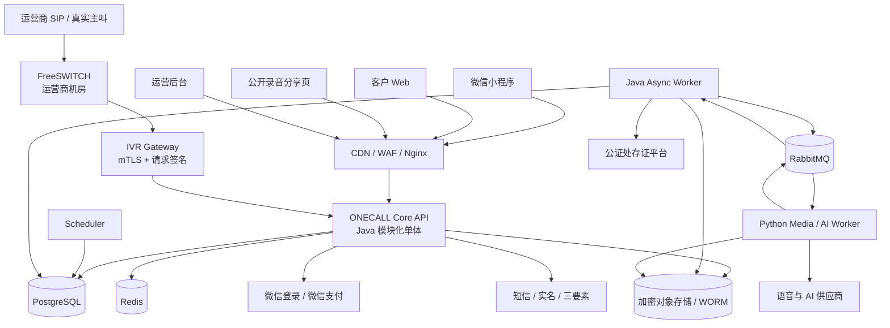
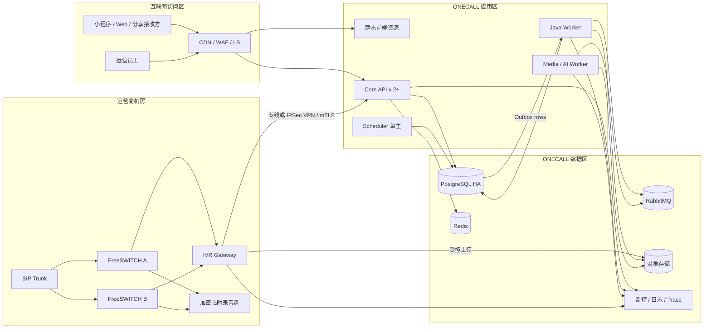

# 一通话 ONECALL 技术栈与系统架构设计

> 状态：技术评审稿
>
> 版本：v1.0
>
> 基线日期：2026-10-21
>
> 适用范围：微信小程序、客户 Web、公开录音分享页、运营后台、自建 IVR、业务服务端、媒体与 AI、数据和基础设施

本文把当前产品规则落实为生产目标架构。业务真源仍以 [09 当前业务基线](09-business-activation-and-lean-admin.md)、[10 跨端规则](10-cross-channel-rules.md) 和 [11 账号体系](11-account-identity-and-workspaces.md) 为准；领域状态机和公证集成细节继续参考 [03 技术方案](03-technical-solution.md) 与 [05 公证处集成](05-yuzhang-notary-integration.md)。发生冲突时，09 至 12 的当前业务基线优先于旧的运营商订购设计。

## 1. 架构结论

### 1.1 已确定的业务事实

- 运营商只提供 SIP/线路、真实主叫和机房部署条件，不提供 ONECALL 业务订购系统。
- 自建 IVR 负责录音告知、按键确认、通话媒体控制和录音采集；业务开通、试用、订单、支付与权益由 ONECALL 后台负责。
- 未注册、未实名认证的 IVR 呼入用户可以按键开通一次性试用并形成录音证据；实名认证和公证资格另行核验。
- 小程序和客户 Web 可以开通及购买；IVR 只能提示用户到微信小程序登录购买，不形成支付闭环。
- 自然人账户、登录身份、企业成员关系、业务主体/号码和运营员工账号相互独立。
- 套餐按不可变版本发布；下架只停止新购，历史订单与权益继续读取购买时快照。
- 工单、退款、发票本期由线下客服承接，系统只提供统一入口、联系方式和处理说明。

### 1.2 推荐的首发形态

采用“模块化单体 + 独立异步 Worker + 独立 IVR 媒体节点”：

- 核心业务使用一套 Java 代码库和一个 PostgreSQL 事务边界，避免分布式事务。
- API、异步 Worker 和 Scheduler 可独立进程部署，但来自同一版本产物和领域模型。
- FreeSWITCH 部署在运营商机房，只执行 SIP/RTP、DTMF、提示音、录音和挂断。
- Python Worker 只处理 FFmpeg、语音转写和 AI 供应商适配，不直接写订单、权益或证据生命周期状态。
- 前端按信任边界分为小程序、客户 Web、公开分享页和运营后台，不能共用登录会话。
- 首发可部署在加固虚拟机或托管容器服务；Kubernetes 不是上线前提。

### 1.3 状态标记

| 标记 | 含义 |
| --- | --- |
| 已确定 | 已被当前产品基线锁定，研发不得自行改变 |
| 推荐 | 本文给出的首发工程选型，进入实现前锁定具体依赖版本 |
| 待确认 | 依赖供应商、法务、安全、容量或生产运维数据 |

## 2. 技术栈

| 层级 | 推荐技术 | 选择理由 | 状态 |
| --- | --- | --- | --- |
| 微信小程序 | 原生微信小程序、TypeScript、原生组件、自有设计令牌、`miniprogram-ci` | 电话、微信登录、手机号授权、文件选择等平台能力最直接，减少跨端框架兼容层 | 推荐 |
| 客户 Web / 分享页 | Vue 3、TypeScript、Vite、Vue Router、Pinia、TanStack Query for Vue | 适合表单、工作台、播放器和响应式公开页；服务端状态与本地 UI 状态分离 | 推荐 |
| 运营后台 | Vue 3、TypeScript、Vite、Vue Router、Pinia、Element Plus | 以表格、筛选、表单和审计为主，组件成熟，团队学习与维护成本低 | 推荐 |
| API 契约 | REST/JSON、OpenAPI 3.1、生成 TypeScript Client、RFC 9457 Problem Details | 避免三端手写并漂移接口类型；统一错误语义 | 推荐 |
| 核心服务端 | Java 21 LTS、Spring Boot 3.x、Spring Modulith、Spring Security、Bean Validation | 单事务核心、清晰模块边界、成熟安全与运维生态 | 推荐 |
| 数据访问与迁移 | jOOQ、Flyway、HikariCP | SQL 和事务行为显式；Schema 与代码可审查；迁移可追踪 | 推荐 |
| IVR 媒体层 | FreeSWITCH、SIP/RTP、ESL、录音提示音资源、Java IVR Gateway | 支持 DTMF、录音、限时和主动挂断；与业务状态解耦 | 推荐，线路能力待确认 |
| 媒体/AI Worker | Python 3.12、FFmpeg、供应商 SDK 适配器 | 音频工具和 AI 生态成熟；限制为任务执行器 | 推荐 |
| 事务数据库 | PostgreSQL 16+，主备高可用、PITR | 订单、权益、证据元数据、审计和幂等记录需要强一致事务 | 推荐 |
| 短期状态 | Redis 7+ | 会话、OTP、限流、短期播放会话和热点缓存；不作为业务真源 | 推荐 |
| 异步消息 | RabbitMQ、事务 Outbox、DLQ | 证据处理、AI、公证、支付后续动作需要可靠异步交付 | 推荐 |
| 媒体存储 | 境内 S3 兼容对象存储、服务端加密、版本控制、WORM/对象锁 | 原始录音与证据字节不进入数据库，固证对象需防覆盖 | 已确定能力，产品待选型 |
| 边缘入口 | CDN/WAF、Nginx 或云负载均衡、TLS 1.2+ | 静态资源、接口限流、域名与证书入口；首期不另建复杂 API Gateway | 推荐 |
| 可观测性 | OpenTelemetry、Micrometer、Prometheus、Grafana、Loki、Tempo/Jaeger、Alertmanager | 指标、日志和 Trace 使用统一关联 ID；可替换为等价托管产品 | 推荐 |
| 交付 | Git、Maven、pnpm、Docker、CI Pipeline、SBOM、依赖与镜像扫描 | 可重复构建、测试、审计和回滚 | 推荐 |

所有 `3.x`、`16+` 之类版本表示兼容家族，不表示允许自动漂移。进入实现时应在父 POM、锁文件和镜像清单中固定经过安全评审的补丁版本。

## 3. 逻辑架构

关键约束：

1. 客户端、运营后台和 IVR 都不能直接访问 PostgreSQL、Redis、RabbitMQ 或永久对象地址。
2. FreeSWITCH 不保存业务开通、试用、订单或权益真源，只缓存当前通话所需的授权结果和限时参数。
3. 外部供应商响应先由适配层验证和规范化，再进入领域模块；供应商错误码不能成为内部状态枚举。
4. 媒体/AI Worker 只能提交任务结果，证据模块验证输入和当前版本后推进状态。
5. 所有持久化业务元数据以 PostgreSQL 为准，媒体字节以对象存储的锁定版本为准；Redis 丢失不能导致试用重发、重复权益或分享撤销失效。

## 4. 部署与网络拓扑

网络策略：

- 运营商机房到应用区只开放 IVR API 和受控对象上传出口，不开放数据库和消息队列。
- IVR Gateway 使用双向 TLS、独立服务身份、请求时间戳、Nonce 和 HMAC/签名防重放；证书支持轮换。
- 运营后台使用独立域名和 Cookie/Token 作用域；生产建议叠加企业 VPN、IP 白名单或 MFA。
- 对象上传先向证据模块申请单次、限对象键、限大小、短时有效的上传凭证；上传完成后服务端重新计算哈希。
- FreeSWITCH 本地临时盘只用于网络中断缓冲，加密、限额、过期擦除并监控水位；它不是长期证据库。
- 生产数据、日志、备份和对象存储部署在中国大陆境内，具体云厂商、地域和同城容灾待确认。

## 5. 部署单元

| 单元 | 主要职责 | 扩缩容方式 |
| --- | --- | --- |
| `customer-web` | 客户 Web 静态资源 | CDN 缓存，按资源版本发布 |
| `public-share-web` | 不带客户会话的公开收听页面 | 独立构建与 CSP，CDN 缓存静态资源 |
| `operations-web` | 运营后台静态资源 | 独立域名和发布权限 |
| `core-api` | 客户、运营、IVR、公开分享和回调 API；领域事务 | 无状态多副本，数据库协调并发 |
| `async-worker` | Outbox 投递、支付后续、证据、公证、通知任务 | 按队列积压横向扩容 |
| `scheduler` | 权益分期、过期、补偿扫描和对账触发 | 单主加租约，任务本身幂等 |
| `media-ai-worker` | 转码、波形、转写、摘要和派生文件 | 按 CPU/GPU/供应商限流独立扩容 |
| `ivr-switch` | SIP/RTP、提示音、DTMF、录音、限时、挂断 | 至少双节点，线路侧健康路由 |
| `ivr-gateway` | 将通话事件映射为版本化 ONECALL IVR 协议 | 与 FreeSWITCH 同机房部署，可双实例 |

`core-api`、`async-worker` 和 `scheduler` 来自同一 Java 多模块仓库，但启动 Profile 和资源配置不同。这样既复用领域规则，又能让耗时任务不占用在线请求线程。

## 6. 核心模块与依赖规则

| 模块 | 持有的业务真源 | 允许依赖 |
| --- | --- | --- |
| `customer-iam` | `Account`、`LoginIdentity`、客户会话、实名档案 | 基础安全与供应商接口 |
| `organization-access` | `Organization`、`OrganizationMembership`、成员角色 | `customer-iam` 的稳定账户 ID |
| `operations-iam` | `EmployeeAccount`、固定员工角色、员工会话 | 审计接口，不依赖客户登录身份 |
| `subject-number` | `BusinessSubject`、号码绑定、认领与风险状态 | 账户 ID 可空；号码验证适配器 |
| `activation-consent` | 同意快照、内部 `ServiceActivation`、状态迁移 | `subject-number` |
| `ivr` | IVR 会话、提示词版本、DTMF 确认、购买引导 | 主体、开通、试用、证据应用接口 |
| `catalog-order` | 商品版本、目录发布、订单与支付状态 | 账户/主体稳定 ID、支付适配器 |
| `entitlement-metering` | 试用、权益、预占、扣量和不可变用量流水 | 商品/订单快照、主体稳定 ID |
| `evidence` | 采集会话、证据元数据、对象清单、哈希与固证状态 | 权益应用接口、对象存储适配器 |
| `sharing` | 分享授权、播放会话、访问事件 | 证据只读投影、媒体授权接口 |
| `ai-orchestration` | AI 任务、转写/摘要版本、引用 | 证据只读版本、权益应用接口 |
| `notary` | 存证请求、回执、报告任务 | 证据不可变快照、供应商适配器 |
| `operations-audit` | 员工操作与关键系统事件的追加审计 | 接收各模块审计事件 |

依赖规则：

- 模块不能直接更新其他模块拥有的表；同步调用走公开应用服务，异步协作走领域事件。
- 跨模块查询优先使用只读投影或明确的查询接口，禁止为页面方便绕过所有权边界写联表业务逻辑。
- 核心领域不能依赖 FreeSWITCH、微信、AI 或公证供应商 SDK；SDK 只能出现在 adapter 层。
- 前端显示状态不能反向成为服务端业务事实，原型中的本地 hook 不进入生产构建。
- 首期不按模块拆独立数据库；未来拆服务时按现有所有权边界迁移，不能共享写表。

## 7. 账号与权限架构

### 7.1 五类身份对象

| 对象 | 用途 | 登录权 |
| --- | --- | --- |
| `Account` | 自然人客户账户 | 通过其有效 `LoginIdentity` 登录 |
| `LoginIdentity` | 微信主体或已登记登录手机号 | 有，唯一绑定一个自然人账户 |
| `OrganizationMembership` | 自然人在某企业的成员资格与角色 | 无独立登录权，登录后派生工作空间权限 |
| `BusinessSubject` / `CallerNumberBinding` | IVR、手机号或独立固话业务归属 | 无；号码开通或认领不会自动变成登录账号 |
| `EmployeeAccount` | ONECALL 运营员工 | 使用独立员工认证域，不与客户账户复用 |

### 7.2 角色策略

- 运营后台首期只有固定 `ADMIN`、`OPS` 两个角色，不建设自定义角色编辑器。
- 企业客户角色首期固定为企业管理员、普通成员、证据管理员、审计员，由成员关系派生。
- 权限由服务端逐请求校验；前端菜单、按钮隐藏和工作空间筛选不是安全边界。
- 资源须显式归属个人账户或企业组织；企业访问同时检查组织/成员状态、角色和资源归属，不能用原型的简化 `accountId` 推导组织所有权。认领只追加已验证关联，不隐式迁移个人或企业资源；归属不明确时拒绝访问，详细模型在后续 Schema 设计中锁定。
- 最后一个启用运营管理员不可停用或降级；角色变更、停用和凭据重置撤销现有会话。
- 运营人员默认只能查看业务元数据，不因后台身份自动获得原始录音播放权。

## 8. API 与信任边界

| API 面 | 示例前缀 | 认证与限制 |
| --- | --- | --- |
| 客户 API | `/api/v1/customer/**` | 微信登录或手机号 OTP 建立的客户会话；服务端解析账户和工作空间 |
| 运营 API | `/api/v1/operations/**` | 独立员工会话、固定 RBAC、敏感操作理由与审计 |
| IVR API | `/api/v1/ivr/**` | mTLS 服务身份、签名、防重放、线路和节点白名单 |
| 公开分享 API | `/api/v1/public/shares/**` | 不可猜测能力令牌；按分享验证方式建立短期播放会话 |
| 回调 API | `/api/v1/callbacks/**` | 供应商签名/证书、时间窗、防重放、原始回调留档 |

统一契约：

- 写请求携带 `Idempotency-Key` 或领域事件 ID；服务端保存请求指纹和首次结果。
- 金额使用人民币分整数；时间使用 UTC `Instant` 保存，展示层转用户时区。
- 分页使用稳定排序和 Cursor；大列表不返回总量时必须明确。
- 错误响应使用稳定业务码、用户可理解信息和 `traceId`，不泄漏供应商响应或内部堆栈。
- 客户端不能提交可信金额、账户 ID、成员角色、成功支付状态或证据固证状态。
- API 版本与 IVR 协议版本独立演进；破坏性变更先兼容部署再切换调用方。

## 9. 关键业务链路

### 9.1 IVR 未注册用户开通、试用和录音

1. 运营商线路把真实主叫和 IVR 会话交给 FreeSWITCH。
2. IVR Gateway 生成跨节点唯一的 `callId`，连同 `nodeId` 作为幂等身份向后台创建会话；后台标准化号码并查找或创建稳定 `BusinessSubject`。
3. FreeSWITCH 播放版本化录音告知。只有可信主叫且按键 `1` 才提交确认。
4. 后台在一个事务内追加同意快照、内部 `ServiceActivation`，并按 `(subjectId, FIRST_TRIAL)` 唯一键创建或复用一次性试用。
5. 后台按 `callId` 在事务内原子创建 `UsageReservation`，预占本次授权秒数并返回额度、预占 ID 和截止时间。活动预占从可用余额扣除，不能由并发呼入重复使用；同一个 `callId` 重放返回首次结果。余额不足、预占冲突或后台不可用时，新会话失败关闭。
6. FreeSWITCH 只按预占秒数录音，到限主动挂断。结束事件携带权威时长、结束原因、预占 ID 和媒体摘要；后台按 `callId` 幂等结算实际使用量，并释放未用额度。重复结束事件返回首次结算；相同事件 ID 的冲突输入进入审计和人工核查，不重复扣量。
7. 未收到结束事件的预占在截止时间后由幂等恢复任务核查通话终态和权威用量；确认结束后仍须先结算已用秒数，再释放未用额度，不能因通话已清除就全额释放。无法取得权威用量的预占保持占用并告警，避免重复授权或漏计已用权益。结算或释放终态保留记录，迟到事件不能重复扣量或再次释放；差异走可审计的调账流程。
8. 录音先进入受控对象键，校验大小、格式和 SHA-256 后形成不可覆盖原始对象及证据元数据。
9. IVR 可播放“请登录微信小程序购买”的提示，但不能创建订单、声明支付成功或发送不存在的短信。

网络中断时，FreeSWITCH 可在已取得的本次预占额度内完成当前录音并加密暂存；不得离线创建新预占、新开通或重发试用。恢复后以原 `callId` 重传媒体和结束事件。预占有效窗口应覆盖已授权通话上限及允许的时钟偏差；窗口过期后节点不得继续录音。

### 9.2 登录后认领 IVR 主体

1. 用户先通过微信或已登记登录手机号进入自然人账户。
2. 用户对原 IVR 号码完成手机号短信/微信持有验证或固话主叫挑战。
3. 后台先检查号码冲突、回收风险和同账户重复请求，再追加 `SubjectClaim` 并关联账户。
4. 认领不修改原试用发放、证据主体、录音时实名状态或同意快照，也不新增登录身份。
5. 冲突或号码回收风险只进入线下人工核验，不向新账户开放历史证据。

### 9.3 小程序/Web 购买与权益到账

1. 客户端读取当前 `CatalogRelease`，展示服务端返回的版本、渠道、价格、权益和版本令牌。
2. 创建订单时服务端重新校验账户、工作空间与主体访问权、普通客户端的实名条件、明确购买同意、当前业务开通状态及精确在售版本/渠道，计算金额并冻结完整商品快照。企业咨询报价不进入个人自助支付，未确认续购叠加、抵扣或自动续费规则前不能自行实现。
3. 微信支付参数由服务端生成；客户端支付结果只用于提示，不能推进订单。
4. 微信支付回调验签并按支付事件幂等推进 `PaymentOrder`；不确定结果主动查询原商户订单。
5. 支付成功写入 Outbox，由权益模块按订单快照幂等发放；订单支付成功与权益到账是两个可观测状态。
6. 套餐下架或发布新版本不影响历史订单和已发权益。IVR 无此链路，只提供购买引导。

### 9.4 录音分享和免验证直听

1. 有录音访问权的用户创建 `EvidenceShareGrant`，冻结内容范围、验证方式、有效期、访问上限和下载权限。
2. 服务端生成至少 128 位随机能力令牌，只保存不可逆摘要；公开 URL 不包含对象存储键或证据内部 ID。
3. 接收方打开公开分享页。服务端检查有效期、撤销世代和验证策略；验证成功后，在同一事务内检查次数、占用一次准入并创建播放会话。仅打开验证页、验证失败或链接预取不计数，重复提交同一次准入返回原会话。
4. `NONE` 模式直接创建短期播放会话；提取码、指定手机号和企业成员模式分别完成对应验证。免验证意味着持链者可听，不代表访问者身份已核验。
5. 成功准入只计数一次；达到次数上限后只阻止新准入，最后一次已获准的会话仍可在会话及分享有效期内播放、定位和续签，不提升撤销世代。播放会话失效后重新准入须再次检查并计数。
6. 撤销、过期或换码使原播放会话失效，后续媒体请求/续签须校验分享当前有效期和撤销世代。使用鉴权媒体网关或短时分片凭证，不返回永久原始地址；已缓冲或已签发且尚未过期的媒体不能远程收回，凭证有效期限定撤销生效窗口。访问事件追加审计。

### 9.5 证据、AI 与公证处存证

1. 证据模块先完成接收、恶意文件检查、哈希和内部固证，再发布 `EvidenceSolidified` 事件。
2. AI 与公证 Worker 分别消费事件；失败、重试和供应商限流不能回滚原始证据。
3. AI 输出形成新版本并引用原录音时间范围，不覆盖旧逐字稿或原始证据。
4. 公证处存证只有在验签成功并取得权威 `recordNo` 后显示完成；存证验证报告不等于公证书。
5. 线下公证书、退款、发票和客服工单本期不建在线流转状态机。

## 10. 数据与一致性设计

### 10.1 真源分配

| 数据 | 真源 | 备注 |
| --- | --- | --- |
| 账户、登录身份、成员、员工 | PostgreSQL | 敏感字段加密，检索使用 HMAC 索引 |
| 业务主体、开通、同意、认领 | PostgreSQL | 关键事实追加记录，状态带修订号 |
| 套餐、订单、支付、权益、用量 | PostgreSQL | 商品和订单快照不可覆盖 |
| 证据元数据、哈希、处理链 | PostgreSQL | 对象字节不入库 |
| 原始录音、证据和派生文件 | 对象存储 | 原始对象版本锁定/WORM；数据库保存对象版本与哈希 |
| 会话、OTP、限流、短期播放票据 | Redis | 可重建或短期数据，不承担永久授权事实 |
| 异步消息 | PostgreSQL Outbox + RabbitMQ | MQ 至少一次投递，消费者必须幂等 |
| 审计 | PostgreSQL 追加流水，日志平台留检索副本 | 日志副本不能替代审计真源 |

### 10.2 事务与异步规则

- 单个领域动作在一个 PostgreSQL 本地事务内提交状态、唯一约束和 Outbox，不使用跨系统两阶段提交。
- 消息为至少一次投递；消费者以 `(domain, eventId)` 和规范化请求指纹去重。
- 试用唯一键为 `(subject_id, campaign_id)`；录音额度预占按 `callId` 唯一且预占只能终结一次；权益发放按订单/期次/权益类型唯一；支付回调按供应商交易和事件唯一。
- 共享额度和访问次数使用行锁、条件更新或乐观修订，不能“先读后写”无并发保护。
- Scheduler 使用数据库租约或等价单主机制，但每个到期/分期任务仍须幂等。
- 外部调用记录请求摘要、供应商关联 ID、尝试次数和结果分类；超时是未知结果，不直接当失败重做副作用。
- DLQ 进入运营告警和人工补偿清单，补偿动作必须有原事件关联和审计理由。

### 10.3 数据生命周期

- 原始证据、授权同意、订单快照、权益和审计不得通过普通后台操作物理删除。
- 已下架套餐保留；只有从未发布且未被任何对象引用的草稿可在未来设计删除能力。
- 公开分享撤销删除的是后续访问能力，不删除原证据。
- 保存期限、用户删除权、法定留存和备份擦除策略必须由法务与安全单独批准。

## 11. 安全设计

### 11.1 身份、凭据与权限

- 微信 `openid/unionid`、手机号、证件号和完整主叫号码不得作为公共业务主键。
- 原值使用 KMS 信封加密；精确检索使用带独立密钥的 HMAC 索引，不能使用普通 SHA-256 枚举手机号。
- 客户、运营员工、IVR 服务和供应商回调使用不同认证域、密钥和 Token Audience。
- OTP、提取码和重置码不落普通日志；提取码使用带盐慢哈希/KDF并绑定分享与轮换世代。
- 高风险后台操作要求二次确认、操作理由、前后快照和员工身份审计；生产建议增加 MFA。

### 11.2 媒体与证据

- Bucket 默认私有，禁止公开读；所有上传/下载使用短时、限操作、限对象的签名凭证。
- 上传后以服务端计算的哈希、MIME 嗅探、大小/时长和恶意文件检查为准，不信任扩展名与客户端哈希。
- 原始对象与预览、转码、逐字稿、摘要分开对象类型和权限；派生结果不能覆盖原始对象。
- 日志只记录对象 ID、哈希前缀和脱敏号码，不记录永久 URL、完整身份或音频内容。

### 11.3 外部接口

- 微信支付、实名、公证、AI 回调必须验签、校验时间窗和防重放；原始报文加密留档并控制访问。
- 对供应商设置超时、并发隔离、熔断和重试预算；业务状态使用内部错误分类。
- 出站域名、IP、证书和凭据纳入配置清单；密钥通过 Secret Manager/KMS 注入，不写入代码和镜像。
- IVR 管理接口与 SIP 媒体网络分区；FreeSWITCH 管理端口不暴露公网。

## 12. 可观测性与运营

每次跨端操作使用统一 `traceId`，业务对象补充 `accountId`、`subjectId`、`callId`、`orderId`、`evidenceId` 或 `shareId` 的脱敏关联字段。

核心指标：

- IVR：呼入量、应答率、DTMF 确认率、主叫缺失、授权失败、录音上传延迟、本地缓冲水位、主动挂断误差。
- 交易：订单创建、支付 UNKNOWN、回调验签失败、权益待发放时长、幂等冲突。
- 证据：上传失败、哈希不一致、固证耗时、对象存储错误、WORM 写入失败。
- 分享：准入成功/拒绝、提取码锁定、过期/撤销拦截、播放凭证签发与异常下载。
- 异步：Outbox 未投递、队列积压、重试、DLQ、任务最长等待时间。
- 外部依赖：调用量、成功率、P95/P99、超时、限流和回调延迟。

告警必须指向 Runbook，至少区分“用户不可继续”“任务延迟但事实安全”“供应商未知结果”“证据完整性风险”。普通应用日志不能代替业务审计。

## 13. 降级、恢复与灾备

| 故障 | 首发行为 |
| --- | --- |
| Redis 不可用 | 登录/OTP/新分享播放会话失败关闭；永久业务状态仍可从 PostgreSQL恢复，不降级为绕过验证 |
| RabbitMQ 不可用 | Core API/Scheduler 仍只提交 PostgreSQL 与 Outbox；异步任务延迟，Worker 恢复后继续投递，不允许业务请求绕过 Outbox 直接发布 |
| 对象存储不可用 | 禁止确认新证据已固化；IVR 已授权通话可短时加密缓冲，水位超限后停止新录音 |
| AI/公证供应商不可用 | 原始证据保持有效，任务进入可重试/人工处理，不伪造成功 |
| 微信支付回调超时 | 保持 UNKNOWN/PENDING 并查询原订单，不创建第二订单或重复发权益 |
| 应用区与机房断网 | 已取得授权的当前通话按上限完成并缓冲；新开通与新试用失败关闭 |
| 单个 FreeSWITCH 节点故障 | SIP 线路切换到健康节点；用 `callId` 幂等对齐重试事件 |

生产需要 PostgreSQL 主备、连续归档和定期恢复演练；对象存储启用跨可用区冗余与版本保护。RPO、RTO、SLO、备份保存时间和异地灾备等级为待确认项，不能由研发自行承诺。

## 14. 测试与交付

### 14.1 测试栈

| 范围 | 推荐工具与重点 |
| --- | --- |
| Java 单元/模块 | JUnit 5、AssertJ、Spring Modulith Tests，验证模块依赖和状态机 |
| 数据与集成 | Testcontainers PostgreSQL/Redis/RabbitMQ、Flyway 迁移与并发唯一约束 |
| 外部契约 | WireMock、供应商沙箱、录制的脱敏契约样例，覆盖超时/重复/乱序/验签失败 |
| Web/后台 | Vitest、Vue Test Utils、Playwright，覆盖权限拒绝、响应式和跨页面流程 |
| 小程序 | TypeScript 检查、组件测试、`miniprogram-automator` 与真实微信设备回归 |
| IVR | SIPp、FreeSWITCH 集成环境、真实线路沙箱，覆盖 DTMF、主叫缺失、断线、限时与重传 |
| 媒体/AI | 固定音频语料、FFmpeg 输出哈希/时长、供应商结果 Schema 与版本回归 |
| 安全 | SAST/SCA、SBOM、镜像扫描、API 越权、对象 URL、回调重放和渗透测试 |

### 14.2 CI/CD 门禁

1. 格式、静态检查、单元测试和模块依赖测试。
2. 数据迁移、集成测试、OpenAPI 兼容性和前端生成 Client 漂移检查。
3. 镜像构建、SBOM、依赖/镜像漏洞和密钥扫描。
4. 测试环境部署，运行 API、Playwright、小程序和 IVR 契约回归。
5. 数据库迁移采用向后兼容的 Expand/Contract；先升级服务端兼容，再切客户端/IVR，最后清理旧字段。
6. 生产使用不可变镜像和配置版本；回滚应用不能回滚已提交数据，必须有迁移兼容窗口。

当前仓库中的 HTML 原型和 `shared/onecall-business.js` 是产品规则演示与 QA 资产，不是生产前端、后端 SDK 或数据库迁移起点。

## 15. 首发实施顺序

### Phase A：平台基础

- 建立 Java 模块化单体、PostgreSQL/Flyway、Outbox、审计、OpenAPI 和四个认证边界。
- 实现账户/登录身份、员工账号、企业成员、业务主体、号码、同意和内部开通。
- 建立对象存储、KMS、日志/指标/Trace 和 CI/CD 基线。

### Phase B：IVR 试用与证据闭环

- FreeSWITCH 与 IVR Gateway，版本化提示音、DTMF、服务鉴权、幂等和限时挂断。
- 一次性试用、录音扣量、断网缓冲、录音上传、哈希和证据固化。
- 真实线路测试未通过前，不开放生产未实名 IVR 试用。

### Phase C：客户购买与录音分享

- 小程序/Web 登录、目录、订单、微信支付、权益发放与历史快照。
- 公开分享页、免验证/提取码/指定手机号/成员验证、短期媒体凭证和访问审计。
- 精简运营后台接入真实员工认证和服务端权限。

### Phase D：AI、公证与生产准备

- 媒体/AI Worker、转写与摘要版本、引用定位。
- 公证处哈希存证、报告任务、供应商对账。
- 容量、灾备、安全、法务、Runbook、灰度和回滚演练。

阶段可以迭代交付，但任一页面不得以静态成功状态替代尚未接通的生产能力。

## 16. 演进与拆分触发条件

以下条件出现前不拆微服务：

- 某模块需要独立发布频率或权限隔离，模块化单体已成为团队交付阻塞。
- 某类 Worker 的 CPU/GPU、吞吐或供应商限流需要独立扩缩容。
- PostgreSQL 单库已通过索引、分区、读副本和归档仍不能满足批准的 SLO。
- 某故障域需要独立可用性，且拆分后的消息一致性、运维和数据迁移成本已有负责人。

优先演进顺序通常是媒体/AI Worker、公证集成和只读查询，而不是账户、订单、权益和用量事务。需要全文检索时先验证 PostgreSQL 索引能力；只有数据量和查询 SLO 有证据时再引入 OpenSearch。需要 Kubernetes 时应以多环境部署数量、自动扩缩容和运维能力为依据，而不是作为架构完成度标志。

## 17. 待确认项与明确排除

### 17.1 待确认

- SIP Trunk、号码规范、真实主叫字段、并发线路、机房网络、主备路由和录音合法提示词。
- FreeSWITCH 版本、操作系统基线、硬件/虚拟化、录音格式与本地缓冲容量。
- 云厂商、境内地域、对象锁/WORM、KMS、数据库高可用和异地灾备产品。
- 微信主体、商户号、短信、实名/三要素、AI、公证处接口、费用、SLA 和数据处理协议。
- 峰值呼入并发、平均录音时长、日新增证据、分享播放流量、AI 任务量和保存年限。
- 生产 SLO、RPO/RTO、告警阈值、值班和客服联系方式。

### 17.2 本期明确排除

- 运营商侧业务订购/退订系统集成。
- IVR 内支付、短信闭环或未确认按键自动开通。
- 企业总机、PBX、分机归属、统一外呼号拆分和坐席 PIN。
- 自定义运营角色设计器；首期使用固定管理员/运营人员角色。
- 在线工单、退款审批、发票流转和自动公证书办理。
- 上线即微服务化、服务网格、多数据库分片或强制 Kubernetes。

## 18. 下一步设计输入

完成本文评审后，建议按以下顺序形成可编码规格：

1. 数据模型与 Flyway 初始 Schema：先账号/主体/开通/试用/目录/订单/证据/幂等/Outbox。
2. OpenAPI：分别输出客户、运营、IVR、公开分享和回调契约。
3. IVR 协议：会话、确认、额度、心跳、结束、媒体上传、重试和错误码。
4. 安全设计：密钥层级、字段加密/HMAC、服务身份、对象存储策略和审计访问。
5. 容量与部署规格：用批准的线路并发和数据保存期计算节点、带宽、存储与备份。
6. 生产验收矩阵：把每条关键状态机映射到正常、重复、超时、乱序、恢复和权限拒绝场景。
