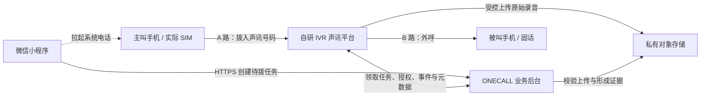
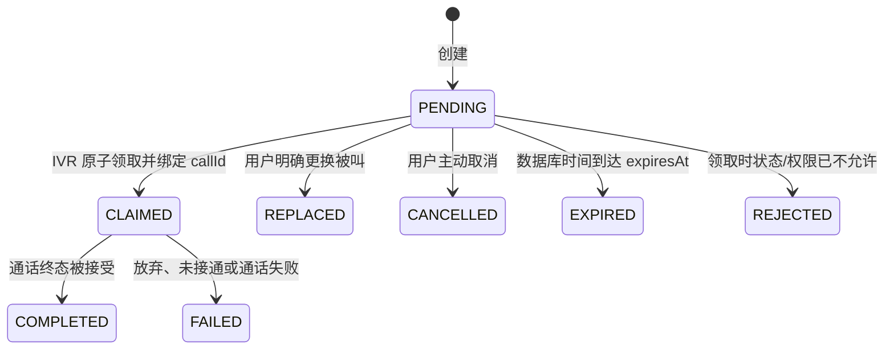

# 自研 IVR 呼叫任务与呼入决策设计

> 状态：技术评审稿
> 版本：v1.0
> 基线日期：2026-10-21
> 适用范围：微信小程序拨号、自研 IVR 声讯平台、ONECALL 业务后台

本文落实“小程序提交待拨任务，手机拨入声讯号码，自研 IVR 外呼被叫并桥接录音”的方案。IVR 已具备接听、外呼、双向桥接、录音、限时挂断、通话记录与时长采集以及向业务系统上传的完整能力；本设计只定义业务系统与现有 IVR 的协作契约，不要求重建 IVR 媒体能力。总体技术栈与部署边界见 [12](12-technology-stack-and-system-architecture.md)，账号、业务号码和工作空间规则见 [11](11-account-identity-and-workspaces.md)。

## 1. 设计结论

1. 小程序只创建待拨任务并拉起系统电话，不承载通话媒体，也不判断接通、时长或录音成功。
2. 同一个规范主叫号码全局最多存在一条非终态待拨任务。本期不是多条 FIFO 队列，而是“单槽待拨任务”：只有一条当前可领取记录；过期、被替换和完成记录保留审计事实，不物理覆盖。
3. 待拨任务有效期默认 `30` 秒，由服务端配置，并在创建时冻结 `ttlSeconds` 与 `expiresAt`。配置变更只影响之后创建的任务。
4. IVR 使用独立的呼入决策接口，一次获得主叫业务状态、当前可用录音秒数和待拨任务结果。有资格执行的任务在同一数据库事务内被领取并绑定 `callId`，不能采用“先查任务、稍后再改状态”。
5. 对符合权限、开通和权益条件的待拨任务，首次呼入的 `resolve` 在同一事务内完成任务领取、权益预占和外呼授权，并返回冻结的被叫号码；IVR 不要求主叫确认被叫号码，按授权自动外呼。被叫接通后，IVR 将 A 路主叫与 B 路被叫接入同一双向媒体桥并录音；这是一个由 IVR 提供桥接/录音的三方通话会话，不另拨第三方参与人。
6. IVR 是实际通话、桥接、录音及权威通信时间点的事实来源；业务后台是账户权限、业务开通、任务、权益、扣量和证据状态的事实来源。
7. 小程序拨号接口成功只表示系统拨号能力已被调用，不表示用户拨出、IVR 接听、被叫接通或录音成功。小程序回到前台后查询服务端状态。

## 2. 系统职责与完整链路



| 参与方 | 拥有的事实与动作 |
| --- | --- |
| 小程序 | 当前登录人与工作空间选择、业务号码与被叫输入、创建/替换/取消待拨任务、展示倒计时与服务端结果、拉起系统拨号 |
| 手机与运营商线路 | 用户实际选用的 SIM、A 路呼入、线路传递的实际主叫与接续事实 |
| 自研 IVR | `callId`、A/B 路呼叫、语音与 DTMF、桥接、录音、限时挂断、通话事件、权威时长、录音与记录上传 |
| ONECALL 后台 | 号码标准化与业务主体、开通/停用、待拨任务、工作空间访问权、试用/付费权益、预占结算、证据接收与审计 |

运营商仍只提供机房、号码、线路和通信承载。自研 IVR 的内部媒体引擎维持现有实现，本方案只增加版本化业务接口和必要的任务/事件关联，不要求替换现有平台。

## 3. 主叫号码、账户与信任边界

- 小程序登录手机号、用户选择的业务号码和实际拨出 SIM 可能不同。任务请求只提交有权使用的 `callerBindingId`；后台从当前登录会话、工作空间和绑定记录解析真实业务归属，客户端不能直接声明 `accountId`、`organizationId` 或权益。
- IVR 请求中的实际主叫号码只接受可信接入线路产生、经自研 IVR 规范化传递的事实，不能采用小程序在任务中填写的号码代替。双卡设备的实际主叫与预期号码不一致时，不领取任务、不外呼、不录音取证。
- 任务冻结发起账户、工作空间、业务主体和主叫绑定。任务领取后、权益预占前仍重新校验主体未停用、发起人仍有当前空间访问权；权限撤销不能由旧任务绕过。
- 未注册、未完成平台注册或未实名的直接 IVR 主叫，仍可进入版本化语音告知、按键开通和首次试用流程；不能为了待拨任务而创建虚假登录身份。小程序创建任务必须存在已登录账户和可访问的业务号码。
- 完整号码使用加密字段保存；按号码查找和并发互斥使用独立密钥的规范号码 HMAC 索引。日志只记录脱敏号码和内部 ID。

## 4. 待拨任务模型

### 4.1 `OutboundCallTask`

| 字段 | 设计要求 |
| --- | --- |
| `taskId` | 服务端生成的不可猜测稳定 ID |
| `callerBindingId` / `subjectId` | 预期主叫绑定与稳定业务主体 |
| `callerNumberHmac` | 规范号码的服务端 HMAC，用于唯一约束和高效匹配；不是公开号码 |
| `ownerType` / `ownerId` | `PERSONAL_ACCOUNT` 或 `ORGANIZATION` 及其冻结归属 |
| `createdByAccountId` | 实际发起的自然人账户；不由客户端声明 |
| `calleeCiphertext` | 加密保存的被叫号码；只有受信 IVR 协议可取得明文 |
| `businessType` | 当前批准的呼叫业务类型；服务端白名单校验 |
| `status` / `reasonCode` | 状态及稳定原因码 |
| `ttlSeconds` / `expiresAt` | 创建时冻结的有效期配置和数据库绝对时间 |
| `claimedCallId` / `claimedAt` | IVR 成功领取时写入，领取后不可更换 |
| `idempotencyKey` / `requestFingerprint` | 客户端重试去重；同键不同输入拒绝 |
| `createdAt` / `updatedAt` / `revision` | 服务端时间与并发修订 |

任务不保存价格、套餐名称或可信余额。它只表达“某个有权限的人，希望用某个业务号码呼叫这个被叫”的短期意图。

### 4.2 状态机



- `REPLACED / CANCELLED / EXPIRED / REJECTED / COMPLETED / FAILED` 均为不可回退终态。终态保留，不重新变为 `PENDING`。
- `PENDING → CLAIMED` 是本设计中的“任务核销”：表示任务已经被一个真实 IVR 呼入领取。它不是支付核销、录音额度扣减或证据完成。
- 30 秒只约束 `PENDING` 能否领取。任务已经 `CLAIMED` 后，外呼、桥接、录音和上传不受原 `expiresAt` 影响。
- `COMPLETED` 表示任务对应的通话已完成并被业务后台接收；录音上传、完整性校验、内部固证、AI 和公证仍使用各自状态，不由任务状态替代。
- 已领取后 B 路外呼失败、忙线、无应答，或 A 路在桥接前挂断，进入 `FAILED` 并保留原因；不能把同一任务重新放回队列。

### 4.3 单主叫单任务

同一规范主叫在任意账户或工作空间下最多有一个 `PENDING` 或 `CLAIMED` 任务。不能只按账户建立唯一性，否则同一号码被多个空间关联时仍会出现多个候选任务。

建议使用两层保护：

1. PostgreSQL 部分唯一约束：`caller_number_hmac` 在 `PENDING / CLAIMED` 状态下唯一。
2. 创建、替换、取消、IVR 领取以及直接 IVR 会话建立，都在事务中取得以规范主叫为键的数据库互斥锁，并检查该主叫不存在其他活动 `CallSession`。

新任务规则：

- 没有非终态任务和活动通话时，创建 `PENDING`，以数据库时间计算 `expiresAt = createdAt + ttlSeconds`。
- 创建或替换前，在同一主叫锁内先按数据库时间把旧的过期 `PENDING` 收敛为 `EXPIRED`，不能让尚未运行的 Scheduler 阻挡新任务。
- 相同幂等键和相同请求返回首次结果，不新增任务、不延长有效期；同键不同请求指纹拒绝。
- 同一主叫、被叫、业务类型和工作空间完全相同的重复提交，可以返回现有 `PENDING`，也不能刷新 30 秒。
- 用户明确更换被叫时，只能替换同一工作空间且由当前账户创建的旧 `PENDING`；在同一事务内把旧任务标记为 `REPLACED` 并创建新任务。其他账户/工作空间的任务统一返回“该号码正在处理呼叫”且不泄漏被叫；若旧任务已经 `CLAIMED` 或已有活动通话，也不能覆盖。
- 用户只可取消仍为 `PENDING` 且属于当前工作空间的任务。领取、替换和取消竞争时只有一个条件更新成功，其余请求返回服务端当前状态。

## 5. 30 秒有效期

配置键建议为 `ivr.call-task.pending-ttl-seconds`，默认值 `30`。它是经过校验、版本化和审计的服务端配置，不由小程序或 IVR 请求覆盖。

- 新任务冻结 `ttlSeconds` 与 `expiresAt`；修改配置不追溯已有任务。
- 所有边界判断使用 PostgreSQL 时间。`now < expiresAt` 才可领取；`now >= expiresAt` 一律失效。
- IVR 领取时必须在同一事务重新检查状态与 `expiresAt`。即使 Scheduler 尚未把记录改成 `EXPIRED`，过期任务也不能领取。
- Scheduler 只负责把未及时触发的过期记录归档为 `EXPIRED` 和生成指标，不承担安全判断。
- 小程序显示服务端返回的 `serverTime` 与 `expiresAt` 倒计时；倒计时仅用于体验，页面停留或本地时钟不能延长服务端有效期。
- 用户在系统拨号确认、双卡选择或网络接续中超过 30 秒，IVR 按“无有效待拨任务”处理，不猜测历史被叫；用户返回小程序后重新发起。

## 6. 接口设计

### 6.1 客户端创建与管理任务

```http
POST /api/v1/customer/outbound-call-tasks
Idempotency-Key: <client-generated-key>
```

```json
{
  "callerBindingId": "CB-001",
  "calleeNumber": "13900139000",
  "businessType": "EVIDENCE_CALL",
  "replacePending": true
}
```

服务端从客户会话解析 `accountId` 和当前工作空间，校验业务号码访问权、开通状态、被叫格式及是否存在活动呼叫。成功响应至少包含：

```json
{
  "taskId": "CT-01J...",
  "status": "PENDING",
  "maskedCaller": "138****6208",
  "maskedCallee": "139****9000",
  "accessNumber": "9510*****",
  "ttlSeconds": 30,
  "serverTime": "2026-10-21T09:20:00Z",
  "expiresAt": "2026-10-21T09:20:30Z"
}
```

`GET /api/v1/customer/outbound-call-tasks/{taskId}` 查询服务端状态；`DELETE` 或显式 cancel 动作仅取消本人当前空间仍为 `PENDING` 的任务。小程序创建成功后调用系统拨号，返回前台时查询任务及通话结果，不能依据拨号 API 回调写 `CLAIMED / COMPLETED`。

### 6.2 独立 IVR 呼入决策接口

```http
POST /api/v1/ivr/inbound/resolve
```

```json
{
  "protocolVersion": "1.0",
  "requestId": "IVR-REQ-001",
  "callId": "CALL-20261021-001",
  "nodeId": "IVR-NODE-01",
  "accessNumber": "9510*****",
  "callerNumber": "13800136208",
  "receivedAt": "2026-10-21T09:20:08Z"
}
```

- 接口只接受 IVR 服务身份，使用 mTLS、签名、时间窗、Nonce 和节点/线路白名单。`callerNumber` 是 IVR 从可信线路取得的实际主叫，不是客户端声明。
- `callId` 是跨节点唯一幂等键。相同 `callId` 和相同请求指纹返回首次冻结决策；相同 `callId` 的主叫、接入号或节点归属冲突时拒绝并告警，不能领取另一任务。
- `receivedAt` 用于审计和时钟偏差监控，任务是否过期只以业务数据库时间为准。

响应示例：

```json
{
  "decisionId": "DEC-001",
  "callId": "CALL-20261021-001",
  "action": "DIAL_TASK_CALLEE",
  "callerState": "ACTIVE",
  "availableRecordingSeconds": 300,
  "balanceAsOf": "2026-10-21T09:20:08Z",
  "taskMatch": "CLAIMED",
  "reservationId": "RSV-01J...",
  "authorizedRecordingSeconds": 300,
  "authorizationExpiresAt": "2026-10-21T09:25:08Z",
  "task": {
    "taskId": "CT-01J...",
    "calleeNumber": "13900139000",
    "businessType": "EVIDENCE_CALL"
  },
  "decisionAt": "2026-10-21T09:20:08Z"
}
```

`calleeNumber` 只在 IVR 内部响应中返回，不能写入普通日志。对 `DIAL_TASK_CALLEE`，`reservationId`、`authorizedRecordingSeconds` 与 `authorizationExpiresAt` 是本次外呼的冻结授权；`availableRecordingSeconds` 仅作分流快照，不能覆盖授权额度。

`authorizationExpiresAt` 是启动新的 B 路外呼操作的最后时刻，不是已建立通话的结束时间。IVR 必须使用受监控的校时钟；授权过期且 B 路尚未启动时不得补拨，应上报未外呼终态并释放预占。若 B 路操作已在截止时间前启动，之后即使授权时间已过，也按原授权时长完成当前通话并等待终态结算；线路结果不明时进入对账，不得把过期当作重拨许可。

首版稳定枚举：`callerState = UNREGISTERED / INACTIVE / ACTIVE / SUSPENDED`；`taskMatch = CLAIMED / NONE / EXPIRED / REJECTED / CONFLICT`；`action` 只使用下表所列动作。`CONFLICT` 表示数据异常或迁移遗留的多个候选，必须拒绝并告警，不能由 IVR 选择其一。未知枚举按协议不兼容失败处理，不能默认为允许外呼。

### 6.3 决策顺序与动作

后台在一个短事务中执行：鉴权与防重放 → `callId` 幂等检查 → 号码标准化 → 取得主叫锁 → 创建/复用 `IVRSession` → 读取主体/开通状态和事务型余额投影 → 使已过期待拨任务失效 → 核验唯一任务、当前空间权限、主体状态和可用权益。只有所有条件均满足时，才在同一事务内将任务从 `PENDING` 条件更新为 `CLAIMED`、绑定 `callId`、创建唯一 `UsageReservation` 并保存 `DIAL_TASK_CALLEE` 冻结决策；提交成功后才返回外呼授权。任何检查或写入失败都回滚领取和预占，不向 IVR 返回可外呼授权，也不在该事务内调用 IVR/线路。

同一 `callId` 重试只返回首次已提交的决策，不再次领取任务或创建预占。收到 `DIAL_TASK_CALLEE` 后，IVR 还必须先以 `callId` 持久化唯一 B 路外呼操作，再调用线路；只有在 `authorizationExpiresAt` 前尚未启动外呼时才允许首次发起。响应丢失或节点重启时只恢复/查询该操作，不能再次拨出。录音告知及适用的同意要求独立于被叫号码确认，按已批准策略处理；它们不是要求主叫在声讯电话中复述或核对被叫号码。

| 条件 | `action` | 是否领取任务 | IVR 行为 |
| --- | --- | --- | --- |
| 主叫缺失、不可信或格式非法 | `REJECT` | 否 | 播放失败提示后结束，不录音取证 |
| 同一主叫已有另一活动通话 | `REJECT_CALL_IN_PROGRESS` | 否 | 提示稍后重试，避免并发消耗和串话 |
| 主体停用 | `REJECT_SUSPENDED` | 否；待拨任务可标记 `REJECTED` | 提示服务停用和线下客服入口 |
| 未建立主体或未开通 | `GUIDE_ACTIVATION` | 否 | 播放告知，明确按键后内部开通并尝试发首次试用 |
| 已开通但当前无可用秒数 | `GUIDE_PURCHASE` | 否 | 提示到微信小程序购买，不在 IVR 创建订单 |
| 已开通、有可用权益、有有效任务 | `DIAL_TASK_CALLEE` | 是，绑定本次 `callId`，并原子预占权益 | 按冻结授权自动外呼被叫；接通后桥接 A/B 路并录音，不要求主叫确认被叫 |
| 已开通、有时长、无有效任务 | `ENTER_CALLEE` | 无 | 进入直接呼入的 DTMF 被叫输入与确认流程 |

优先级不能由 IVR 自行组合判断。IVR 只执行响应中的 `action`，业务系统拥有分流语义。响应同时返回状态和秒数是为了减少往返及支持提示，不授权 IVR 绕过 `action`。

`GUIDE_ACTIVATION` 是该通话的初始决策。用户完成版本化开通/试用告知和按键确认后，IVR 调用独立的开通确认接口；后台在同一 `callId` 会话内幂等完成内部开通/试用，再重新检查尚未过期的任务和权益。若任务仍有效且符合外呼条件，后台原子领取并预占后返回 `DIAL_TASK_CALLEE`；否则返回 `ENTER_CALLEE / GUIDE_PURCHASE / REJECT`。任务路径不增加被叫号码确认步骤。不能通过重复调用 `resolve` 改写首次决策，也不能因开通成功而跳过当前状态校验。

### 6.4 直接输入被叫并取得外呼授权（仅无任务路径）

只有 `ENTER_CALLEE` 的无任务路径，才由主叫通过 DTMF 输入被叫并复核所输入号码。按键确认后调用直接外呼授权接口，携带 `callId`、确认事件 ID、提示词版本、按键及最终输入的被叫号码；该接口必须拒绝非空 `taskId`，不得覆盖或重新选择待拨任务。后台在事务中：

1. 校验会话与可信主叫归属、主体和业务号码状态、开通状态及权益有效期。
2. 按 `callId` 原子创建或复用 `UsageReservation`，返回 `reservationId`、`authorizedRecordingSeconds` 和授权截止时间。
3. 相同事件重试返回首次授权；同键不同确认内容拒绝。未明确确认、权限撤销、余额不足或后台不可用时不允许外呼。

取得授权后，IVR 外呼 B 路；被叫应答时将 A/B 两路接入同一双向桥接会话并按授权秒数录音、限时。任务路径不调用此直接输入授权接口，因为授权已随任务领取在 `resolve` 中提交。

### 6.5 IVR 协议端点

| 端点 | 职责与幂等身份 |
| --- | --- |
| `POST /api/v1/ivr/inbound/resolve` | 建立/复用 IVR 会话；符合条件时在同一事务原子领取唯一任务、预占权益并返回 `DIAL_TASK_CALLEE`；`callId + 请求指纹` |
| `POST /api/v1/ivr/calls/{callId}/activation-confirmations` | 处理 `GUIDE_ACTIVATION` 的提示词与按键确认，返回该会话下一动作；确认 `eventId + 请求指纹` |
| `POST /api/v1/ivr/calls/{callId}/outbound-authorizations` | 仅处理 `ENTER_CALLEE` 的直接 DTMF 被叫输入与确认，原子创建/复用 `UsageReservation`；拒绝带 `taskId` 的请求；`eventId + callId` |
| `POST /api/v1/ivr/calls/{callId}/events` | 接收外呼、应答、桥接、录音和挂断事实；每个 `eventId` 在 IVR 事件域唯一，同键冲突隔离 |
| `POST /api/v1/ivr/calls/{callId}/recordings` | 登记 `recordingId`、格式、声明大小/时长/哈希，签发单对象短时上传凭证；`recordingId` 唯一 |
| `POST /api/v1/ivr/calls/{callId}/recordings/{recordingId}/complete` | 通知上传完成，触发服务端对象校验和证据接收；重复调用返回同一处理状态 |

如果 `authorizationExpiresAt` 到达时 B 路尚未发起，IVR 只有在持久化操作记录能确认从未向线路发出外呼请求时，才可通过通话事件接口提交 `OUTBOUND_NOT_STARTED` 终态，原因 `AUTHORIZATION_EXPIRED`，并关联原 `reservationId`。业务系统按 `callId + eventId` 幂等接收；确认该 `callId` 没有已接受的外呼/应答/桥接事实后，在同一结算事务中将任务终结为 `FAILED` 并释放预占。若线路请求结果不明，不能提交此终态，必须先对账；终态后到达的矛盾线路事实应隔离并告警，不能自动重开任务或重复扣量。

通话记录、时长与事件 JSON 进入业务 API；大录音字节不穿过 Java 在线请求进程，而是使用业务系统签发的受控凭证直接进入其私有对象存储，再由业务系统校验并确认接收。两条路径都属于向 ONECALL 业务系统上传，但避免大文件占满呼入决策线程和 API 内存。

任务路径收到 `DIAL_TASK_CALLEE` 后，IVR 必须先以 `callId` 持久化唯一的 B 路外呼操作，并在 `authorizationExpiresAt` 前向线路发起外呼；截止时刻及之后不得开始新的外呼。同一 `callId` 的重试只恢复/查询该操作，不能创建第二个 B 路。被叫应答后桥接 A/B 并开始录音；任何结果不确定时先向 IVR 本地权威记录或线路状态对账，不得仅因 API 超时就再次拨打。若到截止时仍未向线路发出外呼请求，IVR 按上述终态事件规则上报，后台释放预占并将任务幂等终结为失败。

## 7. 通话、时长与录音上传

IVR 为每次通话保留同一根 `callId`，A/B 路可使用独立 `legId`。任务、通话、权益预占、录音和证据使用显式关联：

```text
taskId? -> callId -> callerLegId / calleeLegId
                  -> reservationId
                  -> recordingId -> evidenceId
```

IVR 上传的通话记录至少包含：实际主叫、被叫、接入号、A/B 路 ID、呼入/应答/外呼/被叫接通/桥接/录音开始/录音结束/挂断时间、各腿结束原因、桥接时长、录音时长、节点及协议版本。所有事件带稳定 `eventId`、顺序号或发生时间，支持重复和乱序收敛。

- 业务系统以 IVR 接受的桥接与录音事件计算有效录音秒数，不用小程序停留时间，也不把 IVR 菜单、振铃或未桥接时长扣作录音权益。
- IVR 受授权秒数约束并到限主动挂断；业务系统仍校验上报时长不超过授权及合理误差。负数、时间逆序、缺少关键时间点或录音摘要冲突进入隔离和人工核查，不直接生成有效证据。
- 通话结束事件按 `callId + eventId` 幂等接收，结算实际有效秒数并释放未用预占。被叫未接、忙线、B 路失败或 A 路在桥接前退出不扣有效录音额度。
- 原始录音通过受控上传会话进入私有对象存储，限制对象键、大小、格式和有效期。IVR 可上传声明哈希，业务系统接收后仍重新计算哈希、校验时长并形成不可覆盖原始对象。
- “结束事件已接收”“录音上传中”“录音校验通过”“证据已固化”是不同状态。上传失败按原 `callId / recordingId` 重试，不能创建第二份任务、重复扣量或把通话伪装为证据完成。
- 业务后台不可用时，IVR 只能在已经取得的授权范围内完成当前通话并加密缓冲记录/录音；不能离线领取新任务、创建新试用或授权新外呼。恢复后按原标识重传。
- IVR 在任务领取后崩溃且未上报终态时，后台不能仅按 30 秒或本地租约把 `CLAIMED` 恢复为可领取。恢复任务应通过自研 IVR 的权威通话记录按 `callId` 对账：确认终态后收敛为 `COMPLETED/FAILED`，仍在进行则保持占用，无法判断则告警并阻止同主叫再次外呼，直到取得权威结果或人工审计处理。

任务在通话终态被后台接受后更新：正常完成为 `COMPLETED`；外呼失败、忙线、无应答、A 路提前挂断或桥接失败为 `FAILED` 并记录原因。证据处理失败不反向把已完成的通信事实改成未发生。

## 8. 高效查询与一致性

呼入接口的目标是少往返、短事务和稳定结果，不是绕过权限或把 Redis 当真源。

- PostgreSQL 至少为 `caller_number_hmac` 的当前业务主体/号码绑定、非终态任务，以及 `callId` 幂等记录建立索引；余额使用随权益与预占事务同步更新的汇总行或等价事务型投影，避免每次呼入扫描全量订单/流水。
- 呼入热路径不上传媒体、不调用微信/支付/AI/公证供应商、不等待异步消息，也不执行报表查询。Outbox 只在事务提交后异步派发审计/观察事件。
- Redis 可做非权威缓存、限流和防重放加速；缓存未命中回 PostgreSQL，缓存丢失不能造成任务重复领取、试用重发或额度重复使用。
- 数据库超时、主叫锁超时、状态冲突或依赖不可用按失败关闭，IVR 播放可重试提示；不能回退到“按主叫取最新被叫”。
- 性能目标需根据批准的线路并发和压测结果确定。上线前至少验证索引命中、并发领取仅一方成功、相同 `callId` 稳定重放、峰值下数据库连接池与 IVR 超时预算。

电话网络不会自动携带 `taskId`。因此，即使只有一个待拨任务，用户取消旧拨号、替换任务后，迟到的旧呼入仍可能领取并自动拨打当前新任务。自动外呼下无法通过声讯电话里的被叫确认来阻止该错配；这是上线前必须由产品/线路/后端评估的风险。若要求呼入与某个任务严格一一对应，需评估线路可传递的任务路由标识等机制；本设计不假设电话线路支持，也不把用户口述/按键确认被叫作为控制。

## 9. 跨端展示

### 9.1 微信小程序

- 创建任务前展示预期业务号码和被叫；双卡设备提示用户选择与业务号码一致的电话卡。
- 创建后显示 30 秒服务端倒计时和“立即拨打”，允许在仍为 `PENDING` 时取消或明确更换被叫。
- 进入系统电话后，小程序可能后台运行或被关闭；服务端/IVR 必须独立完成流程。
- 回到前台后查询：等待呼入、已由 IVR 领取并自动外呼、被叫振铃/已接通、桥接录音中、通话结束、录音处理中、证据可用或失败原因。不能把系统拨号成功展示为通话接通。

### 9.2 Web 与运营后台

- Web 首期不拉起手机电话，但可以查看归属当前账户/空间的通话和录音结果；若以后创建任务，复用同一服务端约束，不另建队列语义。
- 运营后台可按脱敏主叫、`taskId`、`callId` 查询任务状态、IVR 决策、通话事件、时长、上传和证据处理链；不能编辑被叫、修改通信事实、手工标记录音成功或把孤立录音分配给任意账户。

## 10. 核心验收场景

| 场景 | 预期结果 |
| --- | --- |
| 任务创建后 29.999 秒到达领取事务 | 数据库时间仍小于 `expiresAt` 时可领取并绑定唯一 `callId` |
| 恰好 30 秒或之后到达 | 任务失效；不返回历史被叫，不因 Scheduler 尚未运行而领取 |
| 同一请求重试 | 返回原任务且不续期；同幂等键更换被叫被拒绝 |
| 明确更换被叫与 IVR 领取并发 | 只有替换或领取一方成功；不存在已领取任务被改写 |
| 其他账户/工作空间尝试替换同一主叫任务 | 返回号码忙且不泄漏被叫/发起人；原任务不变 |
| 首次有效呼入且存在符合条件的待拨任务 | 一次 `resolve` 原子完成 `PENDING → CLAIMED`、权益预占并返回 `DIAL_TASK_CALLEE`；IVR 自动拨打任务冻结的被叫，不播放被叫确认步骤 |
| 两个 IVR 呼入并发领取同一号码 | 只有一个领取任务/成为活动通话，另一个收到呼叫处理中 |
| 相同 `callId` 重试 resolve | 返回首次冻结决策，不重新领取、不切换任务 |
| 取消旧拨号、替换任务后旧呼入迟到 | 可能领取当前唯一任务并自动外呼其冻结被叫；记录为 caller-only 关联风险，不得声称确认步骤可防止误拨 |
| 实际主叫与预期主叫不一致 | 不领取任务、不外呼、不扣量、不形成录音证据 |
| 任务有效但主体随后停用/权限撤销 | resolve 在同一事务重验并失败关闭；旧任务不能绕过当前状态 |
| 余额与其他呼叫竞争 | 任务领取和录音权益预占在同一事务串行；只有成功预占才返回 `DIAL_TASK_CALLEE` |
| resolve 响应丢失后同一 `callId` 重试 | 后台返回冻结任务/授权；IVR 通过本地持久幂等只恢复原 B 路操作，不重复外呼 |
| `authorizationExpiresAt` 到期时 B 路尚未启动 | 确认线路外呼从未发起后，IVR 以 `callId + eventId` 上报 `OUTBOUND_NOT_STARTED / AUTHORIZATION_EXPIRED`；后台幂等失败终结任务并释放预占 |
| B 路在授权截止前已启动、但截止后才接通 | 当前 B 路可在冻结授权秒数内继续；截止时间不自动释放预占或中断当前通话 |
| 被叫接通 | IVR 将 A/B 接入同一双向媒体桥，由 IVR 媒体节点桥接并录音，按授权时长限时挂断；不产生额外第三个被叫 |
| 有余额但无任务 | 进入直接 DTMF 输入被叫流程，不猜测过期或历史任务 |
| 未注册/未实名直接呼入 | 明确按键后可内部开通及领取一次试用；不创建登录账号 |
| 被叫忙线、拒接或未桥接 | 任务记录失败原因，不扣有效录音秒数，不生成空证据 |
| 结束事件/录音上传重复或乱序 | 幂等收敛到同一 `callId / recordingId`，不重复扣量或生成证据 |
| 上传中业务系统/网络故障 | IVR 加密缓冲并以原标识重传，页面不提前显示证据完成 |
| IVR 领取后崩溃且没有终态事件 | 按 `callId` 查询/对账 IVR 权威记录；未知期间保持占用并告警，不按 TTL 重新放回待拨 |

## 11. 实施边界与待确认项

本轮只形成系统设计；生产服务尚未实现这些接口、事务、索引、上传协议或性能目标。2026-10-25 三端原型已用独立本地 fixture 演示单一非终态任务、创建时冻结 30 秒、原子领取、按冻结被叫自动外呼无需确认、上传/证据分离以及无任务 DTMF 路径；这只是本地评审视图，不改变本文接口、枚举、状态机或 30 秒验收。建议后续依次输出：

1. PostgreSQL Schema 与 Flyway：任务、IVR 决策/会话、活动呼叫互斥、幂等、权益预占和上传会话。
2. OpenAPI / IVR 协议：字段长度、枚举、错误码、签名串、超时、重试和版本兼容。
3. 小程序任务页与回流状态原型，以及运营后台只读诊断视图（本地原型已演示，待生产联调）。
4. 自研 IVR 联调：真实主叫、双卡、A/B 路、DTMF、录音、限时、时长口径、断线缓冲及重复/乱序上传。
5. 以真实线路并发确定接口 SLO、连接池、锁等待、容量、告警和 Runbook。

仍待产品、线路、安全和法务确认：声讯接入号及被叫显示号码、资费与线路并发、正式录音提示词、号码回收与历史证据访问策略、录音格式/大小、IVR 本地缓冲容量、协议密钥轮换及生产 SLO。上述待确认项不能用演示值替代，但不改变本设计中任务唯一、30 秒期限、原子领取和事实所有权。
